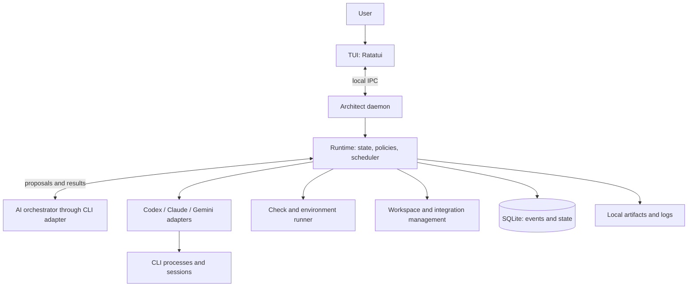

# Architect — AI agent orchestration tool design

Status: design for further iteration; user requirements are settled where marked **settled**. Technical details and defaults remain **proposals** until approved.

Date: 2026-10-13. Working name: Architect.

## 1. Product goal

Architect is a local TUI tool in which the user describes a task and an AI orchestrator selects a team, divides the work into small problems, defines roles and dependencies, coordinates communication, and enforces result verification. Tasks may include a small fix, extending an existing project, an entire new project, research, a document, or analysis.

The primary outcome is a solution suited to the user's context and needs: correct, understandable, maintainable, and supported by appropriate evidence. Agent counts, generated files, and passing tests alone do not measure success.

The system should reduce common agent failures: superficial planning, context loss, AI slop, excessive code, duplication, skipped or unnecessary refactoring, weak tests, security vulnerabilities, performance problems, and apparent verification. Eliminating every model defect cannot be guaranteed. The product should detect and contain these failures and clearly report remaining uncertainty.

## 2. Settled requirements

| Area | User decision |
| --- | --- |
| User | A developer working locally. |
| Platforms | macOS and Linux. |
| Technology | Rust and Ratatui. |
| AI integrations | Existing CLIs only; no custom integrations with model providers' APIs. |
| Providers | Codex, Claude Code, Gemini CLI; the architecture supports adding further CLIs. |
| Task scope | Software, research, documents, and analysis from the outset. |
| Team selection | Automatic; roles and relationships follow from the task and project context. |
| Quality | Takes priority over minimizing cost; independent verification of every activated executor role, including small tasks. |
| Result standard | Code must be an exemplary solution: idiomatic, readable, consistent, appropriately refactored, with no unnecessary additions or unresolved static-analysis findings. |
| Planning | Before implementation, create an abstract solution model and check its behavior through scenario simulation and an independent search for counterexamples. |
| Completeness | No gaps, hidden assumptions, or unexplained dependencies affecting the planned solution's correctness. |
| Boy Scout Rule | Every task assesses opportunities to leave the code it uses in better shape and performs justified structural improvements. |
| Verification checklists | Versioned, mandatory checklists with methods, evidence, and rejection conditions; full accounting for the risk catalog. |
| Full requirements | A persistent register of every requirement in the original request/plan; separate verification of completeness and actual satisfaction of each requirement. |
| Refactoring criteria | Language/project standards and the Refactoring.Guru catalog of problems and techniques, applied in context. |
| Architecture | Assess boundaries, contracts, patterns, and risks introduced by the code; apply patterns where they solve a recognized problem. |
| Inputs | A complete domain model for every parameter, invalid values, and significant combinations, with a justified verification method. |
| Libraries | Check available solutions before implementing custom code; assess dependency quality, security, licenses, and obligations. |
| Solution selection | Investigate realistic alternatives and choose the best against requirements, context, and documented criteria; independently verify the choice. |
| Independence | A separate verifier session and context; preferably another model or CLI, with the same one allowed in a separate session. |
| CLI routing | Profiles assigning effort and work kinds to CLIs; for example, Codex for heavy reasoning and Gemini for lighter tasks and code writing. |
| Autonomy | Two modes: approval of every stage and every revision round, or full automation. |
| Full automation | Local work, tests, and local commits; push, publication, external messages, and destructive operations require separate authorization. |
| MVP limits | No limits on agent count, concurrency, time, cost, delegation depth, or revision rounds. |
| Role pairs | A dedicated verifier agent for every activated executor role. |
| Orchestrator selection | Configurable CLI/model, with no default orchestrator provider. |
| Working directory | A separate worktree by default; direct work selected for a specific task. |
| MVP customization | Built-in roles and templates; editable CLI and effort assignments. Custom roles/templates later. |
| Configuration | TOML. |
| Computer restart | After restarting, Architect resumes interrupted sessions while checking their actual state. |
| Background operation | A local execution process continues after closing the TUI; supports reattachment and crash recovery. |
| Main interface | Two panels: orchestrator chat and a spatial agent graph. |
| Graph | A spatial node-and-edge graph resembling MindNode or Neo4j query visualization, rather than a file-browser tree; arrow navigation, work status, visible communication, and agent details. |
| Progress overlay | An overlay in the upper-right or lower-right corner of the agent panel shows the current step from persistent run/task state; parallel work shows the actual set of active steps. |
| Agent-panel comments | Every visible agent-panel element can be commented on like a diff change. Comments persist, link to an element and its version, survive reattachment, and require an orchestrator answer or proposed action with a visible response status. |
| Agent sessions | Session inspection and direct messages to a selected agent. |
| Agent communication | Every agent can send point-to-point messages to any teammate and broadcast to the others; the runtime persists sender, recipients, and delivery state. |
| Orchestrator context | Managed through task reports, artifacts, verifier decisions, and messages, without needing to read agent-session transcripts. |
| Language | TUI, code, identifiers, and product documentation in English; this document has also been translated into English. |
| Diff and review view | File diffs with change statistics, line/file comments observed by the orchestrator, and code review launched from the diff. |
| Current deliverable | The `design.md` design document; implementation is the next step. |

## 3. Core principles

1. **Every executor role has a verifier.** This includes planning, research, test preparation, and integration, not just coding.
2. **Verification refers to a specific artifact.** Approval reports identify its version/hash, requirements, performed checks, and limitations.
3. **The model proposes; the runtime controls.** AI reasons and proposes actions. Program code checks contracts, permissions, dependencies, and legal state transitions.
4. **Small work units, complete goal.** Dividing work into small tasks must not lose cross-cutting requirements, integration, or user experience.
5. **Context is versioned.** Decisions, requirements, and sources have ownership, provenance, and freshness information.
6. **Actions and communication are observable.** The graph and chat project actual events. Users also see errors, queues, and integration limitations.
7. **Autonomy stays within policy.** Full automation automates stage approvals but cannot grant itself new permissions.
8. **Quality requires measurement.** Compare swarm effectiveness with simpler execution on real tasks. The first version imposes no resource limits; it measures actual overhead.
9. **The plan includes a model and correctness checks.** An activity list is insufficient. Show how the solution meets requirements, preserves invariants, and handles errors.
10. **Every code element needs justification.** It follows from a requirement, a necessary implementation mechanism, or a documented Boy Scout Rule improvement; speculative future features are excluded.
11. **Refactoring is part of completion.** Before delivery, address structural problems in the solution and its significant dependencies rather than leaving cleanup for later.
12. **Quality gates are cumulative.** Tests, static analysis, the correctness model, scope, and review must each pass; success in one check cannot compensate for failure in another.

## 4. Research: conclusions and evidence limits

Research was conducted on 2026-10-13. References `S01`–`S28` point to sources in section 21. User-specified quality requirements are normative; mechanism details describe their proposed implementation. Sources do not prove that Architect already implements these mechanisms effectively.

| Conclusion | Basis and limitation | Design consequence |
| --- | --- | --- |
| Swarms introduce their own failure classes. | MAST identifies 14 failure modes involving system design, collaboration, and verification; the study covers specific frameworks and models. [MAST](https://arxiv.org/abs/2503.13657) | Task contracts, explicit dependencies, completion controls, and incident analysis. |
| More agents do not guarantee a better result. | Anthropic describes research benefits, high token cost, and coding parallelism limits. Its numerical results are not transferred to our product. [Multi-agent research](https://www.anthropic.com/engineering/multi-agent-research-system) | Match teams to risks, constrain concurrent writes, and measure overhead. |
| Long tasks need persistent handoffs. | Anthropic describes premature completion claims, unfinished features, and difficulties between sessions. [Long-running agents](https://www.anthropic.com/engineering/effective-harnesses-for-long-running-agents) | Versioned plans, checkpoints, artifacts, and state checks after resumption. |
| Available context may not be used correctly. | Lost in the Middle shows performance dependence on information placement; it covers the tested models/tasks, not every current CLI. [Lost in the Middle](https://arxiv.org/abs/2307.03172) | Short context packages linking to sources and repeated checks of key constraints. |
| Self-critique without external information can be ineffective. | The study covers reasoning and models from a particular period; it does not prove that all modern self-correction fails. [Self-correction](https://arxiv.org/abs/2310.01798) | Separate verifiers plus tests, tools, and sources as feedback. |
| Hallucinations include repository context and dependencies. | Studies of practical generation and packages document false references and invented dependencies. [Repository hallucinations](https://arxiv.org/abs/2409.20550), [Package hallucinations](https://www.usenix.org/conference/usenixsecurity25/presentation/spracklen) | Check APIs, symbols, versions, and new dependency provenance. Package existence does not prove security. |
| Code repetition is a distinct quality issue. | Code Copycat Conundrum studies generated-code repetition; it does not measure all architectural debt in production repositories. [Code repetition](https://arxiv.org/abs/2504.12608) | Analyze duplication and consistency with existing modules. |
| Quality assessment requires several kinds of checks. | Anthropic discusses deterministic tests, model assessments, and human evaluation, including each method's limits. [Agent evals](https://www.anthropic.com/engineering/demystifying-evals-for-ai-agents) | Hard correctness gates, quality rubrics, and calibration against human assessment. |
| Tool content can redirect the work. | AgentDojo studies prompt injection; OWASP describes agent risks. These inform the threat model rather than certify our design. [AgentDojo](https://arxiv.org/abs/2406.13352), [OWASP](https://genai.owasp.org/resource/owasp-top-10-for-agentic-applications-for-2026/) | Separate data from permissions; enforce restrictions outside the model. |
| Perceived acceleration can differ from measurements. | METR's 2025 study measured slowdown in a specific group; its 2026 update identifies reliability problems in a later measurement. We draw no general conclusion about current models. [METR 2025](https://metr.org/Early_2025_AI_Experienced_OS_Devs_Study-paper.pdf), [METR 2026](https://metr.org/blog/2026-02-24-uplift-update/) | Measure time to an accepted result and user effort, not subjective agent activity. |
| Design and verification need requirement traceability. | NASA describes design analysis, modeling, and requirements tracing. We use engineering principles without claiming compliance with NASA certification processes. [System design — S19](https://www.nasa.gov/reference/4-0-system-design-processes/) | A requirement → model element → code → evidence map checked in both directions. |
| Planning must account for change propagation. | CodePlan combines planning with dependency/change-impact analysis in repositories; its results do not prove our simulation correct. [CodePlan — S20](https://www.microsoft.com/en-us/research/publication/codeplan-repository-level-coding-using-llms-and-planning/) | Analyze impact before implementation and update plans after contract changes. |
| Refactoring includes behavior preservation checks. | Fowler describes small structural transformations preserving observable behavior. [Refactoring — S21](https://refactoring.com/) | Distinguish functional changes from structural transformations and provide contract-preservation evidence. |

## 5. Product model and terminology

| Term | Meaning |
| --- | --- |
| Workspace | A project or working directory and its assigned configuration. |
| Run | One user request with its decision history and results. |
| Stage | A stage with specified inputs, outputs, and an acceptance gate. |
| Task | A small work unit with an owner, criteria, and dependencies. |
| Role | A versioned contract of competencies, permissions, and expected outcomes. |
| Agent | A logical teammate assigned to a role. |
| Session | A conversation in a specific CLI; an agent may have subsequent sessions after recovery or a provider change. |
| Attempt | One attempt at a task; retries do not overwrite earlier attempts. |
| Artifact | A versioned result: plan, patch, tests, report, analysis, or document. |
| Finding | Verifier feedback with evidence, severity, and a repair criterion. |
| Evidence | A tool/experiment/source-reading result linked to an artifact. |
| Gate | A rule allowing stage completion or integration. |
| Approval | User authorization or a decision derived from established policy. |
| Template | A template creating roles, relationships, stages, and gates. |

Roles are either `executor` or `verifier`. Orchestration is a management function; substantive orchestrator decisions about plans, work allocation, and readiness also require checks. There is no infinite reviewer chain: the runtime checks verifier-report format and evidence, while disputes go to an additional independent assessment or the user.

## 6. Task execution lifecycle

### 6.1. Stages

1. **Intake** — read the task, boundaries, input files, project instructions, and permissions. Ask about information without which the task's meaning would change.
2. **Discovery** — build a documented context model: domain, existing flows, contracts, dependencies, standards, environment, and baseline. The Context verifier checks coverage and sources, not merely a list of read files.
3. **Planning** — investigate alternatives and choose the best against requirements; build the chosen solution's abstract model, simulate scenarios, analyze counterexamples, resolve unknowns, assess architecture, libraries, licenses, and risk, plan refactoring and verification, then derive the work DAG and team. The Options verifier checks the choice; the Plan verifier checks model correctness/completeness. Candidate models may be created earlier as comparative evidence.
4. **Execution** — perform small tasks, required refactoring, static analysis, and artifact review. Independent branches may run in parallel. Implementation does not begin with unresolved modeling of significant dependencies.
5. **Validation** — appropriate tests and checks of requirements, security, performance, sources, or calculations. Verify the quality of the checks themselves.
6. **Integration** — combine approved results and revalidate the whole. For documents: unified editing, contradiction checks, and reference checks.
7. **Delivery** — final report: result, satisfied criteria, evidence, limitations, usage instructions, and open risks.

Stages describe a logical cycle; a small task may have short stages and few agents. It still requires independent verification of activated roles. Long projects consist of milestones with the same cycle; the entire project need not wait for one large integration.

Tests can be created before or alongside implementation. The later Validation stage checks the result and evidence completeness. Stage separation does not impose waterfall development.

### 6.2. Two autonomy modes

**Settled semantics:**

| Mode | Behavior |
| --- | --- |
| `supervised` | The user approves starting each stage, every revision round, and each stage's final result. A result-approval card may also present and approve the next stage's scope. Verifier rejection does not automatically open another revision round. |
| `autonomous` | The runtime opens subsequent stages and revision rounds once gates pass. Local work, tests, and local commits are allowed. Push, publication, external messages, and destructive operations require separate authorization. A missing necessary product decision may require the user. |

Mode changes are explicit, recorded, and apply to subsequent actions. They do not retroactively approve changes or remove verifier findings. Changing accepted scope invalidates relevant approvals and requires reassessment.

Separate approval of a **stage** from approval of an **action**. Permission for local implementation does not authorize push, publication, an external message, or a destructive operation. Local commits include only specified task changes, not unrelated user edits.

### 6.3. User changes to a task

Every message has a run, recipient, and identifier. The orchestrator classifies it as a question, additional context, correction, scope change, or control command. The runtime validates the effects of that proposal. Requirement changes increment `spec_revision`; dependent tasks and reports become `stale`. Independent running tasks may continue if still compatible with the new scope.

Sending an agent a message must not silently change the entire project's contract. The agent and orchestrator receive an event; scope changes follow the same plan-update process.

### 6.4. Building context as a verifiable task

Discovery produces a `ContextModel`, not a repository summary. For the change area it must explain what the system currently does, what it depends on, and which constraints must be preserved. Context must establish correctness across the entire changed path, including beyond edited files.

| Component | Required content |
| --- | --- |
| Intent and scope | Expected behavior, audience, acceptance criteria, explicitly excluded features. |
| Domain | Concepts, rules, units, legal states, and sources of truth. |
| Current behavior | Entry points, callers, consumers, data flow, and side effects. |
| Dependencies | Direct and transitive dependencies relevant to the change, including dynamic/configuration dependencies. |
| Contracts | APIs, schemas, serialization, errors, compatibility, permissions, and resource ownership. |
| Standards | Language/framework rules, project standards, formatting, linters, prohibited patterns. |
| Environment | Actual versions, feature flags, build/test variants, platforms, and external services. |
| Baseline | Tests, static diagnostics, known defects, and measurements needed for comparison. |
| Reuse opportunities | Existing functions, modules, and dependencies meeting part of the need; constraints on their use. |
| Knowledge state | Every important claim has a source, revision, confirmation status, and impact on the solution. |

Facts about code are sourced to a specific code/configuration/use version or execution result; a function name alone does not prove its behavior. Compare documentation with implementation. Intermediate summaries do not become a new source of truth.

The unknowns register includes the question, impact, verification method, and owner. Anything affecting correctness must be resolved by inspection, experiment, contract documentation, or user decision. Relabeling it as an assumption to unblock implementation is prohibited. Explicit contract conditions, such as permitted inputs, need a basis and enforcement or boundary checks.

The Context verifier independently traces requirements through inputs, processing, outputs, and consumers, seeking missing dependencies, contradictory sources, and misinterpretation. `context_ready` means coverage of relevant paths, resolution of blocking unknowns, and no unresolved contradictions. Neither files-read counts nor report length open this gate.

### 6.5. Abstract solution model and simulation

Planning produces `SolutionModel`, `SimulationReport`, `TraceabilityMap`, `RefactorPlan`, and `VerificationPlan`. The task DAG derives from these artifacts; it does not replace solution design.

**The abstract model must define:**

- Solution boundaries, actors, inputs/outputs, observable behavior, and associated requirements.
- Entities, types, legal states, owners, and sources of truth.
- Operations, preconditions, postconditions, and state-transition rules.
- Domain, security, data-consistency, and resource-ownership invariants.
- Data/control flows, module responsibilities, and contracts between modules.
- Errors, partial execution, side effects, cancellation, retries, and recovery where applicable.
- Operation ordering, transactions, concurrency, and significant event interleavings where applicable.
- Termination conditions, cost characteristics, and compliance with performance requirements.
- Refactoring scope, preserved versus intentionally changed behavior, and how to distinguish them.
- A link from every element to a requirement, a necessary technical prerequisite, or a documented Boy Scout Rule improvement.

A simple algorithm needs its contract, pseudocode, invariants, and input cases. A stateful process needs a state/transition table; integration needs contracts and sequences; concurrency needs data ownership and interleaving analysis. Form should fit the problem; completeness is mandatory. A box diagram without semantics is insufficient.

**Mental simulation** means walking through the model before coding: selecting an initial state/input, applying defined operations, checking every significant invariant, and comparing the final state with the requirement. The Planner records concise audit outcomes as scenarios and state tables; disclosure of private model reasoning is not required.

| Scenario type | Required checks |
| --- | --- |
| Normal execution | Results and side effects meet the requirement. |
| Empty, minimum, and maximum input | Legal states, units, domain constraints, and costs. |
| Invalid or contradictory input | Validation, error contract, and absence of unauthorized effects. |
| Failure at an operation boundary | Partial-execution state, transaction/compensation, and recovery. |
| Repeated or delayed event | Idempotency, deduplication, ordering, and no use of stale versions. |
| Cancellation and restart | Resource ownership, preserved permissions, and correct resumption. |
| Significant concurrent-operation interleaving | Consistency, absence of races, and ability to progress. |
| Integration and migration | Producer/consumer compatibility, old/new data, and rollout order. |

Every scenario has a `scenario_id`, requirement criterion, model version, input state, event sequence, expected result, checked invariants, and assessment result. `not_applicable` requires justification; “should work” is not a simulation result.

The Plan verifier creates independent scenarios and searches for counterexamples. Gaps return to the model and context before implementation. Unclear module responsibilities, underspecified transitions, and unconfirmed dependency properties cannot be deferred to developer decisions during implementation.

AI model simulation is a design check, not formal proof of every possible execution. Where a significant property cannot be assessed reliably this way, the plan must specify an executable model, property checking, model checking, an experiment, or another suitable method. Each method needs a justified connection to risk. Model results are subsequently checked against actual code.

`plan_ready` requires all of: approved context, verified option selection (`solution_selected`, section 6.7), a complete model of significant behavior, resolved correctness-affecting unknowns, a successful independent simulation, bidirectional requirements mapping, a refactoring plan, and an evidence plan. A generic positive review without these artifacts does not start executors.

### 6.6. Preserving every requirement from a long plan

The original request, attached plan, and corrections are persistent, versioned sources. Summaries help work but never replace originals or `RequirementLedger`. The system does not rely on one orchestrator session's memory.

The Requirements analyst extracts atomic requirements while preserving hierarchy and all qualifiers: conditions, exceptions, constraints, quality expectations, negative requirements, and acceptance details. For example, “CSV export, correct UTF-8 handling, and no export without permission” retains all three obligations; an export command's mere existence does not meet the complete requirement.

Each record contains `requirement_id`, source and text range, original text, precise interpretation, parent, mandatory criteria, implementation/verification owners, dependencies, version, and evidence. Splitting a requirement does not remove the original; satisfying a parent requires every mandatory child and the integration condition.

Every mandatory user-prescribed step or implementation method is a source-backed requirement with acceptance criteria. Suggestions and examples are not automatic obligations. Agent-selected technical steps remain tasks linked to existing active requirements; they do not create artificial requirements to justify themselves.

The Requirements verifier independently reads the full source and compares it with the register, checking coverage of every obligation-bearing passage and interpretation accuracy. It does not merely approve the executor's extraction. Ambiguity requires resolution; a requirement cannot silently become optional.

Every task references the `requirement_id` values it implements. Every handoff/checkpoint preserves the register, statuses, and missing evidence. Requirement states include `identified`, `clarification_needed`, `planned`, `in_progress`, `implemented`, `verified`, `blocked`, `stale`, and `superseded_by_user`. `implemented` is a claim of execution; `verified` requires independent assessment of all criteria against the current result.

There is no automatic “partly satisfied → done” transition. A quality requirement is met only through evidence of quality, not merely a file/test/API's presence. Cross-cutting requirements such as no data loss cover the entire relevant flow, beyond one agent's module.

The final `ComplianceAudit` compares the integrated result with the **full source and register**. The auditor also searches for requirements omitted during extraction; its dedicated verifier checks audit coverage and evidence. Every mandatory requirement must meet every criterion. Missing or superficial implementation, stale evidence, contradictory results, or unapproved simplification block `requirements_complete`.

Removing, weakening, deferring, or changing a requirement's meaning needs an explicit user decision and new revision. Full automation cannot authorize this. The TUI requirements list is accessible from chat/palette and task details, showing coverage, evidence, omissions, and revision differences. Completion percentages indicate progress; they do not replace satisfaction of each mandatory criterion.

### 6.7. Choosing the best of the investigated options

The first correct idea does not end planning. Before plan approval, produce `OptionsAnalysis` and `SolutionDecision`: investigated approaches, comparison against shared criteria, selection, and reasons for rejecting alternatives. This applies to code, research methods, documents, and analyses. Investigation depth matches decision risk; a small fix may have a short comparison but must still consider alternatives.

Required process:

1. Define the decision, complete requirements, project constraints, and criteria before evaluating candidates. Mandatory requirements are eligibility filters, not points offset by performance or price.
2. Investigate realistic, distinct approaches: reuse, a library, a simpler variant, or another architectural/methodological solution. Use the current state as baseline where relevant. Do not invent weaker options to make the first idea win. If only one realistic option exists, justify this with search results and constraints.
3. Record search scope, sources, dates, significant solution classes, and exclusion reasons. Do not claim to have examined every imaginable idea; the Options verifier checks for significant available classes that were missed.
4. Assess candidates on the same basis: correctness/completeness, security, project fit, simplicity, maintenance, testability, refactorability, performance, risk, licenses, and lifetime cost. Weights or preference ordering follow user needs; quality is the default priority. Cost/time are comparative information, not MVP limits.
5. Base assessments on sources, models, measurements, or experiments. Mark uncertainty and evidence scope. If an important unknown could change the choice, perform a spike, benchmark, or integration experiment. Experiments are separate artifacts; their temporary code does not automatically enter the product.
6. Reject options failing mandatory conditions. Among eligible options, choose the one best meeting agreed preferences. An option dominated on every significant criterion cannot win without identifying a missing criterion or data error. Arbitrary point totals do not replace justification.
7. Check decision sensitivity: could a reasonable change in weights, data, or conditions reverse the result? Ask the user for a preference when an unresolved trade-off matters to the goal; silence does not authorize weaker requirements. Autonomy cannot invent user goals.
8. The Options verifier independently seeks better alternatives and checks criteria, evidence, and rejected options. `solution_selected` follows only after this assessment. In supervised mode the choice is part of the approved plan; in autonomous mode policy approves it after successful verification.

A minimal option record includes `option_id`, mechanism description, sources, requirements coverage, criterion results with evidence, dependencies, risks, unknowns, and maintenance cost. The decision identifies the chosen option, criterion version, justification, rejection reasons for each competitor, sensitivity-check result, and reopening conditions. New requirements, experimental results, or discovered libraries may invalidate the choice; sunk implementation work is not a reason to retain it.

In the lean runtime, the global pre-plan comparison (`ensure_options`) is distinct
from task-level `WorkKind::Options`. Plan finalization adds a read-only options
prerequisite to each `writes=true` task lacking a direct one, after optional quality
gates and independently of `policy.required_gates`. Existing shared options are
reused and must cover every dependent writer. Startup validation always requires
`routing.options` with valid executor and verifier profiles. Task options compare
2–4 realistic alternatives under common criteria and end their report with
`Selected: <id>`; this textual selection is an agent/verifier contract, not a
structured decision parsed by the runtime. Approved dependency reports go to the
writer and its independent verifier. The writer implements the selected variant
or explicitly reports a departure with evidence and justification, including any
requirement violation or uncovered task. A better variant or broken premise is
reported with evidence rather than silently reopening the choice. Reporting it
does not automatically stop the plan; the verifier checks the actual implementation
and departure evidence independently. See [the session model](docs/session-model.md#options-before-each-writing-task).

“Best” means the best-supported choice in the investigated space for current requirements and evidence. The system does not claim proof of a global optimum without grounds. The process follows criteria definition, alternative comparison, and uncertainty-control principles in [NASA Decision Analysis — S28](https://www.nasa.gov/reference/6-8-decision-analysis/); the contract and gate above are Architect's design.

## 7. Automatic swarm construction

### 7.1. Team selection

The orchestrator proposes a `TeamPlan` based on result type, complexity, risk, dependencies, context size, project modules, available CLIs, needed tools, and quality profile. The runtime validates it before launch. Every added agent needs a justified responsibility; no limits does not mean agents without tasks.

Bootstrap uses built-in roles and an explicitly chosen orchestrator profile. Discovery and requirements analysis may run before a complete implementation plan; supervised mode requires approval for that stage. The orchestrator expands the team after gathering context and RiskCoverage. Implementation gates apply to solution work; analyses needed to create a plan have their own criteria and do not require a finished implementation plan.

Mandatory conditions:

- Every task has an owner, result, and verifiable completion criteria.
- Implementation tasks have current `context_ready` and `plan_ready` and a linked model fragment; small changes do not bypass the gate.
- Option selection has `solution_selected`; architecture, inputs, and dependencies are assessed before implementation to the extent checkable from the plan. Code/final-integration evidence closes the same gates before delivery.
- Every activated executor role has an independent verifier.
- Neither the task dependency graph nor management delegation has cycles.
- Every active write has a defined scope and integration method.
- Escalation, stop, and completion conditions are defined.
- Each new round identifies an unresolved problem and action plan. The MVP imposes no numerical round or agent limit.

Communication graphs may contain cycles. Conversation cycles must not create infinite execution loops. Conversations concern a specific task and end in an artifact, decision, or escalation.

### 7.2. Example role-pair catalog

| Executor | Verifier | Verification scope | Typical artifact |
| --- | --- | --- | --- |
| Orchestrator | Orchestration verifier | Substantive team, scope, and strategy changes; alignment with the goal. | TeamPlan change proposal or management decision. |
| Context analyst | Context verifier | Actual behavior, sources, dependency coverage, standards, and resolved unknowns. | ContextModel and verified-knowledge register. |
| Requirements analyst | Requirements verifier | Intent alignment, contradictions, and criterion completeness. | Specification and criterion map. |
| Planner | Plan verifier | Abstract model, invariants, independent simulation, counterexamples, scope, and evidence completeness. | SolutionModel, SimulationReport, and task DAG. |
| Options analyst | Options verifier | Available-option coverage, fair comparison, evidence, uncertainty, and justified best-solution selection. | OptionsAnalysis and SolutionDecision. |
| Architect | Architecture verifier | Project fit, simplicity, and reuse of existing solutions. | ADR/module contracts. |
| Dependency analyst | Dependency verifier | Alternatives to custom code, provenance, licenses, security, and dependency maintenance cost. | DependencyDecision and LicenseReport. |
| Implementer | Code verifier | Model/standard/requirement compliance, simplicity, responsibilities, and no extras. | Patch, TraceabilityMap, and standards report. |
| Refactorer | Refactor verifier | Addressed solution debt, preserved contracts, improved structure, and no speculative abstractions. | RefactorReport, patch, and preservation evidence. |
| Static analysis operator | Static analysis verifier | Analyzer coverage, configurations, no unresolved findings or weakened rules. | StaticAnalysisReport with raw results. |
| Compliance auditor | Compliance verifier | Every requirement and full-plan step, implementation quality, extraction gaps, and evidence freshness. | ComplianceAudit and RequirementLedger accounting. |
| Test designer | Test design verifier | Scenarios derived from requirements and able to detect likely errors. | Test plan and requirements map. |
| Test implementer | Test verifier | Assertions, real execution paths, isolation, mocks, and test robustness. | Tests and execution results. |
| Security analyst | Security verifier | Threat model, coverage, reproductions, false positives, and fixes. | Threat model and findings. |
| Performance engineer | Performance verifier | Representative benchmarks, baseline, and no semantic regressions. | Measurements and recommendations/patch. |
| Integrator | Integration verifier | Complete changes, intermodule contracts, and regressions. | Delivery candidate. |
| Researcher | Research verifier | Source reliability, freshness, coverage, and facts versus inferences. | Referenced report. |
| Data analyst | Analysis verifier | Data, assumptions, calculations, units, and reproducibility. | Analysis and script/notebook. |
| Writer | Editorial/factual verifier | Factual accuracy, citations, consistency, and brief compliance. | Document. |
| Delivery author | Delivery verifier | Report/instruction alignment with actual results. | Final report. |

This is a competency catalog. Every run includes context, requirements, options, planning, compliance, and delivery pairs, plus checks of substantive orchestrator decisions. Software tasks additionally include architecture, dependency, implementation, refactor, static analysis, test design, test implementation, and integration; assessments may be brief but remain mandatory. Other pairs match actual threats; RiskCoverage may require a separate security or performance pair. Research without code does not need fictional compilation tests.

Every activated role has its own executor and dedicated verifier. Small tasks have shorter artifacts and may need fewer specialist roles, but cannot share one verifier agent between multiple executor roles. Agents may run sequentially; team membership does not require a continuously running CLI process. Refactoring is not performed when no file changes are needed; the mandatory assessment may establish that no transformations are necessary.

### 7.3. Team templates

| Template | When | Core composition |
| --- | --- | --- |
| `small-change` | A local fix. | Shared foundation and required software pairs from section 7.2; brief but complete artifacts. |
| `feature` | A feature in an existing project. | Context, planning, implementation per module, tests, integration; all with verifiers. |
| `refactoring` | Structural change. | Context/architecture, characterization tests, refactoring, integration; verifier pairs. |
| `security-fix` | Security fix. | Threat/reproduction, plan, fix, adversarial tests, integration; independent checks. |
| `greenfield` | New project. | Requirements, architecture, vertical slice, incremental implementation, validation, and milestones. |
| `research` | Research question. | Research plan, researchers for independent areas, synthesis; source and synthesis verification. |
| `document` | Specification, instructions, report. | Brief/outline, research as needed, writer, factual/editorial review. |
| `analysis` | Data or option analysis. | Plan/method, analyst, independent recalculation, synthesis review. |

All templates inherit the shared foundation and appropriate pairs from section 7.2; this table describes specialization. Templates define required competencies and gates. The orchestrator may extend them, shorten queues, or reallocate work, but cannot remove required verification. Every team change has a justification and history event.

### 7.4. Routing through effort profiles

Product effort levels (`light`, `standard`, `deep`) are independent of model parameter names. Profiles include a CLI, model where available, native reasoning parameter where supported, and permitted work types. The MVP adds no resource limits.

Proposed initial configuration reflecting user preferences:

| Profile | Preference | Uses |
| --- | --- | --- |
| `deep-reasoning` | Configurable; e.g. Codex | Difficult planning, ambiguity resolution, architecture analysis, and complex review. |
| `light-execution` | Configurable; e.g. Gemini CLI | Scoped tasks, material preparation, and simpler transformations. |
| `coding` | Configurable; e.g. Gemini CLI | Implementing well-defined tasks. |
| `independent-review` | Another available CLI/model than the executor's | Artifact verification in a fresh session. |
| `orchestrator` | Explicit user choice required | Run management. |
| `claude-profile` | Configurable | Claude Code configuration without an invented capability ranking. |

This is user policy, not a verified provider ranking. Measure profiles on your own task set. Do not hardcode “latest” model names. An unavailable CLI triggers an explicit replacement proposal or blockage, never a hidden model change. First launch requires orchestrator-profile assignment. Validate all necessary profiles before starting the team; unsupported native effort must not be silently ignored.

### 7.5. Verification protocol

1. Freeze artifact and requirement versions.
2. Give the verifier criteria, sources, and artifact; executor justification is supporting material, not a verdict.
3. The verifier independently checks key claims and identifies evidence. Code tests may run in an isolated environment.
4. Return `pass`, `changes_requested`, `blocked`, or `inconclusive`, plus findings.
5. The executor fixes or answers specific findings. Rejecting a finding requires evidence and reassessment.
6. Repeat relevant checks on the revised version. An old `pass` does not approve a new artifact.
7. Disputes, no possible next step, or repeated identical failures trigger a proposal for arbitration or a different approach. The MVP does not stop after a fixed round count. Blocking reflects a specific unmet dependency, not a counter.

Verifiers must not fix artifacts they subsequently approve. If a verifier prepares a patch, it becomes that patch's executor and needs another verifier. Resolve significant disputes through criteria and evidence, not majority voting.

### 7.6. Mandatory checklists and risk accounting

Every verifier receives a pinned checklist version: shared items, role-specific items, and task-domain/risk items. This is a work contract, not a prompt suggestion. Built-in definitions are versioned with the product; the MVP offers no editor that can remove inconvenient checks.

Each item defines `check_id`, `checklist_version`, related `risk_ids`, a control question, method, required evidence type, rejection condition, and valid `not_applicable` condition. Results add requirement/artifact revisions, `requirement_ids`, the method actually performed, evidence links, findings, and one status: `pass`, `fail`, `blocked`, or `not_applicable`. Missing data is not `pass`; unresolved issues are `blocked`. `not_applicable` needs scope-specific justification and confirmation by the appropriate verifier.

Every section-19 risk creates a mandatory `RISK-Rxxx` item: a question about the described failure, the detection-column method, and a check of the mitigation's effectiveness. Evidence must identify a real model/code fragment, tool result, source, or scenario. Copying the catalog recommendation does not satisfy the item. Reject results when the problem exists, mitigation is ineffective, or the report does not justify its conclusion.

`RiskCoverage` includes **every** ID in the current catalog version. The Context analyst proposes applicability and ownership; the Context verifier checks exclusions. Applicable risks receive an executor role and its dedicated verifier. If competencies are missing, the orchestrator adds a role pair. No item disappears between planning and completion. The full list is divided among responsible reviewers; each also receives the complete map to spot incorrect assignments.

Shared checklist for every role:

| ID | Check and method | Required evidence / rejection reason |
| --- | --- | --- |
| V01 | Compare the task source, requirement revision, and input snapshot with the assessed artifact. | Hashes/revisions; an outdated basis blocks assessment. |
| V02 | Account for every assigned requirement, qualifier, exception, and prohibition. | Criteria-to-evidence map; omitted or partial criteria prevent approval. |
| V03 | Check every assigned risk and mandatory role item. | Complete results; missing items or generic non-applicability block the report. |
| V04 | Reproduce key claims independently of the executor's account. | Own source reading, simulation, execution, or calculation; executor claims are insufficient. |
| V05 | Seek counterexamples, contradictory data, and unmet premises. | Falsification attempt and result; happy paths alone are insufficient. |
| V06 | Compare results with approved scope and negative requirements. | Justified solution elements; extra features or hidden scope changes need correction. |
| V07 | Check resolution of every finding and the impact of fixes. | Current-version evidence; closing a ticket without checking does not close the problem. |
| V08 | Confirm assessment independence and evidence provenance. | Authors, sessions, commands, and outputs; an author's patch needs another verifier. |

Mandatory role extensions: each component in a cell is a separate checklist item, not one aggregate checkbox. Built-in definitions assign persistent role-namespaced `check_id` values; renaming or display reordering does not change IDs. The table's method/rejection condition is specialized per item and linked to appropriate risk-catalog IDs:

| Verifier role | Required checks | Method and evidence; rejection condition |
| --- | --- | --- |
| Orchestration verifier | Competency coverage; dedicated pairs; dependencies; permissions; round approval. | Validate TeamPlan/history; missing owners or approval block changes. |
| Context verifier | Fact sources; consumers; contracts; configurations; baseline; standards; unknowns. | Independently review ContextModel paths/sources; an unverified significant premise blocks. |
| Requirements verifier | Complete original source; atomicity; conditions; prohibitions; conflicts; measurable criteria. | Independent extraction and ledger comparison; even one missing obligation blocks. |
| Plan verifier | Complete model; inputs; invariants; states; failures; dependencies; simulations; evidence. | Own model scenarios/counterexamples; a correctness gap blocks the plan. |
| Options verifier | Real alternatives; criteria before ranking; common conditions; mandatory filters; evidence; sensitivity; no better omitted option. | Independent search and comparison reproduction; superficial alternatives or an unjustified winner block selection. |
| Architecture verifier | Boundaries; responsibilities; dependency directions; patterns; data consistency; change risk; alternatives. | ArchitectureReview and specific section-12.2.9 flows; unresolved significant trade-offs block. |
| Dependency verifier | Existing-solution search; comparison; provenance; direct/transitive licenses; distribution obligations. | Section-12.2.11 DependencyDecision/LicenseReport; missing data or infeasible obligations block. |
| Code verifier | Model compliance; standards; code necessity; input contracts; error handling; ownership; no duplication. | Patch/use review and InputDomainMatrix; unjustified paths or unmet contracts block. |
| Refactor verifier | All SM01–SM23; necessary transformations; Boy Scout Rule; behavior; scope. | Before/after and behavior tests; deferred necessary refactoring or regressions block. |
| Static analysis verifier | Rules; versions; target scope; feature matrix; raw results; suppressions; old findings. | Repeat needed analyses and diff configuration; unresolved findings block. |
| Test design verifier | Every criterion; input classes; boundaries; errors; invariants; integration; oracle. | Requirements/scenario matrix; inability to detect violations blocks. |
| Test verifier | Real paths; assertion quality; mocks; isolation; determinism; resistance to faulty implementation. | Executions and controlled behavior violations; vacuous green tests block. |
| Security verifier | Trust boundaries; authn/authz; data; dependencies; injection; secrets; abuse. | Threat model and attack checks; unresolved required protection blocks. |
| Performance verifier | Representativeness; time/memory cost; baseline; distribution tails; semantics. | Repeatable measurement in a specified environment; unsupported conclusions or regressions need correction. |
| Integration verifier | Contract composition; migrations; configurations; concurrency; whole-result regressions. | Post-integration checks on the final hash; pre-merge results are insufficient. |
| Compliance verifier | Full source versus ledger; all requirement children; every plan step; evidence quality; freshness. | Independent ComplianceAudit; any partial, omitted, or stale requirement blocks. |
| Research verifier | Existence; primary sources; freshness; claim support; contradictory sources. | Opened materials and claim-to-source map; apparent citations block. |
| Analysis verifier | Provenance; data completeness; units; method; uncertainty; reproduction. | Independent recalculation and sensitivity analysis; unsupported conclusions block. |
| Editorial/factual verifier | Brief; audience; every claim; structure; repetition; citations. | Check text against brief/sources; unmet goals or AI slop need correction. |
| Delivery verifier | Report/result alignment; instructions; results; limitations; requirements. | Reproduce instructions and compare artifacts; claims of unperformed work block delivery. |

The runtime rejects reports with empty items, missing risks, stale evidence, or unauthorized authors. It cannot itself prove rigorous agent reasoning; evidence and assessment quality therefore receive independent checks and evaluations on tasks with seeded defects. Verifiers may report uncataloged risks: these enter the run register with an owner/check and later a new catalog version.

Comparability comes from shared definitions, methods, and snapshots. Reports retain per-item results rather than just overall ratings. Severity describes impact on a specific requirement, security, or operations; it does not weaken mandatory criteria. Average ratings or coverage percentages cannot excuse omitted requirements. Checklist, requirement, or significant-input revisions invalidate dependent results until rechecked.

## 8. TUI: two panels and navigation

### 8.1. Main screen

```text
 Architect  project: example  run: R-42  mode: supervised  stage: Execution
┌─ Orchestrator ───────────────────────┬─ Team: graph ──────────────────────┐
│ Plan approved.                      │             [Orchestrator]         │
│ Implementing import validation.     │               /        \           │
│                                     │     [Planner] ───── [Implementer]  │
│ Test verifier requested a case      │         │               │          │
│ for duplicate records.              │  [Plan verifier]   [Code verifier] │
│                                     │                \      /           │
│ > Add a malformed UTF-8 case         │               [Integrator]         │
├─────────────────────────────────────┤                  ┌─ Current step ┐ │
│ [Send]                              │                  │ Execution     │ │
└─────────────────────────────────────┴──────────────────┴───────────────┴─┘
 Tab: focus  Arrows: select  Enter: inspect  c: comment  Ctrl+P: commands
```

The mockup shows the information structure and a spatial graph with nodes/edges that remain readable while scrolling. Every activated role and verifier exists in the graph model and is accessible through navigation/search. Agent details open in the right panel or a full-screen view with a return to the graph; the main screen keeps two panels.

### 8.2. Chat panel

**Settled:** `antislop ui` starts a new task from a typed request and `Ctrl+S`. The orchestrator interviews the user and selects agents/configurations from that conversation. Roles and system prompts are predefined. Preparing `SPEC.json` or manually configuring every agent is not required to start a conversation. Discussion, requirements clarification, and execution approval appear in the same chat panel.

- Requests, context, questions, stage reports, and orchestrator commands.
- Multiline user messages; scrollable/searchable history.
- Concise progress linking to agents, artifacts, and evidence.
- Approval cards show scope, verification results, remaining risks, and the next stage.
- Clearly distinguish sent, runtime-accepted, session-delivered, and agent-answered messages.
- Control events have forms/commands; natural language can propose the same action but must become a validated intent.

### 8.3. Agent graph and progress overlay

Store distinct relationships: `supervises`, `depends_on`, `verifies`, `communicates_with`. The panel shows a MindNode/Neo4j-style spatial graph: nodes occupy two dimensions and edges connect actual relationship participants. An indented file-browser list does not meet the requirement. Relationship filters show delegation, verification, dependencies, or communication. Large swarms need not display every edge at once.

Nodes show role, CLI/model, status, and current task. Status has text/symbols and optional color: `queued`, `starting`, `running`, `waiting_agent`, `waiting_user`, `verifying`, `changes_requested`, `paused`, `blocked`, `failed`, `completed`, `cancelled`.

An active edge represents an actual message delivery/receipt event, briefly highlighted with time and count. It does not imply access to hidden model reasoning. “Working” means observed session activity or a running turn; no events alone do not prove a hang.

Proposed keys:

| Key | Behavior |
| --- | --- |
| `Tab` / `Shift+Tab` | Change focused panel. |
| `↑` / `↓` | Select a visible node vertically in the graph. |
| `←` / `→` | Select a visible node horizontally in the graph. |
| `Enter` | Details of the selected agent or graph element. |
| `c` outside an editor | Comment on the selected agent-panel element; same add/delete/resolve lifecycle as diff comments. |
| `Esc` | Return, close a view, or cancel editing; does not stop the run. |
| `/` | Search/filter agents in the team panel. |
| `Ctrl+P` | Palette: pause/resume/cancel, mode, approvals, plan, artifacts. |
| `?` | Help for the active view. |
| `q` outside an editor | Detach the TUI; the run continues. |

Editor arrows move the cursor. Node selection remains stable during incoming events; layout does not jump for each message. Large teams support stage/module grouping, collapsed completed branches, and filters. The upper-right/lower-right agent-panel overlay shows the current step, active task, and role. Parallelism shows actual active steps; paused, waiting, or blocked states show no fabricated activity. It updates from a consistent snapshot after stage changes, restarts, and reattachment without covering the selected node or taking focus.

Small terminals use switchable panel views. Support colorless and non-Unicode rendering; mouse support is optional.

### 8.4. Agent details and session

Tabs: `Overview`, `Session`, `Artifacts`, `Findings`, `Messages`, `Evidence`, `Checks`.

`Checks` shows checklist version, every item, assigned risks, result, evidence, and blocking reason. Run details from chat/palette provide `Requirements`, `Options`, `Risks`, and `Quality gates`: original requirements/criteria, option comparison, responsibility map, and gate state. Preserve the two main panels; details open as a view or overlay.

Overview: role contract, task, relationships, context, permissions, CLI version, timings, resource usage, and blocking reason. Session: available transcript and tool events; do not promise information the CLI does not expose.

Messages to active agents have three adapter-dependent options: native steering within a turn, queuing for the next turn, or interrupt/resume after explicit user choice. The UI shows the available option and never simulates mid-turn delivery when the adapter supports only the next turn.

User messages show sender identity and also enter orchestration history. Do not impersonate system messages or silently edit old session history.

### 8.5. Comments on agent-panel elements

Every visible agent-panel element has a stable comment target: agent, task, relationship, session, turn, artifact, finding, message, evidence, checklist item, and gate, including details. Comments retain run, element type/ID, version/hash, content, author, timestamp, and resolution state. Filtering an element away or changing its version does not remove history; stale comments are explicitly marked. Adding, deleting, and resolving comments are available through the TUI and persisted by the daemon.

The orchestrator receives new/unresolved comments with element context without reading agent transcripts. Responses visibly link to comments: answer, clarification request, or proposed task/fix with an owner. Delivery alone does not resolve a comment. Comments do not approve scope changes or grant permissions; proposed work follows existing approvals and independent review. After restart, preserve comments, responses, and uncertain delivery state without automatically repeating effects.

### 8.6. Diff view, comments, and code review

The TUI/CLI diff view inspects current candidate modifications against the workspace baseline snapshot:

- List changed, added, and deleted files with per-file added/deleted line counts.
- Unified diffs divided into chunks, clearly mapping old and new line numbers.
- Add/delete user `DiffComment` entries for an entire file or specific diff line.
- Launch a dedicated code review of the candidate's current changes directly from the diff view.
- Persist comment add/delete/resolve events and diff-review requests in the run register and broadcast them through IPC.

## 9. Technical architecture

### 9.1. Components



A modular monolith: one repository and shared domain, daemon, and TUI client. The MVP needs no microservices, cloud broker, or vector database.

| Module | Responsibility |
| --- | --- |
| `domain` | Types/contracts: run, task, role, artifact, finding, approval. |
| `runtime` | Legal transitions, scheduler, dependencies, policies, resumption. |
| `orchestration` | Context packages, plan proposals, routing, templates, and AI-response format checks. |
| `providers` | CLI processes, protocols, events, sessions, capabilities, and version compatibility. |
| `workspace` | Snapshots, Git worktrees, integration candidates, and user-change protection. |
| `verification` | Check runner, evidence, gates, and report validity. |
| `storage` | SQLite, artifact files, migrations, and sensitive-data redaction. |
| `ipc` | Local command/event-subscription protocol. |
| `tui` | Rendering, keyboard input, selection, and views; no orchestration rules. |

Proposed libraries beyond Ratatui: Tokio, Crossterm, Serde/serde_json, tracing, and SQLite through rusqlite. Select versions, compatibility, and required features during implementation. Each module does not need a separate async service.

### 9.2. AI orchestrator and deterministic runtime

The orchestrator is a selected-CLI session with a management role. It returns structured proposals: questions, plans, task creation/changes, role selection, messages, and completion recommendations. Prefer native structured output or a controlled tool channel where supported. Fallback: validated JSON in CLI output; free text does not execute runtime commands.

The runtime checks schema, state, plan revision, and permissions. Invalid results return for repair or produce an explicit protocol error; never execute shell commands read directly from model responses. The MVP does not limit repair attempts.

The orchestrator cannot remove quality gates, elevate permissions, change accepted requirements, or mark undocumented results verified. A dedicated Plan verifier assesses plans and an Orchestration verifier checks substantive management decisions; the scheduler follows tested program rules. Routine event routing and progress rendering need no separate review turn.

**Settled:** The orchestrator manages through task reports, artifacts, verifier decisions, findings, and addressed messages. It need not read agent-session transcripts; full sessions serve user inspection/diagnostics. Missing information triggers a question to the responsible agent, not inspection of its conversation.

**Settled:** Every agent, including verifiers and the orchestrator, shares point-to-point and broadcast messaging. Point-to-point messages can address any current teammate; broadcast expands to an explicit list of other agents at acceptance time. The runtime binds sender identity to an actual session/turn, records content, and keeps per-recipient receipts. Messages grant no permissions and do not replace independent verification. Direct communication needs neither orchestrator mediation nor access to others' sessions.

**Settled:** The orchestrator observes `DiffComment` entries in its orchestration context package. Unresolved user comments enter orchestrator prompts and become implementation/repair tasks for appropriate roles (e.g. `Implementer`, `Refactorer`) with bounded `write_scopes`.

The base transport uses persistent runtime inboxes and a structured outbox in CLI-turn results. An adapter may use a verified hook/tool channel for the same protocol; hooks require identity scoped to a run, agent, and turn. Active-turn delivery depends on actual adapter capabilities. Without a confirmed mechanism, messages wait for the next turn; the runtime never fabricates real-time delivery. Interrupting active work remains a separate explicit operation.

### 9.3. Daemon and IPC

- A local daemon manages processes independently of the TUI; it owns child-process supervision.
- Unix domain socket restricted to the user. Check path and ownership on connection.
- Versioned request/response protocol plus event stream; every request has `request_id` and state changes have an idempotency key.
- Reattachment fetches a snapshot and events after the saved sequence number.
- Disconnection does not cancel work. Stopping tasks is a separate command.
- MVP proposal: one active controlling client and optional observer clients; control conflicts cannot use last-write-wins.

### 9.4. CLI adapter contract

```text
probe(binary, version) -> capabilities + health + auth_status_if_available
start(session_spec) -> session_handle
send(session_handle, message, delivery_mode) -> delivery_receipt
subscribe(session_handle) -> normalized_events
interrupt(session_handle) -> cancellation_receipt
resume(provider_session_id, checkpoint) -> session_handle
close(session_handle) -> result
```

Capabilities separately cover structured output, streaming, history, resume, mid-turn steering, cancellation, approvals, tool restrictions, sandbox, usage, and native subagents. Missing functionality is explicit. `interrupt` does not undo tool effects; receipts distinguish an interruption request from confirmed termination.

Launch processes with `Command` arguments, never `sh -c` with interpolated prompts. Separate protocol stdout from diagnostic stderr, with message-size limits and backpressure. Handle partial lines, UTF-8, unknown events, and malformed payloads.

### 9.5. Verified integration points

| CLI | Documented capability | Adapter design and limitation |
| --- | --- | --- |
| Codex | App-server: bidirectional JSON-RPC over stdio, threads/turns, streaming, steering, interrupt; exec offers JSONL. | Prefer app-server stdio with a version-matched schema. Some surfaces/transports are experimental, requiring a compatibility spike. [App-server](https://learn.chatgpt.com/docs/app-server), [Non-interactive](https://learn.chatgpt.com/docs/non-interactive-mode) |
| Claude Code | Print mode, JSON/stream-json, stream-json input, explicit session resume, and permission parameters. | CLI adapter with a separate session per agent; exact active-turn control and approvals require tests on supported versions. Never identify sessions by “last session.” [Programmatic CLI](https://code.claude.com/docs/en/headless), [CLI reference](https://code.claude.com/docs/en/cli-reference) |
| Gemini CLI | Headless JSON/JSONL with session, tool, and result information; documented ACP mode. | Compare ACP and headless in a spike. Headless remains a lower-capability option; streaming alone does not imply mid-turn interaction. [Headless](https://geminicli.com/docs/cli/headless/), [ACP](https://geminicli.com/docs/cli/acp-mode/) |

Architect implements no model API client or custom login-token handling. CLIs use available provider-supported authentication. Architect does not guarantee model access, subscription quotas, or terms of use. Missing cost data appears as `unknown`; tokens do not automatically equal USD cost.

Do not parse providers' interactive TUI animation/ANSI by default. PTY may later provide compatibility with reduced observability. MCP/ACP are possible local integration protocols, not direct model APIs.

Native CLI subagents must be disabled or registered as managed nodes with their own verification/accounting. A CLI version supporting neither option fails the execution-adapter requirements and needs resolution in M0. An invisible nested swarm cannot support claims of complete quality control.

### 9.6. Configuration and data storage

The settled configuration format is TOML. User configuration contains CLI paths and profile/model/effort assignments. Run configuration persists mode, workspace, and assignment revision. Editing global configuration must not implicitly change an existing run's settings.

The current complete example is [examples/antislop.toml](examples/antislop.toml).
Profiles specify provider, model, and effort (`low`, `medium`, `high`, `xhigh`);
routing assigns profiles to task kinds and roles. Available effort levels depend
on the CLI/model. Workspace modes are `task-worktrees` and `in-place`.

Daemon/run state goes in a platform-appropriate local user data directory. Every workspace has a stable ID independent of its directory name. SQLite stores state/indexes; artifact directories hold larger results. Projects need not contain transcripts or secrets. Exact paths are implementation details.

Write artifact files atomically before the transaction registering their hash. Orphan files after crashes can be removed; records must never point to incomplete files. External tool effects are outside SQLite transactions; reconcile state using receipts and the current environment.

## 10. State, artifacts, and communication

### 10.1. Minimal domain records

```text
Run: id, workspace_id, objective, mode, spec_revision, status, policy_revision
Stage: id, run_id, kind, scope_revision, status, approvals, gates
Task: id, stage_id, owner, verifier, dependencies, acceptance_criteria,
      input_artifacts, output_artifacts, attempt, status
Agent: id, role_id, role_version, profile, supervisor_id, active_session_id
Session: id, agent_id, provider, binary_version, provider_session_id, status
Artifact: id, kind, revision, content_hash, source_snapshot, created_by
Finding: id, verifier_id, artifact_revision, severity, evidence, resolution
Evidence: id, kind, command_or_source, input_hashes, environment, result,
          exit_code_if_applicable, started_at, finished_at, output_hash
Message: id, sender, recipient, task_id, content_ref, delivery_state
DiffComment: id, run_id, path, line_number, text, author, created_at, resolved
Approval: id, actor, scope, scope_hash, policy_revision, decision, expires_if_any
Event: seq, id, run_id, type, entity_id, causation_id, timestamp, payload_version
Requirement: id, run_id, spec_revision, parent_id, source_ref, source_span,
             original_text, interpretation, qualifiers, criteria, owner, status
ContextFact: id, revision, claim, source_refs, input_hashes, verification, status
Unknown: id, impact, resolution_method, owner, evidence_refs, status
ModelElement: id, model_revision, kind, contract, invariant_ids, requirement_ids
SimulationCase: id, model_revision, input_class, initial_state, events,
                expected_transitions, expected_result, invariant_checks, evidence
Option: id, decision_id, mechanism, source_refs, requirement_coverage,
        criterion_results, risks, unknowns, evidence_refs
SolutionDecision: id, revision, criteria_revision, option_ids, chosen_option_id,
                  rationale, rejection_reasons, sensitivity, reopen_conditions
InputDomain: id, model_revision, interface, parameter, source, domain,
             boundaries, constraints, interactions, behavior, evidence_refs
ChangeRisk: id, assessment_revision, scenario, affected_requirements, impact,
            likelihood_rationale, detectability, reversibility, mitigation, evidence
DependencyDecision: id, revision, contract, candidates, chosen_mechanism,
                    reuse_build_rationale, graph_hash, evidence_refs
LicenseAssessment: id, dependency_graph_hash, source_refs, expressions,
                   chosen_options, distribution_model, obligations, fulfillment
ChecklistDefinition: id, version, role_id, items, content_hash
ReviewItemResult: id, review_id, check_id, checklist_version, risk_ids,
                  requirement_ids, input_revisions, method, evidence_refs,
                  status, findings, not_applicable_rationale
RiskCoverageEntry: run_id, catalog_version, risk_id, applicability,
                   rationale, executor_id, verifier_id, check_ids, status
QualityGate: id, run_id, phase, spec_revision, required_check_ids, evidence_refs,
             input_hashes, reviewer_ids, status, invalidation_dependencies
```

AI `confidence` may be descriptive but never substitutes for evidence or gates. Preserve raw reports; domain fields use validated schemas.

These records describe a domain contract, not a requirement for one SQL table per type. Immutable sources, models, reports, and checklists may be versioned artifacts; indexes ensure completeness/reference checks. Evidence comes from a runner or documented inspection, not solely author declarations. Evidence dependencies form an invalidation graph: changed inputs reopen relevant gates without deleting history.

### 10.2. State machines

Run: `created → discovering → planning → executing → validating → integrating → delivering → completed`, with `waiting_user`, `paused`, `blocked`, `failed`, `cancelled`, and returns to earlier stages after scope changes.

Task: `planned → ready → running → awaiting_verification → verified`; rejection: `awaiting_verification → changes_requested → ready`; additional states: `waiting_user`, `blocked`, `failed`, `cancelled`, `stale`.

CLI-process state is separate from task state. Exit code 0 does not mean `verified`. Task success does not imply integration of the entire run.

### 10.3. Memory and context packages

Persistent sources: requirements, ContextModel, SolutionModel, simulation results, quality standards, decisions, plan, contracts, accepted artifacts, findings, check results, and source index. Agents receive task-specific packages referencing complete materials.

Required package content: goal, scope, criteria, project instructions, constraints, current revision, inputs, prohibition on self-granted permissions, and stop conditions. Summaries have authors/references and do not replace originals. After compaction, agents receive key constraints again and check artifact freshness.

Project instructions (e.g. AGENTS.md, CLAUDE.md, GEMINI.md) are tracked with directory scopes. Conflicts need explicit decisions. Discovered document/page content cannot increase runtime permissions.

Every handoff preserves invariants, contracts, negative requirements, open findings, and claim provenance. Changing source code/configuration invalidates related facts, models, and simulations, not just the final report. Session resumption compares the package with the current snapshot. Agents cannot build further plans on `stale` knowledge.

### 10.4. Inter-agent communication

Messages pass through the daemon: persist before delivery, assign identifiers/receipts, and queue with memory backpressure. Types: `question`, `answer`, `handoff`, `finding`, `decision`, `status`, `user_instruction`. Large materials use artifact references; persistent queues survive TUI disconnection.

Do not claim exactly-once guarantees from providers. Internal events/operations deduplicate; uncertain delivery becomes `delivery_unknown` and requires session reconciliation. Never automatically retry external actions with unknown outcomes.

Communication/subscription scopes are explicit. Broadcast announces shared-assumption changes; substantive conversations address specific roles. Reduce status storms and full-transcript copying.

## 11. Workspace, parallelism, and integration

### 11.1. Software projects

- Input snapshots include the commit and modified/untracked-file information. Protect user changes; no automatic reset/stash/clean.
- Two workspace modes: default `worktree` and task-selected `in-place`.
- In `in-place`, executors use the user's directory. Serialize overlapping writes and check user changes between reading/writing. Never automatically move sessions to worktrees.
- In `worktree`, parallel tasks may use separate working trees. A dirty repository requires explicit identification of task-related local changes.
- File scopes/leases reduce conflicts. Serialize overlapping tasks or plan their joint integration.
- Worktree mode uses a separate integration candidate; in-place mode checkpoints/snapshots the result and blocks conflicting writes during validation. Reviewers/testers always assess an identifiable version.
- The integrator resolves conflicts; resolutions are new artifacts requiring verification.
- Test the complete change set after integration. Separate-branch reports are insufficient.
- Moving changes to the user's checkout, commits, push, and publication are separate operations governed by run policy.

Worktrees isolate working files but share Git components and are not security boundaries. Participants may conflict through ports, databases, caches, files outside the repository, and processes; the runner allocates separate resources or serializes tasks.

A lease is a scheduler rule for managed tasks, not a hard write lock on arbitrary processes. In `in-place`, without mediation of CLI operations, snapshots cannot prevent every race with the user's editor. Hard guarantees require adapter/environment write control; otherwise show the limitation, serialize executors, and detect divergence. Never claim unenforceable protection.

New projects without Git receive an initial snapshot/repository for default worktree mode. Research/documents may work without Git using versioned artifact directories.

### 11.2. Research, documents, and analyses

Versioned input/output directories and hashed artifacts also work without Git. Research stores URLs, titles, access dates, supported-claim scope, and permitted available excerpts/snapshots. Analysis records data provenance, transformations, assumptions, units, and calculation code. Documents undergo editorial and factual integration.

Inaccessible sources are not citations. Do not unnecessarily copy entire works; storage/export respects material rights. Missing network access or research tools yields `blocked`/`inconclusive`, not fabricated confirmation.

## 12. Quality and completion conditions

### 12.1. Shared gate

A task may be verified when every required criterion has evidence, the appropriate verifier assessed the current artifact, no findings remain unresolved, and relevant input revisions are unchanged. An applicable quality criterion cannot receive `pass` through an added exception. Users may explicitly change requirements/scope, creating a new revision requiring reassessment; the report shows the change.

A run completes after integrated-result checks, stage gates, required approvals, and a truthful final report. Missing required tests, sources, or other evidence blocks completion. Transport failure, provider quota exhaustion, and context exhaustion are not success. `solution_selected`, `requirements_complete`, and `review_complete` also apply to research, documents, and analyses, with evidence methods suited to the result type.

### 12.2. Software

The required result is exemplary code for its project/task. This commits to the verifiable conditions below rather than an aspiration. Functional correctness does not finish work when refactoring is needed, standards are violated, or extras exceed requirements.

#### 12.2.1. Coding standards contract

Before implementation, create `CodeQualityContract`: applicable language/library versions, idioms, project conventions, and API, error, data-ownership, security, concurrency, and testing rules. Specify analyzers, versions, rules, and the target/configuration matrix. Base it on official stack guidance, explicit project rules, and justified design decisions.

“Best standards” must become project-appropriate rules. They do not mean mechanically applying every design pattern or copying poor existing code. Resolve conflicts between project rules and security, correctness, or idioms in the contract before execution.

| Dimension | Required standard |
| --- | --- |
| Responsibilities | Cohesive modules/functions, explicit boundaries, no mixed independent responsibilities. |
| Readability | Names describe domain/effects, direct flow, comments explaining reasons or contracts. |
| Types and data | Representations reflect the domain; illegal states are prevented or boundary-validated. |
| State and ownership | Clear data/resource owners; no unnecessary sharing or duplicate sources of truth. |
| API | Minimal required interface, explicit conditions, no unnecessary public exposure or hidden effects. |
| Errors | Complete error contract, preserved context, partial-execution handling; no silent ignoring. |
| Simplicity | Simplest structure meeting requirements, without false economies shifting complexity elsewhere. |
| Duplication | Consistent source for shared business rules; similar syntax does not force an incorrect abstraction. |
| Security | Trust boundaries, least privilege, correct validation, and data protection. |
| Performance | Justified algorithmic/I/O/memory costs and measurements for significant requirements. |
| Maintenance | Changeable/testable without hidden operation-order dependencies. |

#### 12.2.2. Mandatory refactoring completion

Every code change receives a structural assessment before implementation and after achieving functional behavior. Produce `RefactorReport`: problems, decisions, transformations, impact, and evidence. If no refactoring is needed, a reviewer confirms this against specific code; never add artificial patches merely to satisfy a stage.

Address problems in the solution and dependencies needed for correctness: scattered rules, unnecessary layers, multiple sources of truth, unreadable functions, excessive coupling, structural workarounds, dead code, and speculative extensions. Known necessary refactoring cannot remain a TODO or “next PR.”

Refactoring requires prior evidence of existing contracts, such as characterization tests. Transformations are small and checked. Intentional behavior changes have separate requirements and cannot hide under refactoring. Reassess structure across the whole integrated solution.

Required refactoring is part of task execution. Rebuilding unrelated areas needs separate scope justification and cannot excuse new features/frameworks. Definition of Done includes no unresolved structural problems in the agreed solution area. Behavior-preserving transformation follows [Fowler — S21](https://refactoring.com/).

#### 12.2.3. No code or behavior beyond requirements

`TraceabilityMap` works both ways: every requirement has implementation, and every added function, behavior branch, public API, dependency, configuration option, or mechanism is justified by a requirement, technical necessity, or documented Boy Scout Rule quality improvement. Structural improvement does not authorize a new product feature.

Categories: `explicit_requirement`, `necessary_mechanism`, `quality_improvement`, `out_of_scope`. Necessary mechanisms identify the otherwise unmet requirement and why a simpler solution is insufficient. `quality_improvement` identifies the specific Boy Scout Rule improvement, area, and preserved contract. Executor labels are not approvals; verifiers check justification.

Without requirements, prohibited additions include future plugin systems, extra endpoints, configuration options, operating modes, backup backends, general frameworks, unused abstractions, and “useful” product features. Tests, validation, correct error handling, and necessary structure belong to a rigorous solution but still need specific purposes. Generated files/dependencies receive the same scope checks.

The Code verifier performs removal analysis: can an element be removed without violating requirements, contracts, security, or justified maintainability improvements? If so, absent another concrete reason, exclude it. Minimizing line counts does not replace readable design.

#### 12.2.4. Static analysis without unresolved findings

Require a complete agreed-analysis report: formatting, compiler/type checker, lint, bug/security detection, and other `CodeQualityContract` analyzers. The outcome is no errors, warnings, or unresolved findings in covered code. Exit code 0 is insufficient if diagnostics exist or targets were not analyzed.

Record tool versions, rules, commands, files/targets, configurations/features, snapshot, and raw results. Scope covers delivered solution code and relevant project dependencies, extending to the whole project where feasible and contracted. Do not narrow to a few diff lines to hide dependency defects.

Baselines establish diagnostic provenance, not acceptance. Preexisting findings within required scope still block a clean result. If repair requires a scope change, the orchestrator presents the dependency to the user rather than ignoring it or claiming the quality requirement is met.

Prohibited green-result workarounds include reduced severity, disabled rules, unjustified `allow`/`ignore`, removed targets, analyzer-version substitutions, and warning-accepting baselines. Real false positives need evidence and independent analysis-verifier assessment; documented resolution preserves the original finding. Analysis-policy changes are separate visible decisions, not incidental edits.

For Architect in Rust, the proposed starting point is `cargo fmt --check`, compilation checks, and workspace/all-target Clippy with warnings as errors. Feature/platform matrices must match supported configurations; `--all-features` does not replace them when features are mutually exclusive. Additional lints are explicit/justified. Official documentation covers warning escalation and rule-group limitations: [Clippy usage](https://doc.rust-lang.org/clippy/usage.html), [Clippy lints — S22](https://doc.rust-lang.org/clippy/lints.html).

Clean static analysis is necessary but does not alone establish architecture quality, requirement completeness, or every runtime property. Those have separate gates.

#### 12.2.5. Tests derived from models and requirements

- Every requirement/significant invariant has an appropriate verification method; derive behavior tests from models/contracts without copying implementation algorithms.
- Bug fixes reproduce the issue before and verify after the change. Inability to reproduce is an explicit gap requiring other evidence, not assumed success.
- Check normal, negative, boundary, failure, and relevant integration paths. Link planned simulations to actual-code evidence.
- The Test verifier assesses assertions, mock boundaries, isolation, flakiness, and ability to detect specific faults.
- Use appropriate property/mutation/fuzz testing or model checking for critical properties, with justified selection.
- Preserve existing tests/contracts; baselines must not hide regressions. Coverage does not replace behavioral coverage.
- Assess security/performance against requirements and the threat model, with reproduction/measurement.

#### 12.2.6. Cumulative code-completion gates

| Gate | Condition |
| --- | --- |
| `context_ready` | Actual context, relevant dependencies, and standards confirmed; no blocking unknowns. |
| `solution_selected` | Real alternatives investigated and compared against common criteria; independently checked selection. |
| `plan_ready` | Model, simulations, and counterexamples checked; significant transitions/contracts resolved. |
| `architecture_verified` | Boundaries, contracts, patterns, impact, and change risks analyzed/confirmed. |
| `input_domain_verified` | Every input and significant interaction has contracts, classes, and adequate evidence. |
| `dependencies_verified` | Reuse/build justified; current dependency graph has resolved licenses/security and fulfilled obligations. |
| `scope_clean` | No unjustified code, dependencies, or behavior beyond requirements. |
| `standards_clean` | Code compliance with standards/idioms confirmed. |
| `refactor_complete` | Necessary transformations performed; no necessary solution debt left behind. |
| `static_clean` | Analyzers completed the agreed scope without unresolved findings. |
| `behavior_verified` | Actual code meets requirements/contracts/invariants, including required invalid cases. |
| `integration_verified` | Integrated version passed necessary rechecks. |
| `requirements_complete` | Every mandatory requirement in the full source and all its criteria independently verified. |
| `review_complete` | Relevant-role checklists complete; every risk accounted for, with no empty/unjustified items. |

The runtime checks evidence presence, versions, and validity; independent verifiers assess content. Executor `pass` fields alone decide no gate. Violations discovered later reopen relevant gates. No MVP limits means continuing necessary work rather than reducing standards after more rounds.

Architecture, input-domain, and dependency assessments have `design` and `delivery` phases: before implementation, approve the model/checking method; before completion, require evidence from the actual integrated solution. Design-phase success does not replace final confirmation. Gate records distinguish phases to prevent a good plan alone from proving finished-code quality.

#### 12.2.7. Native Boy Scout Rule

Every task offers opportunities to improve encountered code. Discovery/execution identify these without waiting for a separate refactoring request. This includes existing code, not only agent-generated lines. The rule is a permanent built-in MVP process element.

Each improvement identifies a concrete problem/effect: clearer contract, removed duplication, better naming, simpler flow, improved data ownership, removed dead code, or stronger tests. Preserve required behavior, standards, and security. No artificial cleanup minimum applies; well-maintained code may need no transformation.

Record `boy_scout_improvements` in `RefactorReport`: before/after, reason, related work area, preserved contracts, and evidence. Adjacent-file changes are not automatically excluded; relevance and impact control matter. Product changes, large unrelated redesigns, or public-contract changes require scope updates rather than cleanup labels.

Supervised mode covers improvements through approved stage plans and round approvals. Significant newly discovered plan changes return for approval. Autonomous mode performs justified improvements within authorized scope without permission for each transformation. In both modes, a dedicated Refactor verifier assesses actual improvement and absence of regression; more commits alone do not prove quality.

Basis and application: [The Boy Scout Rule — S23](https://www.oreilly.com/library/view/97-things-every/9780596809515/ch08.html), [opportunistic refactoring — S23](https://martinfowler.com/bliki/OpportunisticRefactoring.html).

#### 12.2.8. Refactoring.Guru problem and technique catalog

The built-in refactoring checklist uses the [Refactoring.Guru smell catalog](https://refactoring.guru/refactoring/smells) as shared vocabulary. Assessment also considers language standards and the project model. Check whether each symptom actually impairs understanding/change; it does not automatically mandate an object-oriented pattern.

| Problem family | Assessment areas |
| --- | --- |
| Bloaters | Oversized functions/modules, inappropriate primitive types, excessive parameters, recurring data groups. |
| Misused polymorphic structure | Scattered behavior selection, temporary state, unsuitable inheritance, different APIs for the same contract. |
| Change preventers | Modules changing for independent reasons, rules requiring many edits, coupled hierarchies. |
| Dispensables | Comments masking unreadability, duplication, empty layers, misplaced data behavior, dead paths, unused generality. |
| Excessive coupling | Dependence on others' internals, broken encapsulation, long access chains, valueless delegation, scattered library workarounds. |

Signals are not syntax bans. A typed `match` may ensure completeness; a methodless data type may be an appropriate transport contract. Verifiers justify assessments through uses/impact. The checklist covers the complete source catalog rather than just this summary; `Incomplete Library Class` remains a separate item despite different source-page grouping.

The questions/evidence below form Architect's contract. Preserve symptom names for comparison with the source. Account for each item separately; confirmed problems without justified repair are `fail`, while suitable structure can be `pass` with evidence.

**Bloaters** — [family vocabulary S24](https://refactoring.guru/refactoring/smells/bloaters).

| ID / symptom | Control question | Method and evidence |
| --- | --- | --- |
| SM01 / Long Method | Is the operation understandable as a cohesive whole? | Trace responsibilities and flow. |
| SM02 / Large Class | Does the module/type combine independent duties? | Map reasons to change and dependencies. |
| SM03 / Primitive Obsession | Do types protect data meaning? | Try swapping units and values. |
| SM04 / Long Parameter List | Is the call contract unambiguous? | Review call sites and parameter dependencies. |
| SM05 / Data Clumps | Does a shared data group have a shared contract? | Compare uses and invariants. |

**Behavior and type structure** — [family vocabulary S24](https://refactoring.guru/refactoring/smells/oo-abusers).

| ID / symptom | Control question | Method and evidence |
| --- | --- | --- |
| SM06 / Switch Statements | Is behavior selection consistent and complete? | Compare branches and extension rules. |
| SM07 / Temporary Field | Does state depend on a hidden phase? | State/field-validity table. |
| SM08 / Refused Bequest | Does the implementation respect its adopted contract? | Check substitutability in uses. |
| SM09 / Alternative Classes with Different Interfaces | Are differences between equivalent components justified? | Compare contracts and integrations. |

**Change cost** — [family vocabulary S24](https://refactoring.guru/refactoring/smells/change-preventers).

| ID / symptom | Control question | Method and evidence |
| --- | --- | --- |
| SM10 / Divergent Change | Does a module have independent reasons to change? | Map rules to responsibilities. |
| SM11 / Shotgun Surgery | Does one rule require scattered edits? | Simulate a specific change and its impact. |
| SM12 / Parallel Inheritance Hierarchies | Does extending one type force another? | Compare type relationships and composition alternatives. |

**Dispensables** — [family vocabulary S24](https://refactoring.guru/refactoring/smells/dispensables).

| ID / symptom | Control question | Method and evidence |
| --- | --- | --- |
| SM13 / Comments | Does a comment hide unreadability or divergence? | Compare it with the contract/code. |
| SM14 / Duplicate Code | Does one responsibility have multiple implementations? | Search structural/semantic duplication. |
| SM15 / Lazy Class | Does the element provide a needed responsibility? | Check removal consequences. |
| SM16 / Data Class | Is data behavior placed appropriately? | Review validation/consumers; assess DTOs in context. |
| SM17 / Dead Code | Is there a required reachable consumer? | Analyze uses, configuration, and compatibility. |
| SM18 / Speculative Generality | Does generality serve a current need? | Link mechanisms to requirements or justified quality. |

**Coupling** — [family vocabulary S24](https://refactoring.guru/refactoring/smells/couplers), [separate SM23 description](https://refactoring.guru/smells/incomplete-library-class).

| ID / symptom | Control question | Method and evidence |
| --- | --- | --- |
| SM19 / Feature Envy | Is logic near the data it governs? | Compare access and rule ownership. |
| SM20 / Inappropriate Intimacy | Does a component depend on another's internals? | Review boundaries/encapsulation violations. |
| SM21 / Message Chains | Does a consumer know unnecessary topology? | Trace chains and change impact. |
| SM22 / Middle Man | Does delegation preserve a significant contract? | Assess layer value and uses. |
| SM23 / Incomplete Library Class | Does the library workaround have one cohesive home? | Review scattered extensions and the adapter. |

For confirmed problems, select transformations from the [technique catalog](https://refactoring.guru/refactoring/techniques): composing methods, moving responsibilities, data representations, conditionals, call contracts, or type relationships. Plans record goals, preserved behavior, impact, and checking methods; run appropriate tests after each significant transformation according to the [refactoring process — S24](https://refactoring.guru/refactoring/how-to).

Do not copy entire source materials into prompts. Built-in items use original operational questions and links, pinned to each run. The Refactor verifier checks smell coverage, technique justification, absence of new structural problems, and current test/static-analysis results.

#### 12.2.9. Architecture, patterns, and introduced-code risk

Every software task assesses architectural impact. Small changes may confirm existing boundaries; larger ones need explicit alternatives and an ADR. Assess the entire changed flow, not just new files. The Architect and its dedicated Architecture verifier are responsible for:

| Check | Required question and evidence |
| --- | --- |
| Boundaries and responsibilities | Does the component own a cohesive area without domain logic leaking into UI, transport, or persistence? Responsibility map and actual call flow. |
| Dependencies | Do dependency directions match the architecture without cycles, hidden service locators, or shared mutable state? Dependency graph, construction sites, and uses. |
| Contracts | Do APIs, errors, versioning, and data ownership enable safe composition? Producer and all significant-consumer contracts. |
| Consistency and failures | Do transactions, event ordering, retries, cancellation, and recovery preserve invariants? Simulate failures between effects and run integration tests. |
| Change and testability | Does each rule have one responsible location, controllable test dependencies, and no unjustified scattered edits? A real change example and effect test. |
| Operational properties | Does the solution meet security, performance, observability, portability, and maintenance needs? Links to nonfunctional criteria/evidence. |
| Structural fit | Does abstraction match the current problem? Compare a simpler option, costs, and rejection reasons. |

`PatternAssessment` identifies problems with known design/architectural patterns. For each significant problem record need, considered approach, language fit, application or rejection reason, cost, and consequences. Verifiers reject duplicated manual mechanics when a suitable pattern/idiom simplifies them, and reject patterns added without need. Every function need not review the entire pattern encyclopedia.

Product-specific examples: Adapter for CLI differences; Strategy for replaceable routing policies; explicit state machines for sessions/approvals; Command or equivalent representations for auditable actions; publish/subscribe for TUI events. These are candidates, not mandates for class hierarchies. Rust may favor enums, traits, composition, or functions. The source also discusses mechanical/unjustified pattern use: [Refactoring.Guru — S25](https://refactoring.guru/design-patterns/criticism).

Every change gets `ChangeRiskAssessment`: threat, cause, scenario, affected requirements/components, impact scope, justified likelihood, detectability, reversibility, mitigation, and effectiveness evidence. Include user data, public APIs, migrations, dependencies, security, failures, computational cost, and maintenance. Multiplying numeric scores does not replace scenario analysis.

Residual risk is documented with an owner and acceptance criterion. It cannot excuse unmet mandatory requirements; changes need user decisions and new revisions. High impact requires stronger evidence and appropriate competencies without limiting agent count. Inability to assess significant risk blocks `architecture_verified`.

#### 12.2.10. Complete input domain and parameter combinations

`InputDomainMatrix` covers **every** public-interface parameter, data field, configuration, environment variable, persistent state, and intercomponent input. Every input has a source, type, unit, valid domain, defaults, normalization rule, dependencies, and invalid-data behavior. Inputs from internal modules are not exempt.

Account for missing values, null/None, empty values, zero, negatives, minima/maxima and neighboring boundaries, range/size overflow, invalid encoding, Unicode, duplicates, contradictions, ordering errors, incomplete inputs, and untrusted inputs. Floating point includes infinity/NaN; time includes zones/ordering; paths include normalization/access boundaries; streams include fragmentation/EOF/errors. Each category is applicable or has substantive type-specific `not_applicable` justification.

Verify interactions: mutually exclusive options, conditional required fields, permission/configuration/state combinations, and historical dependencies. The model defines expected outcomes and absence of prohibited side effects per class. Tests derive from this map: equivalence classes, boundaries, property-based tests, fuzzing, combinatorial tests, and state scenarios as appropriate. Pairwise testing is insufficient for rules depending on three or more parameters.

“All possible inputs” means a complete domain/behavior description, not claims of infinitely many executed tests. Enumerate small finite spaces when needed; for large/infinite spaces, justify partitioning and interaction/invariant coverage. Disclose remaining uncertainty. The Plan verifier checks the domain model, Test design verifier checks scenario coverage, and Code verifier checks actual contract enforcement. Unassigned parameters, missing expected results, or unexamined significant combinations block `input_domain_verified`.

#### 12.2.11. Existing libraries, provenance, and licenses

Before implementing general mechanics, analyze `reuse vs build`: project code, standard library, maintained external libraries, then custom solutions. This includes parsers, protocols, cryptography, scheduling, serialization, validation, and data structures. Availability of similar libraries is a mandatory question, not automatic installation approval.

`DependencyDecision` records the required contract, inspected sources/access dates, considered libraries/versions, functional fit, API quality, maintenance, security, performance, dependency-graph size, platforms, toolchain compatibility, and integration cost. Custom code needs specific reasons for rejecting suitable existing solutions. Poorly fitting, unmaintained, risky, or expensive libraries may lose to simple custom code; preference to write code or an unperformed search is insufficient. The verifier independently checks significant alternatives, preventing both reinvented wheels and valueless dependencies.

Before incorporating external code, create `LicenseReport` for actual versions/enabled features:

- Package, repository, and artifact provenance; license texts, exceptions, file licenses, and copied code.
- Direct, transitive, build-time, vendored, native-component, and bundled-asset dependencies.
- SPDX expressions and correct `AND`, `OR`, `WITH` interpretation; chosen multi-license option and selection conditions.
- Target-project license and use/delivery model: local use, binary/source distribution, linking, network service where relevant.
- Applicable obligations, e.g. notices/attribution, included texts, required source availability; actual fulfillment in the final artifact.
- Ambiguity, missing licenses, metadata/file discrepancies, and necessary decisions.

SPDX identifies and expresses terms; identifiers alone do not prove use compliance. Never assume “open source = unrestricted use.” Unknown or unresolved compatibility blocks dependency inclusion/delivery until terms are established, an alternative selected, or appropriate confirmation obtained. The system cannot invent a project license the user has not specified. Format source: [SPDX — S26](https://spdx.dev/learn/handling-license-info/).

Dependency/advisory scanning is separate from licensing. Reports retain versions and database date; no known CVEs alone does not prove security. Example primary documentation of scanner scope: [OWASP Dependency-Check — S27](https://owasp.org/www-project-dependency-check/). Select analyzers per ecosystem; mentioning a tool does not claim support for every language.

`dependencies_verified` requires resolved reuse/build selection, licensing, security, and fulfilled obligations on the final graph. Lockfile, version, feature, distribution-model, or vendored-file changes invalidate dependent assessments. Include the dependency catalog and required notices in delivery.

### 12.3. Research and documents

Criteria: adequate question coverage, primary sources where available, freshness, claim support in cited materials, disclosed contradictory data, facts distinguished from inferences, and accurate bibliography. Verifiers independently open key sources rather than checking URL format alone.

Document AI slop includes content without concrete information, unjustified certainty, repetition, invented sources, and vague language replacing analysis. Assess with a document/audience-specific rubric; word filters alone are insufficient.

### 12.4. Analyses

Criteria: data provenance/quality, explicit assumptions, correct units/denominators, independent recalculation of key results, uncertainty control, and sensitivity analysis where relevant. Conclusions cannot exceed the strength of the data.

## 13. Permissions and threat model

Protect user files, secrets, CLI authentication, session history, artifacts, local IPC, repositories, and external resources. Potentially untrusted inputs include repository contents, dependencies/test scripts, pages, tool results, plugins/MCP, other agents' responses, and generated patches.

Run policy defines access to files, network, tools, secrets, publication, deletion, and external effects. Full automation remains within policy. Model assessment does not replace process safeguards.

**Significant CLI integration limitation:** Architect does not automatically control every internal CLI tool call. Hard restrictions require documented provider approvals/restrictions or an external sandbox/environment. If a profile requires unenforceable restrictions, block that session or require explicit user selection of a weaker profile. Prompts/worktrees cannot replace isolation.

Proposed profiles: `read-only`, `workspace-write`, `restricted-execution`, `extended-access`. macOS/Linux sandbox mechanisms require a spike; containers may be optional, without assuming they are already required or compatible with every CLI authentication method.

Verifiers access pinned artifacts and may run checks in separate environments. They should not modify accepted sources. Tests are executable code and receive the same restrictions as other commands.

Logs/exports use secret redaction, restricted permissions, and retention policies. Redaction cannot guarantee removal of every secret; minimize collection at the source. Never copy CLI authentication stores into logs/artifacts. Sanitize unsafe terminal control sequences.

## 14. Resilience, recovery, and no MVP limits

- SQLite WAL; event append and state update in one transaction. The TUI is not the source of truth.
- Checkpoint stage boundaries, tool results, and significant plan changes. Snapshots accelerate reads; events support auditing.
- After crashes: rebuild state, determine process/session outcomes, inspect the workspace, then resume or create a new session with a handoff package.
- After computer restart and Architect launch: identify interrupted sessions by persistent IDs, check current state, and natively resume every interrupted session. If a provider cannot resume it, report an explicit error and propose a replacement with a handoff; never pretend a new session is the same session.
- Resume preserves pauses/pending approvals. Supervised mode cannot start unapproved rounds/stages; autonomous mode may continue authorized work. Restart alone grants no additional permissions.
- Resume does not reproduce model generation exactly. Reconcile unknown operation effects first.
- Provider disconnection: retry/backoff safe operations, distinguish auth/rate-limit/network states; persistent errors need cause repair rather than blind retries.
- Inactivity: distinguish model/tool/user waiting; manual interruption remains available. The MVP imposes no turn/run completion time limit.
- Pause stops scheduling new actions; explicitly offer safe completion or interruption of active turns. It does not promise immediate tool rollback.
- Cancel stops new actions, interrupts processes, preserves checkpoints, and reports effects. It does not delete user work.

**Settled:** the first version has no limits on agent count, concurrency, time, cost, delegation depth, or revision rounds. No hidden thresholds stop work either. The scheduler follows dependencies, write safety, and actual environment availability.

Users may manually pause/cancel. The runtime still rejects dependency cycles, unauthorized actions, and invalid protocols. Missing authorization is not a budget limit. OS, throughput, and provider limitations are reported as actual errors/waiting, not claims that providers have no limits.

Stream buffering and message-size validation support transport resilience; they do not set task/agent budgets. Token/cost data is marked `reported`, `estimated`, or `unavailable`; missing data is not zero. Configurable budgets may come later.

## 15. Observability and effectiveness assessment

History includes CLI versions, profiles/models, prompts/roles, requirement revisions, team plans, routing, communication, turn starts/ends, check results, findings, approvals, and integration. Diagnostic export is local and user-controlled.

Measure:

- Independently assessed compliance with result criteria.
- Missed defects and verifier false positives.
- Time to accepted results and active user effort.
- Rounds, blockages, conflicts, repeated actions, and scope changes.
- Regressions, test quality, and task-appropriate security/performance.
- Resource usage and coordination overhead where available.

## 16. MVP scope and implementation milestones

Product requirements include all three providers and all agreed task kinds. The first vertical slice is an implementation milestone, not a scope reduction.

| Milestone | Result | Advancement condition |
| --- | --- | --- |
| M0: integration spike | Probe three CLIs, capabilities, auth, streaming/resume/cancel, permissions, and environments. | Documented version/limitation matrix; selected transport per CLI. |
| M1: local runtime | Daemon, IPC, SQLite, events, fake provider, start/stop/reattach. | State recovery without lost approvals or duplicate actions. |
| M2: vertical slice | One real adapter, plan → executor → verifier → result, supervised. | Evidence-based completion and rejection of weak results. |
| M2Q: quality contracts | Requirements, tasks and evidence, ContextModel, model/simulations, option comparison, checklists, RiskCoverage, evidence-validity graph. | Fake providers cannot close tasks with omitted requirements, risks, or gates. Part of MVP, not a post-release extension. |
| M3: team and TUI | Two panels, spatial node/edge graph, current-step overlay, details, sessions, direct messages, and element comments. | Actual events, correct navigation, truthful delivery states, independently checked orchestrator comment responses. |
| M4: complete MVP | Three adapters, effort/TOML profiles, two modes, worktree/in-place, integration, restart resume, software/research/document/analysis templates. | Dedicated verification for every activated role; passing acceptance scenarios. |

Proposals beyond the first MVP: multiuser collaboration, remote execution farms, cloud synchronization, and a plugin marketplace. Extensions should not force a domain-model redesign.

## 17. Testing strategy for Architect itself

Start with a fake provider and deterministic protocol fixtures; use real CLIs for contract/smoke tests on explicitly supported versions.

| Layer | Checks |
| --- | --- |
| Domain/runtime | Legal transitions, dedicated pairs, revisions, approval invalidation, acyclic graphs, correct error/retry handling. |
| Quality/compliance | Full source versus ledger, complete checklists, justified N/A, every risk, fresh evidence, no ranking compensation for unmet requirements. |
| Adapters | Partial JSONL, unknown events, invalid UTF-8/payloads, resume, disconnect, cancel, provider limitations, absent capabilities. |
| Storage/IPC | Transactions, migrations, restart, deduplication, snapshot reconnect, socket protection. |
| Workspace | Dirty checkouts, untracked files, conflicts, concurrent user edits, integration, evidence validity. |
| Security | Missing permissions, data-borne prompt injection, unauthorized scope expansion, secrets, escape sequences. |
| TUI | Active-panel navigation, editor, resizing, stable selection, colorless accessibility. |
| E2E | Actual task lifecycle, rejected verification, both modes, detached execution, resumption. |

Runtime tests are critical: incorrect acceptance or repeated external effects can undermine the entire product. Visual tests supplement keyboard behavior and correct state.

## 18. Product acceptance scenarios

1. Small bug fix: plan, executor, verification; a test reproduces the issue, the fix passes review, and the result matches the task.
2. A weak planner misses a dependency: the verifier blocks the plan before implementation.
3. A tester creates a test without meaningful assertions: the Test verifier requests changes despite a green run.
4. An executor copies an existing module or adds an unnecessary layer: the reviewer identifies concrete duplication and a simpler solution.
5. Parallel tasks touch a shared contract: the scheduler/integrator resolves dependencies and retests the whole.
6. A user messages an active agent: exact delivery mode/status is visible and the orchestrator knows the change.
7. Supervised mode stops at gates and resumes after appropriate approval.
8. Autonomous mode advances stages without approval within policy; missing capabilities are not bypassed.
9. Closing the TUI does not stop the run; reattachment restores current graph/chat state.
10. A daemon crash between execution and confirmation does not cause blind repetition.
11. Research finds a nonexistent or unsupported source; the report does not receive `pass`.
12. An analysis with incorrect units/denominators is corrected after independent recalculation.
13. Changes after successful review invalidate relevant reports pending re-verification.
14. A CLI needs login or exhausts quota: explicit waiting state, with preserved history/artifacts.
15. Repository/page/agent text attempting permission escalation is rejected by the runtime.
16. After computer restart, Architect resumes the correct sessions by ID, preserving pending approvals and roles.
17. TOML changes do not implicitly overwrite profiles of active runs.
18. In-place mode preserves existing user changes; conflicts are reported rather than overwritten.
19. A model omits an intermediate state or assumes unguaranteed ordering: independent simulation blocks implementation.
20. A significant unknown is replaced with an assumption: Context/Plan verifiers require evidence and reject gaps.
21. An analyzer exits 0 but reports a warning: `static_clean` stays closed pending resolution.
22. An agent suppresses a warning or changes a baseline: the Static analysis verifier detects the workaround; the original finding remains in history.
23. Preexisting findings remain in agreed scope: preexisting status does not approve them; scope conflicts require explicit resolution.
24. Functionality works but necessary refactoring or unnecessary abstractions remain: `refactor_complete` blocks delivery.
25. A task encounters adjacent structural debt: a Boy Scout improvement fixes it with preservation evidence; supervised rounds need approval.
26. Code is already well maintained: RefactorReport justifies no transformations, without a forced cosmetic patch.
27. A long plan has 100 obligations but only 99 are implemented: independent ComplianceAudit detects the omission and blocks completion.
28. A requirement has multiple qualifiers but a test covers one: status remains partial and the parent is not verified.
29. Extraction misses a middle-source requirement: the Requirements verifier finds it by reading the original independently.
30. A report omits a checklist item, risk, or N/A justification: the runtime rejects it regardless of claimed pass.
31. Model, requirement, or checklist changes invalidate dependent reviews; old evidence cannot open gates.
32. Architecture duplicates one policy across adapters: the verifier compares suitable patterns/idioms and requests justified simplification.
33. An agent adds an unnecessary pattern: simpler options/current requirements lead to rejection of excess structure.
34. Individually valid parameters form an invalid three-way combination: InputDomainMatrix/interaction tests detect it; pairwise is insufficient.
35. A suitable maintained library exists for a planned custom parser: the Dependency verifier requires comparison first.
36. A familiar library has unresolved licensing in its actual graph/vendored files: `dependencies_verified` blocks inclusion/delivery.
37. A multi-licensed package has an acceptable option: the report records that option and checks obligations rather than rejecting the label alone.
38. A high-ranked preferred option violates one obligation: eligibility filtering excludes it before comparison.
39. Comparisons use superficial alternatives or different benchmark conditions: the Options verifier rejects the decision and completes the investigation.
40. An experiment finds a better option or undermines a significant premise: report it explicitly with evidence; existing code cannot justify the worse option. For task-level options, the selection remains binding unless a departure is explicitly justified, and the independent verifier checks the actual implementation and departure evidence. No silent switch or automatic plan stop follows from the report.

## 19. Risk catalog and mitigation mechanisms

The catalog below is a broad operational product list, expanded through incidents/evaluations. There is no proven closed list of every defect in every AI agent. `B` denotes a problem described in research/sources; `P` denotes anticipated design risk or engineering elaboration. Group references do not empirically establish every `P` case.

### 19.1. Intent, context, and planning

Basis: [MAST — S01](https://arxiv.org/abs/2503.13657), [context engineering — S04](https://www.anthropic.com/engineering/effective-context-engineering-for-ai-agents), [Lost in the Middle — S05](https://arxiv.org/abs/2307.03172). Detailed mechanisms are our design.

| ID / type | Problem | Detection | Response and responsibility |
| --- | --- | --- | --- |
| R001 / B | Doing a different task from the one requested. | Map requirements to outcomes. | Requirements verifier checks the goal before execution and at delivery. |
| R002 / B | Missing relevant context. | List inspected modules and unknown areas. | Context verifier fills missing dependencies. |
| R003 / B | Losing agreements after compaction. | Compare the handoff package with persistent decisions. | Runtime restores current constraints before resumption. |
| R004 / B | Failing to use information in a long context. | Ask control questions about important constraints. | Context pair prepares a short package with references. |
| R005 / B | Failing to obtain necessary clarification. | Identify unknowns that change acceptance criteria. | Requirements verifier asks the user a specific question. |
| R006 / P | Presenting assumptions as requirements. | Track decisions and hypotheses separately. | Planner marks assumptions and their approval source. |
| R007 / P | A plan without tests, integration, or migration. | Use a plan rubric and risk map. | Plan verifier blocks incomplete plans. |
| R008 / P | Tasks are too large or too fragmented. | Check shared context size and handoff count. | Planner divides work by cohesive outcomes. |
| R009 / P | Unrecognized conflicts in project instructions. | Index instructions with scope and provenance. | Context verifier identifies contradictions before execution. |
| R010 / P | Blindly copying patterns from another project. | Compare proposals with the existing architecture. | Architecture verifier requires evidence of fit. |


#### 19.1.1. Detailed context-building risks

The following items form Architect's engineering-check contract, elaborating context and change-impact tracing from S04, S19, and S20.

| ID / type | Risk | Detection | Mitigation |
| --- | --- | --- | --- |
| R101 / P | Inspecting the wrong repository, branch, or snapshot. | Compare the directory, HEAD, status, and input hashes. | Context verifier pins an unambiguous snapshot to facts. |
| R102 / P | Inferring behavior solely from names, signatures, or stubs. | Trace the implementation and run a representative path. | Behavioral facts require evidence, not naming intuition. |
| R103 / P | Treating outdated documentation as current reality. | Compare documentation with code, configuration, and execution. | Discrepancies enter ContextModel before planning. |
| R104 / P | Missing a consumer of a changing contract. | Find calls, exports, and uses outside the module. | The impact map covers every significant consumer. |
| R105 / P | Missing a transitive dependency or indirect effect. | Trace the call, data, and dependency graphs. | Context verifier checks change propagation beyond the first level. |
| R106 / P | Missing configuration that changes behavior. | Check file, environment, CLI, and default precedence. | The model records effective configuration and its variants. |
| R107 / P | Misidentifying the data source of truth. | Compare storage, caches, projections, and recovery. | Explicit synchronization contracts and state owners. |
| R108 / P | Failing to recognize an invariant in existing data. | Check the schema, validation, and real cases. | Input invariants are confirmed, not invented. |
| R109 / P | Missing the error contract of an existing API. | Read error types and caller responses. | The plan preserves or explicitly changes the agreed contract. |
| R110 / P | Missing lifecycle, shutdown, or cancellation behavior. | Trace start, stop, cleanup, and restart. | ContextModel includes resource owners and terminal transitions. |
| R111 / P | Assuming a concurrent path is sequential. | Check tasks, threads, locks, and shared data. | Significant interleavings become modeling inputs. |
| R112 / P | Missing time, ordering, or repetition semantics. | Check clocks, queues, retries, and delayed responses. | Explicit time and delivery rules in the model. |
| R113 / P | Reading only one platform or feature combination. | Compare cfg, platforms, and supported variants. | Context verifier approves the project environment matrix. |
| R114 / P | Using the API of a different version from the installed one. | Compare the lockfile, toolchain, and version documentation. | Evidence refers to actual versions. |
| R115 / P | Missing serialization format and data compatibility. | Check producers, parsers, and old stored records. | Format and version contracts enter the plan. |
| R116 / P | Ignoring existing data and migrations. | Check schema history and recovery of old state. | The model covers upgrades, migration failure, and recovery. |
| R117 / P | Failing to identify trust and permission boundaries. | Trace data provenance and authorization decisions. | Threat models reflect actual boundaries. |
| R118 / P | Lacking a reliable baseline for behavior and analysis. | Run appropriate checks before making changes. | Persist the baseline; never use it to excuse findings. |
| R119 / P | Missing prohibitions and negative requirements in context. | Compare the complete source with role packages. | Prohibitions have IDs and verifiable criteria. |
| R120 / P | Treating poor existing code as the required standard. | Compare conventions with language rules and the quality contract. | Resolve standards conflicts before implementation. |
| R121 / P | Overlooking an available mechanism in the project. | Search implementations by behavior, not just name. | The reuse map identifies reuse or justified rejection. |
| R122 / P | Losing qualifiers and provenance in summaries. | Compare summaries with source passages. | Packages link to and never replace full sources. |
| R123 / P | A fact becomes outdated after a concurrent change. | Compare the fact's dependency hashes with current state. | Invalidate dependent models, decisions, and reviews. |
| R124 / P | Searching only for evidence supporting the first idea. | Inspect queries, rejected sources, and counterevidence. | Context verifier performs an independent search. |
| R125 / P | Closing an unknown by inventing a convenient assumption. | Check how every unknown was resolved. | Significant unknowns without evidence block context_ready. |

#### 19.1.2. Detailed modeling and planning risks

| ID / type | Risk | Detection | Mitigation |
| --- | --- | --- | --- |
| R126 / P | Operations lack preconditions or postconditions. | Check every model operation. | Complete contracts before plan_ready. |
| R127 / P | Module contracts are individually correct but do not compose. | Simulate data and error handoffs between modules. | Plan verifier checks boundary compatibility. |
| R128 / P | An event has no defined transition in a given state. | Walk through the state-by-event table. | Every case has an outcome or a justified prohibition. |
| R129 / P | The representation permits impossible or contradictory states. | Try constructing all field combinations. | Strengthen types or explicit validation invariants. |
| R130 / P | The model describes results but omits side effects. | List writes, messages, and external actions. | Simulations cover effects, not just return values. |
| R131 / P | No analysis of failure between two writes. | Inject failure after every significant effect. | Define atomicity, recovery, and data-loss prevention. |
| R132 / P | A retry can duplicate an effect. | Simulate missing confirmation after execution. | Provide evidence of idempotency or state reconciliation. |
| R133 / P | Correctness depends on ordering that is not guaranteed. | Reverse and delay events. | The model specifies ordering or handles its absence. |
| R134 / P | Checking safety without checking progress. | Look for blocking, starvation, and infinite loops. | Progress requirements have separate arguments and tests. |
| R135 / P | Resource ownership and release time are undefined. | Trace ownership through every branch. | Contracts cover failure, cancellation, and normal shutdown. |
| R136 / P | Cancellation leaves inconsistent intermediate state. | Interrupt every significant model phase. | Explicit cancellation and recovery semantics. |
| R137 / P | The plan works only at a small data scale. | Assess growth in cost, queues, and persistent data. | Required scales have cost models and measurements. |
| R138 / P | Assuming library behavior that is not guaranteed. | Compare the version's contract with an experiment. | Undocumented dependency properties cannot establish correctness. |
| R139 / P | Circular correctness arguments between components. | Check dependencies between premises. | Arguments have verified foundations, not mutual declarations. |
| R140 / P | Pseudocode hides difficulty behind 'handle correctly'. | Expand the steps that determine the contract. | Nonoperational placeholders block planning. |
| R141 / P | Incorrect partitioning into equivalence classes. | Look for differently behaving cases within one class. | Separate classes and add boundaries. |
| R142 / P | Simulation repeats the author's reasoning without counterexamples. | Compare author and verifier scenarios. | The verifier independently attempts invariant violations. |
| R143 / P | No model of partial states and checkpoints. | Simulate resuming from every persistent stage. | The plan explains what has already executed. |
| R144 / P | The test strategy comes only from planned code. | Compare the oracle with requirements and the model. | Test plans are independent of implementation details. |
| R145 / P | Refactoring order makes behavior changes hard to track. | Compare transformation steps and protective tests. | Separate small transformations from functional changes. |
| R146 / P | Missing integration, rollout, or compatibility. | Trace the entire delivered outcome. | Plans include migrations and actual consumers. |
| R147 / P | No reverse mapping from model elements to goals. | Check the justification for every operation and entity. | Remove unnecessary elements or identify the need. |
| R148 / P | An added feature expands scope in the name of completeness. | Compare the model with requirements and the Boy Scout Rule. | Code verifier enforces scope_clean on models and results. |
| R149 / P | An unproven assumption is critical to the simulation result. | Challenge the premises of every scenario. | Perform the check or block the plan. |
| R150 / P | Implementation departs from the model without revising it. | Compare the patch with contracts and simulations. | Update the model and repeat dependent verification. |

### 19.2. Collaboration and team management

Basis: [MAST — S01](https://arxiv.org/abs/2503.13657), [multi-agent research — S02](https://www.anthropic.com/engineering/multi-agent-research-system). MVP limits remain absent; detected problems trigger replanning or explicit escalation, not automatic counter-based stopping.

| ID / type | Problem | Detection | Response and responsibility |
| --- | --- | --- | --- |
| R011 / B | Violating the assigned role. | Compare actions with the role contract. | A dedicated verifier reports scope violations. |
| R012 / B | Repeating the same steps. | Check action history for a lack of new outcomes. | The orchestrator proposes another approach; the user may interrupt. |
| R013 / B | Failing to recognize completion. | Use completion criteria instead of turn counts. | Runtime closes tasks only when criteria are met. |
| R014 / B | Conversation drifts away from the goal. | Link each thread to a task. | The orchestrator restores the goal or creates explicit new scope. |
| R015 / B | Failing to pass on important information. | Check unresolved dependencies in the handoff. | Verifier requires the missing artifact or answer. |
| R016 / B | Ignoring another agent's feedback. | Give findings and responses persistent statuses. | Blocking findings require resolution. |
| R017 / B | Claims do not match actions. | Compare reports with tool events. | Verifier rejects unsupported claims. |
| R018 / P | Duplicated work and unnecessary roles. | Check overlapping contracts and outcomes. | The orchestrator merges scopes; every remaining role retains its pair. |
| R019 / P | Deadlock or a dependency cycle. | Validate the DAG and wait graph. | Runtime rejects cycles; the orchestrator replans. |
| R020 / P | Message storms and loss of readability. | Check repeated status updates and the delivery queue. | The router aggregates statuses and preserves substantive content as artifacts. |

### 19.3. Code correctness and maintainability

Basis: [repository hallucinations — S07](https://arxiv.org/abs/2409.20550), [code repetition — S09](https://arxiv.org/abs/2504.12608), [agent evals — S10](https://www.anthropic.com/engineering/demystifying-evals-for-ai-agents). “AI slop” is an umbrella quality term, not a single scientific diagnosis.

| ID / type | Problem | Detection | Response and responsibility |
| --- | --- | --- | --- |
| R021 / B | Invented symbols, APIs, or library capabilities. | Build, check types, and read actual documentation. | Code verifier identifies the correct contract. |
| R022 / B | Repetitive, redundant code. | Analyze similarity and review the diff. | Code verifier requires unnecessary repetition to be removed. |
| R023 / P | Excessive abstractions and configuration. | Compare the number of new layers with the need. | Architecture verifier requests a simpler solution. |
| R024 / P | Skipping necessary refactoring. | Find workarounds and duplication forced by old structure. | Refactor pair removes the obstacle within agreed scope. |
| R025 / P | Unjustified redesign disguised as refactoring. | Compare the diff with the problem and RefactorReport. | Plan/code verifier checks requirements and justified Boy Scout improvements. |
| R026 / P | Stubs, TODOs, and hardcoding replace functionality. | Run the user scenario and analyze execution paths. | Code verifier rejects apparent completion. |
| R027 / P | Hiding errors, empty catches, and silent fallbacks. | Test failures and review error handling. | Implementer repairs behavior according to the error contract. |
| R028 / P | Backward incompatibility or schema/API drift. | Run contract tests and compare public interfaces. | Integration verifier requires migration or compatibility. |
| R029 / P | Dead code, unnecessary dependencies, and unhelpful comments. | Check symbol uses, the manifest, and the readability rubric. | Code verifier requires justification or removal. |
| R030 / P | A locally correct change breaks system consistency. | Test flows across modules. | Integration pair assesses the complete result. |

#### 19.3.1. Structure and standards

| ID / type | Risk | Detection | Mitigation |
| --- | --- | --- | --- |
| R151 / P | The same rule has inconsistent meanings in different places. | Compare calculations and policies across modules. | One rule source with a contract and tests. |
| R152 / P | A function mixes reads, policy, transformation, and effects. | Trace responsibilities and dependencies. | Separate responsibilities where this improves cohesion and control. |
| R153 / P | A name hides units, scope, or a side effect. | Compare names with contracts and calls. | Names and types convey actual meaning. |
| R154 / P | Primitive types allow distinct concepts to be confused. | Swap arguments or units in a counterexample. | Domain types and validation at the appropriate boundary. |
| R155 / P | A public interface exposes unnecessary implementation details. | Check exports and actual consumers. | Minimal contract and necessary encapsulation. |
| R156 / P | Inconsistent error and result-handling conventions. | Trace errors from source to consumer. | Consistent project idioms without losing causes. |
| R157 / P | Hidden shared state complicates reasoning and tests. | Find mutable globals, singletons, and implicit dependencies. | Explicit ownership and controlled dependencies. |
| R158 / P | An intermediate layer adds no contract or value. | Trace forwarding and consumer needs. | Remove empty forwarding while preserving needed boundaries. |
| R159 / P | An oversized module combines independent reasons to change. | Compare responsibilities and change history. | Extract cohesive responsibilities without artificial fragmentation. |
| R160 / P | Comments substitute for a correct model and readable code. | Compare comments with behavior and types. | Refactoring removes ambiguity; comments explain necessary reasons. |

#### 19.3.2. Implementation semantics

| ID / type | Risk | Detection | Mitigation |
| --- | --- | --- | --- |
| R161 / P | Error handling returns apparent success or an empty result. | Force a dependency error and trace the result. | Explicit error semantics without silent masking. |
| R162 / P | A fallback weakens the required contract. | Force the primary path to become unavailable. | Fallbacks meet requirements or explicitly block. |
| R163 / P | Panic, unwrap, or exceptions occur on reachable invalid input. | Trace preconditions and a counterexample. | Handle permitted failures according to the contract. |
| R164 / P | Mutating input surprises the caller. | Check aliases, uses, and post-call state. | Ownership and effects are explicit and tested. |
| R165 / P | Poor ownership modeling causes unnecessary copies or allocations. | Trace the data lifecycle and memory profile. | Simplify ownership without harming readability or correctness. |
| R166 / P | An inappropriate abstraction level scatters a simple operation. | Reconstruct the reading path and the reason for each layer. | Reduce structure to task needs. |
| R167 / P | Semantic duplication remains despite different names. | Compare similar rules and transformations. | One location for genuinely shared responsibility. |
| R168 / P | Overaggressive DRY combines similar but independent rules. | Check their different reasons to change. | Separate responsibilities instead of multiplying flags. |
| R169 / P | The solution is not idiomatic for the language or framework. | Compare it with applicable standards and official APIs. | Code verifier resolves deviations through evidence. |
| R170 / P | A temporary spike, debug code, or TODO reaches the product. | Review the final patch and execution paths. | Remove leftovers; do not defer necessary work. |

#### 19.3.3. Refactoring and Boy Scout Rule

| ID / type | Risk | Detection | Mitigation |
| --- | --- | --- | --- |
| R171 / P | Refactoring is planned but never performed. | Compare RefactorPlan, the patch, and RefactorReport. | refactor_complete requires actual results. |
| R172 / P | A transformation implicitly changes observable behavior. | Compare contracts and characterization tests before and after. | Separate and approve intended behavior changes. |
| R173 / P | A new abstraction has only hypothetical uses. | Check current consumers and requirements. | Remove speculative generality. |
| R174 / P | Refactoring covers only new code despite a blockage in existing code. | Trace the entire changed flow. | Fix necessary structural problems in the existing solution. |
| R175 / P | Cleanup spreads into unrelated areas. | Compare the problem, impact, and task scope. | Boy Scout improvements need concrete relevance; the rest changes scope. |
| R176 / P | No behavior tests before a risky transformation. | Check the baseline and contract protection. | Add characterization tests before transformation. |
| R177 / P | A large one-shot rewrite prevents regression localization. | Compare refactoring steps and intermediate evidence. | Small verifiable transformations in a justified order. |
| R178 / P | Dead paths and old mechanisms remain. | Check uses, configurations, and compatibility. | Remove genuinely unnecessary code and verify consumers. |
| R179 / P | Mechanically treating a code smell worsens the solution. | Compare complexity and contracts before and after. | Justify the effect, not merely the technique's name. |
| R180 / P | The Boy Scout Rule is skipped or reduced to a cosmetic commit. | Check encountered problems and transformation effects. | Assess every task; no needed changes can be a justified outcome. |

#### 19.3.4. Static-analysis reliability

| ID / type | Risk | Detection | Mitigation |
| --- | --- | --- | --- |
| R181 / P | Analysis covered only the default target or part of the workspace. | Compare report scope with the target matrix. | Analyze all agreed significant targets. |
| R182 / P | Excluded features hide an error. | Check build configurations and coverage. | Analyze supported combinations without contradictory all-features. |
| R183 / P | Exit code 0 hides warnings or findings. | Read complete output, not just the process exit code. | static_clean requires no unresolved findings. |
| R184 / P | Adding allow or suppression removes the alarm instead of its cause. | Compare rules and annotations before and after. | Suppressions do not replace repairs. |
| R185 / P | Changing the baseline or severity creates apparent improvement. | Compare analyzer configurations and findings. | Preserve original results and independent resolution. |
| R186 / P | An old issue is ignored as preexisting. | Compare the baseline with the final analysis scope. | Resolve findings; scope conflicts require user decisions. |
| R187 / P | An analyzer did not run or stopped early. | Check output and environment completeness. | Analysis failure blocks the gate rather than showing green. |
| R188 / P | Analysis covered an earlier code hash. | Compare evidence inputs with the delivery candidate. | Invalidate results after significant changes. |
| R189 / P | Enabling every rule blindly creates a contradictory standard. | Check documentation and the agreed rule contract. | Select suitable rules without weakening requirements. |
| R190 / P | A finding is dismissed as a false positive without reproduction or justification. | Check triage evidence and the original finding. | Independently assess actual false positives. |

### 19.4. Tests and apparent verification

Basis: [MAST — S01](https://arxiv.org/abs/2503.13657), [long-running agents — S03](https://www.anthropic.com/engineering/effective-harnesses-for-long-running-agents), [self-correction — S06](https://arxiv.org/abs/2310.01798), [agent evals — S10](https://www.anthropic.com/engineering/demystifying-evals-for-ai-agents).

| ID / type | Problem | Detection | Response and responsibility |
| --- | --- | --- | --- |
| R031 / B | Missing or incomplete verification. | Find criteria without evidence. | Runtime does not assign verified status. |
| R032 / B | An incorrect reviewer verdict. | Reproduce independently and calibrate assessments. | An arbiter checks the specific disputed finding. |
| R033 / B | Prematurely declaring completion. | Check the final requirements-to-artifacts map. | Delivery verifier blocks incomplete results. |
| R034 / P | A test reproduces the implementation instead of the requirement. | Read assertions and specifications separately. | Test verifier requires behavioral tests. |
| R035 / P | A test passes despite an incorrect result. | Introduce a controlled change or error; use mutation testing when justified. | Test pair strengthens assertions. |
| R036 / P | Excessive mocks hide incorrect integration. | Check mock boundaries and real contract/E2E tests. | Test verifier adds an appropriate integration path. |
| R037 / P | Missing negative and boundary cases. | Map risks and input classes. | Test designer adds scenarios. |
| R038 / P | Weakening or deleting tests to make them pass. | Compare the test diff with the baseline. | Verifier requires justification for every changed expectation. |
| R039 / P | Flaky tests and confusing regressions with environment failures. | Repeat the specific failure and inspect the environment. | Test verifier identifies causes without masking results. |
| R040 / P | Treating green coverage or exit codes as quality. | Assess criteria independently of metrics. | Runtime separates check execution from task satisfaction. |

### 19.5. Assessment independence and integration

Basis: [self-correction — S06](https://arxiv.org/abs/2310.01798), [Multi-agent research — S02](https://www.anthropic.com/engineering/multi-agent-research-system). Self-correction research identifies limitations; the process details below are anticipated product risks. Multi-agent research describes the importance of independent artifacts and persistent state.

| ID / type | Problem | Detection | Response and responsibility |
| --- | --- | --- | --- |
| R041 / P | The executor and verifier share a false assumption. | Use a fresh session, separate sources, and tests. | Prefer another profile/CLI; diversity is not a guarantee. |
| R042 / P | The reviewer is swayed by the executor's explanation. | Assess the artifact before reading its justification. | Verifier derives key checks independently. |
| R043 / P | The reviewer makes fixes and approves them. | Check artifact provenance and change authorship. | Runtime requires a new independent verifier. |
| R044 / P | Endless style disputes. | Look for findings without criteria or evidence. | An arbiter applies project standards; users decide preferences. |
| R045 / P | Approving an outdated diff. | Check artifact hashes and input revisions. | Changes invalidate linked reports. |
| R046 / P | Independent branches break when merged. | Validate the integrated candidate. | Integration verifier requires new evidence. |
| R047 / P | A conflict is resolved with incorrect semantics. | Review the resolution diff and contract tests. | Conflict resolutions are new changes requiring assessment. |
| R048 / P | Overwriting user or another agent's work. | Use snapshots, leases, and pre-write change checks. | Runtime stops conflicting writes; the integrator reconciles changes. |
| R049 / P | The agent evaluates a different version from the test runner. | Check input hashes and the pinned environment. | Verification runner binds every result to a version. |
| R050 / P | The executor modified test results or logs. | Check evidence provenance and runner-controlled recording. | Verifier uses independently collected results. |

### 19.6. Security of the produced solution

Basis: [code security study — S13](https://arxiv.org/abs/2211.03622), [package hallucinations — S08](https://www.usenix.org/conference/usenixsecurity25/presentation/spracklen). Specific `P` vulnerabilities are a domain-dependent checklist, not a claim that every agent generates them.

| ID / type | Problem | Detection | Response and responsibility |
| --- | --- | --- | --- |
| R051 / P | Incorrect authorization or tenant isolation. | Run negative access tests and inspect the permission model. | Security pair checks trust boundaries. |
| R052 / P | SQL, command, or template injection and XSS. | Analyze data flow and test payloads. | Implementer uses appropriate safe APIs; security verifier confirms. |
| R053 / P | Path traversal, symlinks, and unsafe temporary files. | Test paths, permissions, and races. | Security verifier checks actual filesystem boundaries. |
| R054 / P | SSRF, unsafe deserialization, or unsafe parsing. | Model inputs and run controlled attack tests. | Security pair restricts capabilities to needs. |
| R055 / P | Secrets in code, logs, or reports. | Run secret scanning and inspect data flow. | Minimize collection, remove leaks, and report incidents. |
| R056 / P | Unsafe cryptography, sessions, or defaults. | Review libraries and configuration. | Security verifier compares against domain requirements. |
| R057 / B | Invented packages and slopsquatting. | Check package existence, provenance, and history. | Review dependencies before installation; existence alone is insufficient. |
| R058 / P | A vulnerable dependency or uncontrolled install script. | Check the lockfile, advisories, and installation scope. | Security pair assesses new supply chains. |
| R059 / P | Tests or scripts perform unexpected actions. | Review commands, isolate execution, and observe effects. | Runner uses an authorized environment. |
| R060 / P | License violations or unclear code provenance. | Track sources and licenses of new material. | Code/delivery verifier requires compliance or marks unknowns. |

### 19.7. Agent-system security

Basis: [AgentDojo — S11](https://arxiv.org/abs/2406.13352), [OWASP Agentic Top 10 — S12](https://genai.owasp.org/resource/owasp-top-10-for-agentic-applications-for-2026/). `B` denotes a documented threat class, not a confirmed Architect vulnerability.

| ID / type | Problem | Detection | Response and responsibility |
| --- | --- | --- | --- |
| R061 / B | Prompt injection hijacks the agent's goal. | Check content provenance and attempts to change instructions. | Runtime enforces policy outside the model; security pair tests payloads. |
| R062 / B | Misuse of an available tool. | Check operations against the role and authorization. | CLI/sandbox restrictions; block when required control is unavailable. |
| R063 / B | Identity or privilege escalation. | Ensure every policy change has an authorized author. | Agents cannot grant themselves access. |
| R064 / B | Malicious plugins, MCP servers, or supply-chain components. | Maintain an explicit integration list with versions. | Only integrations approved for the run. |
| R065 / B | Unexpected execution of code from data. | Analyze the data-command boundary. | Never evaluate model text as runtime commands. |
| R066 / B | Poisoned memory or handoff packages. | Check decision provenance and original sources. | Untrusted summaries cannot change approved specifications. |
| R067 / B | Impersonation in agent communication. | Have the daemon assign sender identity. | IPC authorization; no arbitrary sender substitution. |
| R068 / B | Cascading propagation of an incorrect decision. | Check the artifact-version dependency graph. | Invalidate dependent results and reassess. |
| R069 / B | Excessive user trust in apparent certainty. | Show evidence alongside verdicts and explicit unknowns. | TUI distinguishes agent declarations from confirmed outcomes. |
| R070 / B | An agent acts outside the agreed team or scope. | Track processes, tools, and native subagents. | Control permissions and register child agents, or explicitly disclose lost guarantees. |

### 19.8. Performance, resources, and failure behavior

Basis: [agent evals — S10](https://www.anthropic.com/engineering/demystifying-evals-for-ai-agents). This engineering list must fit the specific project; it does not report empirical AI failure frequencies.

| ID / type | Problem | Detection | Response and responsibility |
| --- | --- | --- | --- |
| R071 / P | Poor algorithmic complexity. | Measure scaling with growing input. | Performance pair selects a justified algorithm. |
| R072 / P | N+1, unnecessary I/O, and repeated network calls. | Profile and count operations. | Performance verifier confirms cost reduction. |
| R073 / P | Unbounded allocations, leaks, and missing streaming. | Profile memory under realistic load. | Implementer removes the cause; verifier checks long executions. |
| R074 / P | Race conditions, deadlocks, and starvation. | Run concurrency tests and inspect the lock graph. | Review state ownership and synchronization models. |
| R075 / P | Blocking the event loop or TUI thread. | Measure input latency and trace long operations. | Separate rendering from process work. |
| R076 / P | Incorrect retries and missing idempotency or cancellation. | Inject faults and interrupt execution. | Runtime/check runner distinguishes safe retries. |
| R077 / P | Incorrect caching and stale data. | Change inputs and check invalidation. | Versioned keys; verifier checks freshness. |
| R078 / P | Incorrect transactions or data loss. | Fail between writes and check invariants. | Integration verifier checks atomicity and recovery. |
| R079 / P | An unrepresentative benchmark or missing baseline. | Review data, environment, and methodology. | Performance verifier requires comparable measurements. |
| R080 / P | Optimization breaks semantics or increases code complexity. | Run behavior tests and analyze trade-offs. | Code and performance pairs assess the same artifact. |

### 19.9. Research, documents, and analyses

Basis: [context engineering — S04](https://www.anthropic.com/engineering/effective-context-engineering-for-ai-agents), [agent evals — S10](https://www.anthropic.com/engineering/demystifying-evals-for-ai-agents). The detailed criteria below describe our assessment-process design.

| ID / type | Problem | Detection | Response and responsibility |
| --- | --- | --- | --- |
| R081 / P | Invented sources, quotes, or measurements. | Independently open sources and read evidence. | Research verifier removes unsupported claims. |
| R082 / P | A citation does not support its attributed claim. | Map claims to source passages. | Verifier checks content, not merely links. |
| R083 / P | Outdated data or applying old results to the present. | Check event, publication, and access dates. | Research verifier marks temporal scope and seeks updates. |
| R084 / P | Cherry-picking and apparently independent sources. | Check primary sources and their dependency graph. | Research pair includes counterevidence and shared provenance. |
| R085 / P | Presenting correlation as causation. | Review methodology and conclusion strength. | Analysis verifier narrows conclusions. |
| R086 / P | Errors in units, denominators, arithmetic, or transformations. | Recalculate independently and test data. | Analyst corrects calculations; verifier reproduces results. |
| R087 / P | Missing data and undisclosed assumptions. | Check data provenance and the missing-data register. | Analysis pair shows limitations and sensitivity. |
| R088 / P | Vague, repetitive text without information. | Use a content-value and brief-compliance rubric. | Editorial verifier requests specifics and concision. |
| R089 / P | Contradictory sections after document merging. | Check the shared glossary, requirements, and references. | Integration/editorial pair checks the whole. |
| R090 / P | Overstated conclusions or missing uncertainty. | Compare recommendations with evidence scope. | Factual/analysis verifier limits claimed certainty. |

### 19.10. Runtime, integrations, and user interaction

Basis: [long-running agents — S03](https://www.anthropic.com/engineering/effective-harnesses-for-long-running-agents), [Codex — S15](https://learn.chatgpt.com/docs/app-server), [Claude — S16](https://code.claude.com/docs/en/headless), [Gemini — S17](https://geminicli.com/docs/cli/headless/). The list describes our implementation risks; CLI references are official interfaces.

| ID / type | Problem | Detection | Response and responsibility |
| --- | --- | --- | --- |
| R091 / P | Incompatible CLI versions or schema drift. | Probe and keep fixtures for supported protocols. | Adapter explicitly refuses unsupported functionality. |
| R092 / P | Missing authentication, network access, or provider quota. | Categorize provider-specific failures. | Preserve state and specify the action needed to resume. |
| R093 / P | Resuming the wrong or a lost session. | Persist provider_session_id and check workspace compatibility. | Never use the last session for automatic resumption. |
| R094 / P | Duplicate actions after a crash. | Use idempotency keys and reconcile effects. | Never blindly repeat external actions with unknown effects. |
| R095 / P | False work or message-delivery status. | Derive status from receipts and events. | TUI shows pending/unknown instead of assumed success. |
| R096 / P | Authorization applies to an old scope. | Check the scope hash and policy revision. | Changed scope requires new authorization. |
| R097 / P | Unknown cost is presented as zero. | Check usage provenance and completeness. | Use reported/estimated/unavailable metrics, without MVP limits. |
| R098 / P | Host overload without application limits. | Check OS errors, memory, process count, and availability. | Visible diagnostics, transport backpressure, manual pause/cancel; no hidden agent limit. |
| R099 / P | Excessive process overhead relative to quality. | Measure time to acceptance and compare the baseline. | Calibrate roles/routing without removing dedicated verification. |
| R100 / P | Unsafe or unreadable terminal output. | Check escape sequences, size, and encoding. | TUI renders safe text with filters and stable views. |

Extend the catalog when new failure classes are discovered. Incidents record the risk ID, expected/actual detection mechanisms, reason for the miss, and process/test changes. Absence from the catalog does not approve a discovered defect.

### 19.11. Requirement completeness and checklist rigor

| ID / type | Risk | Detection | Mitigation |
| --- | --- | --- | --- |
| R191 / P | A requirement disappears during extraction from a long source. | Compare independent extraction with the ledger. | Requirements verifier rereads the full source. |
| R192 / P | A partially satisfied requirement is marked complete. | Check every criterion and qualifier separately. | Parents become verified only after all parts and integration. |
| R193 / P | A plan step is silently removed or replaced. | Compare source-backed requirements with every mandatory user-prescribed step. | Alternatives have justification and an appropriate scope decision. |
| R194 / P | A test links to a requirement but does not check it. | Read the oracle, assertions, and execution path. | Compliance verifier assesses evidence content, not link presence. |
| R195 / P | A completion percentage hides a critical omission. | Compare the final status of every obligation. | requirements_complete is a conjunction, not an average. |
| R196 / P | A risk has no responsible verifier. | Check complete RiskCoverage against the catalog version. | Runtime rejects missing assignments. |
| R197 / P | An aggregate checkbox hides unexamined subitems. | Check results for atomic items. | Every subitem requires its own outcome and evidence. |
| R198 / P | Not applicable conveniently excludes a difficult risk. | Check how the justification relates to actual scope. | Independent exclusion assessment; no basis means blocked. |
| R199 / P | Changing the checklist removes a finding during work. | Compare pinned versions and history. | Checklist migration is explicit; repeat dependent reviews. |
| R200 / P | An agent claims a check without performing it. | Compare the report with evidence and tool history. | Undocumented assertions are not evidence. |

### 19.12. Architecture and change risk

| ID / type | Risk | Detection | Mitigation |
| --- | --- | --- | --- |
| R201 / P | A dependency cycle prevents independent module changes. | Build import and runtime dependency graphs. | Correct boundaries and responsibility directions. |
| R202 / P | Domain logic leaks into UI, transport, and persistence. | Trace where rules are implemented. | Architecture verifier requires cohesive boundaries. |
| R203 / P | Missing patterns cause duplicated, unreliable mechanics. | Compare the problem with suitable patterns and idioms. | PatternAssessment justifies selection or rejection. |
| R204 / P | A pattern is applied dogmatically without a need. | Compare a simpler option and structural cost. | Remove unjustified abstraction. |
| R205 / P | A public API embeds external provider details. | Trace types and errors across boundaries. | An Adapter or equivalent contract isolates necessary differences. |
| R206 / P | Duplicated state has no consistency rule. | Compare sources of truth and update points. | Explicit ownership, synchronization, and recovery. |
| R207 / P | Apparent modularity hides strong temporal coupling. | Change initialization and call order. | Contracts explicitly define or eliminate the dependency. |
| R208 / P | Code introduces risk without assessing its impact. | Trace failures to data and consumers. | ChangeRiskAssessment includes blast radius and mitigations. |
| R209 / P | A numerical risk score replaces scenario analysis. | Check score justifications and safeguard effectiveness. | Reviewer requires specific causes, effects, and evidence. |
| R210 / P | Maintenance or rollback risk is ignored. | Analyze migration failures and future contract changes. | Explicit maintenance costs, reversibility, and limitations. |

### 19.13. Input domain and interactions

| ID / type | Risk | Detection | Mitigation |
| --- | --- | --- | --- |
| R211 / P | A parameter, environment variable, or persistent state has no documented contract. | Compare interfaces and reads with InputDomainMatrix. | Every input has a domain and result. |
| R212 / P | Missing, null, and empty values are confused. | Check each class separately. | Explicit presence and value semantics. |
| R213 / P | Zero, signs, and range boundaries are omitted. | Check minima, maxima, and neighboring values. | Boundary tests and appropriate types. |
| R214 / P | Overflow, NaN, or infinity breaks an invariant. | Supply extreme values of the relevant type. | Validation and arithmetic follow the contract. |
| R215 / P | Unicode, encoding, or normalization changes meaning. | Check equivalent representations and invalid bytes. | Unambiguous normalization and error handling. |
| R216 / P | Combinations of individually valid parameters are unexamined. | Build constraints and interaction scenarios. | Combination tests follow dependencies, not convenience. |
| R217 / P | Pairwise testing is used for a rule depending on many fields. | Compare interaction strength with the rule model. | Check actually significant higher-order combinations. |
| R218 / P | Fragmentation, EOF, or large input changes parser behavior. | Test fragment boundaries and sizes. | Stream contracts and safe resource behavior. |
| R219 / P | Duplicate and out-of-order events have no defined semantics. | Supply repetitions, delays, and reorderings. | Stateful input models and transition tests. |
| R220 / P | Random examples are claimed as complete input verification. | Check class justifications and invariant coverage. | Explicit coverage method and remaining uncertainty. |

### 19.14. Libraries, licenses, and provenance

| ID / type | Risk | Detection | Mitigation |
| --- | --- | --- | --- |
| R221 / P | An agent writes an available mechanism without checking alternatives. | Reconstruct the search and reuse map. | DependencyDecision precedes custom implementation. |
| R222 / P | Library popularity substitutes for fit assessment. | Compare the API with the required contract. | Choose using quality and cost evidence. |
| R223 / P | A dependency without a license is treated as freely usable. | Read the relevant files and provenance. | Missing terms block use pending resolution. |
| R224 / P | Only the direct dependency's license was checked. | Trace the lockfile, features, and native components. | LicenseReport covers the actual graph and assets. |
| R225 / P | AND, OR, or a WITH exception is misinterpreted. | Compare the expression with license texts. | Document the appropriate option and obligations. |
| R226 / P | The license does not fit the project's delivery model. | Check intended distribution and use. | Resolve compatibility of actual use conditions. |
| R227 / P | Notices, attribution, or required code are missing from delivery. | Check the final package against obligations. | Dependencies verified requires actual fulfillment. |
| R228 / P | Copied or vendored code bypasses license checks. | Compare fragment and file provenance. | Apply the same checks as package-managed code. |
| R229 / P | Version or feature changes do not reopen assessment. | Compare the graph and report input hashes. | Invalidate dependent decisions and scans. |
| R230 / P | Package existence and no known CVEs create false trust. | Check provenance, maintenance, and scanner scope. | Independent supply-chain checks and explicit uncertainty. |

### 19.15. Solution selection and comparison quality

| ID / type | Risk | Detection | Mitigation |
| --- | --- | --- | --- |
| R231 / P | The first correct idea wins without comparison. | Check OptionsAnalysis and search scope. | Options verifier requires real alternative investigation. |
| R232 / P | Alternatives are superficial and deliberately weaker. | Compare mechanism distinctness and practical usability. | Independently seek a stronger competitor. |
| R233 / P | Criteria are retrofitted to the preferred option. | Check criterion and decision history. | Set criteria before ranking; revisions are explicit. |
| R234 / P | Options were evaluated on different data or conditions. | Compare benchmarks, contracts, and configurations. | Use a shared comparison basis. |
| R235 / P | An average score compensates for an unmet requirement. | Check eligibility filtering before ranking. | Exclude options failing obligations. |
| R236 / P | A rating or advantage is invented without evidence. | Reconstruct sources, measurements, and experiments. | Significant uncertainty requires investigation. |
| R237 / P | A significant available solution class was omitted. | Compare the problem space with the search. | Options verifier expands the search, not just the ranking. |
| R238 / P | The decision is unstable under small premise changes. | Perform sensitivity analysis. | Add data or obtain a necessary preference. |
| R239 / P | Sunk implementation cost blocks a better choice. | Compare current evidence and future consequences. | New data can reopen SolutionDecision. |
| R240 / P | The best examined option is advertised as a global optimum. | Check the claim's scope and study limitations. | Reports specify criteria, explored space, and uncertainty. |

## 20. Open decisions

1. Specific process-isolation mechanisms and supported CLI versions — M0 spike results.
2. Session-resumption compatibility details for each CLI — M0 contract tests.
3. Product and command names; `Architect` is the directory's working name.
4. Architect's license and intended distribution model — to be explicitly settled before closing dependency-license assessments.

## 21. Sources

Sources read during research; accessed 2026-10-13. Historical results describe studied systems, not rankings of current models.

- **S01**: [Why Do Multi-Agent LLM Systems Fail? — MAST, 2025](https://arxiv.org/abs/2503.13657). Taxonomy of collaboration and verification failures.
- **S02**: [How we built our multi-agent research system — Anthropic, 2025](https://www.anthropic.com/engineering/multi-agent-research-system). Delegation, coordination, persistence, and research costs.
- **S03**: [Effective harnesses for long-running agents — Anthropic, 2025](https://www.anthropic.com/engineering/effective-harnesses-for-long-running-agents). Handoffs and premature completion.
- **S04**: [Effective context engineering for AI agents — Anthropic, 2025](https://www.anthropic.com/engineering/effective-context-engineering-for-ai-agents). Context selection and persistence.
- **S05**: [Lost in the Middle: How Language Models Use Long Contexts, 2023/2024](https://arxiv.org/abs/2307.03172). Limitations of long-context use.
- **S06**: [Large Language Models Cannot Self-Correct Reasoning Yet, 2023/2024](https://arxiv.org/abs/2310.01798). Limitations of self-correction without external feedback.
- **S07**: [LLM Hallucinations in Practical Code Generation, 2024](https://arxiv.org/abs/2409.20550). Hallucinations in repository context.
- **S08**: [We Have a Package for You! — USENIX Security 2025](https://www.usenix.org/conference/usenixsecurity25/presentation/spracklen). Invented dependencies and supply-chain risks.
- **S09**: [Code Copycat Conundrum, 2025](https://arxiv.org/abs/2504.12608). Repetition in generated code.
- **S10**: [Demystifying evals for AI agents — Anthropic, 2026](https://www.anthropic.com/engineering/demystifying-evals-for-ai-agents). Assessing agent correctness and quality.
- **S11**: [AgentDojo, 2024](https://arxiv.org/abs/2406.13352). Prompt injection and defense limitations.
- **S12**: [OWASP Top 10 for Agentic Applications for 2026](https://genai.owasp.org/resource/owasp-top-10-for-agentic-applications-for-2026/). Agent threat model.
- **S13**: [Do Users Write More Insecure Code with AI Assistants?, 2022/2023](https://arxiv.org/abs/2211.03622). Study of users of a specific historical assistant, not every contemporary agent.
- **S14**: [METR: Measuring the Impact of Early-2025 AI on Experienced Open-Source Developer Productivity](https://metr.org/Early_2025_AI_Experienced_OS_Devs_Study-paper.pdf) and [methodology update, 2026](https://metr.org/blog/2026-02-24-uplift-update/). Productivity measurement and generalization limits.
- **S15**: [Codex App Server](https://learn.chatgpt.com/docs/app-server) and [Non-interactive mode](https://learn.chatgpt.com/docs/non-interactive-mode). Official integration interfaces.
- **S16**: [Claude Code programmatic usage](https://code.claude.com/docs/en/headless) and [CLI reference](https://code.claude.com/docs/en/cli-reference). CLI, sessions, and input/output formats.
- **S17**: [Gemini CLI Headless](https://geminicli.com/docs/cli/headless/) and [ACP mode](https://geminicli.com/docs/cli/acp-mode/). Programmatic integration and transport limitations.
- **S18**: [Ratatui](https://ratatui.rs/). Official documentation for the selected TUI framework.
- **S19**: [NASA: System Design Processes](https://www.nasa.gov/reference/4-0-system-design-processes/) and [Identifying Objective Evidence Improves Requirement Implementation, 2026](https://sma.nasa.gov/news/articles/newsitem/2026/03/25/identifying-objective-evidence-improves-requirement-implementation). Design modeling, requirement tracing, and objective evidence; engineering inspiration without certification claims.
- **S20**: [CodePlan: Repository-level Coding using LLMs and Planning — Microsoft Research](https://www.microsoft.com/en-us/research/publication/codeplan-repository-level-coding-using-llms-and-planning/). Planning with dependency/change-impact analysis within the studied approach.
- **S21**: [Refactoring — Martin Fowler](https://refactoring.com/). Structural transformations preserving observable behavior.
- **S22**: [Clippy: Usage](https://doc.rust-lang.org/clippy/usage.html) and [Lints](https://doc.rust-lang.org/clippy/lints.html). Rust analysis, rule selection, and warnings as errors; exact commands depend on the pinned toolchain.
- **S23**: [The Boy Scout Rule — Robert C. Martin](https://www.oreilly.com/library/view/97-things-every/9780596809515/ch08.html) and [Opportunistic Refactoring — Martin Fowler](https://martinfowler.com/bliki/OpportunisticRefactoring.html). Improving encountered code and controlling transformation scope.
- **S24**: [Refactoring.Guru: Refactoring](https://refactoring.guru/refactoring), [Code Smells](https://refactoring.guru/refactoring/smells), [Techniques](https://refactoring.guru/refactoring/techniques) and [How to refactor](https://refactoring.guru/refactoring/how-to). Smell and technique vocabulary; Architect's operational questions are its own design.
- **S25**: [Refactoring.Guru: Criticism of patterns](https://refactoring.guru/design-patterns/criticism). Pattern fit to language/problem and the risk of unjustified application.
- **S26**: [SPDX: Handling license information](https://spdx.dev/learn/handling-license-info/). Identifiers, license expressions, and exceptions; the format does not replace use-compliance assessment.
- **S27**: [OWASP Dependency-Check](https://owasp.org/www-project-dependency-check/). Scope of dependency and known-vulnerability identification, separate from license compliance.
- **S28**: [NASA: Decision Analysis](https://www.nasa.gov/reference/6-8-decision-analysis/). Decision criteria, alternatives, evidence, and uncertainty; a comparison-process basis, not proof of any solution's optimality.
