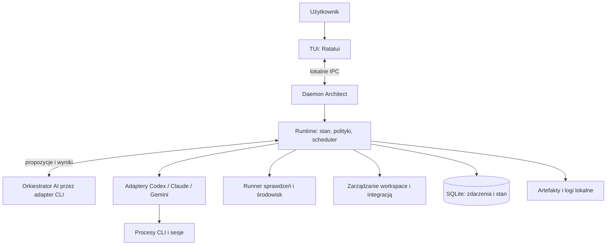

# Architect — projekt narzędzia do orkiestracji agentów AI

Status: projekt do dalszej iteracji; wymagania użytkownika są ustalone tam, gdzie oznaczono je jako **ustalone**. Szczegóły techniczne i wartości domyślne są **propozycjami**, dopóki nie zostaną zatwierdzone.

Data: 2026-10-13. Nazwa robocza: Architect.

## 1. Cel produktu

Architect to lokalne narzędzie TUI, w którym użytkownik opisuje zadanie, a orkiestrator AI dobiera zespół, rozdziela pracę na małe problemy, określa role i zależności, koordynuje komunikację oraz egzekwuje weryfikację rezultatów. Zadaniem może być drobna poprawka, rozwój istniejącego projektu, cały nowy projekt, research, dokument lub analiza.

Najważniejszym rezultatem jest rozwiązanie pasujące do kontekstu i potrzeb użytkownika: poprawne, zrozumiałe, możliwe do utrzymania i poparte adekwatnymi dowodami. Sama liczba agentów, wygenerowanych plików lub przechodzących testów nie jest miarą sukcesu.

System ma ograniczać typowe błędy agentów: powierzchowne planowanie, utratę kontekstu, AI slop, nadmiar kodu, duplikację, zaniechany lub zbędny refaktor, słabe testy, luki bezpieczeństwa, problemy wydajnościowe i pozorną weryfikację. Nie można zagwarantować usunięcia wszystkich wad modeli. Produkt ma je wykrywać, ograniczać i jasno raportować pozostałą niepewność.

## 2. Ustalone wymagania

| Obszar | Decyzja użytkownika |
| --- | --- |
| Użytkownik | Programista pracujący lokalnie. |
| Platformy | macOS i Linux. |
| Technologia | Rust i Ratatui. |
| Integracje AI | Wyłącznie istniejące CLI; bez własnych integracji z API dostawców modeli. |
| Dostawcy | Codex, Claude Code, Gemini CLI; architektura umożliwia dodawanie kolejnych CLI. |
| Zakres zadań | Oprogramowanie, research, dokumenty i analizy od początku. |
| Dobór zespołu | Automatyczny; role i relacje wynikają z zadania oraz kontekstu projektu. |
| Jakość | Priorytet nad minimalizacją kosztu; niezależna weryfikacja każdej uruchomionej roli wykonawczej, również przy małych zadaniach. |
| Standard rezultatu | Kod ma być wzorowym rozwiązaniem zadania: idiomatyczny, czytelny, spójny, po wymaganym refaktorze, bez zbędnych dodatków i nierozstrzygniętych zastrzeżeń analizy statycznej. |
| Planowanie | Przed implementacją powstaje model abstrakcyjny rozwiązania oraz sprawdzenie jego działania przez symulację scenariuszy i niezależne poszukiwanie kontrprzykładów. |
| Kompletność | Brak pustych miejsc, ukrytych założeń i niewyjaśnionych zależności wpływających na poprawność planowanego rozwiązania. |
| Boy Scout Rule | Każde zadanie obejmuje ocenę możliwości pozostawienia używanego kodu w lepszym stanie i wykonanie uzasadnionych usprawnień struktury. |
| Checklisty weryfikacji | Wersjonowane, obowiązkowe listy sprawdzeń z metodą, dowodem i warunkiem odrzucenia; pełne rozliczenie katalogu ryzyk. |
| Pełne wymagania | Trwały rejestr wszystkich wymagań z oryginalnego zlecenia/planu; oddzielna weryfikacja kompletności i rzeczywistego spełnienia każdego wymagania. |
| Kryteria refaktoru | Standardy języka/projektu oraz katalog problemów i technik Refactoring.Guru, stosowane adekwatnie do kontekstu. |
| Architektura | Ocena granic, kontraktów, wzorców i ryzyka wprowadzanego kodu; wzorce stosowane tam, gdzie rozwiązują rozpoznany problem. |
| Wejścia | Pełny model dziedziny wszystkich parametrów, błędnych wartości i istotnych kombinacji, z uzasadnioną metodą weryfikacji. |
| Biblioteki | Obowiązkowe sprawdzenie dostępnych rozwiązań przed własną implementacją; ocena jakości, bezpieczeństwa, licencji i obowiązków zależności. |
| Wybór rozwiązania | Zbadanie realnych wariantów i wybór najlepszego względem wymagań, kontekstu oraz udokumentowanych kryteriów; niezależna weryfikacja wyboru. |
| Niezależność | Osobna sesja i kontekst weryfikatora; preferowany inny model lub CLI, dopuszczalny ten sam w osobnej sesji. |
| Routing CLI | Profile przypisujące wysiłek i rodzaj pracy do CLI; przykład: Codex do ciężkiego rozumowania, Gemini do lżejszych zadań i pisania kodu. |
| Autonomia | Dwa tryby: zatwierdzanie każdego etapu i każdej rundy poprawek albo pełny automat. |
| Pełny automat | Praca lokalna, testy i lokalne commity; push, publikacja, wiadomości zewnętrzne i operacje destrukcyjne wymagają osobnej zgody. |
| Limity MVP | Brak limitów liczby agentów, współbieżności, czasu, kosztu, głębokości delegacji i rund poprawek. |
| Pary ról | Dedykowany agent weryfikujący dla każdej uruchomionej roli wykonawczej. |
| Wybór orkiestratora | CLI/model konfigurowalne, bez domyślnego dostawcy orkiestratora. |
| Katalog pracy | Domyślnie osobny worktree; praca bezpośrednia wybierana dla konkretnego zadania. |
| Personalizacja MVP | Wbudowane role i szablony; edytowalne przypisania CLI i effort. Własne role/szablony później. |
| Konfiguracja | TOML. |
| Restart komputera | Po ponownym uruchomieniu Architect wykonuje resume zerwanych sesji, z kontrolą ich rzeczywistego stanu. |
| Działanie w tle | Lokalny proces wykonawczy działa po zamknięciu TUI; możliwość ponownego podłączenia i odzyskiwania po awarii. |
| Główny interfejs | Dwa panele: czat z orkiestratorem oraz przestrzenny graf agentów. |
| Graf | Przestrzenny graf węzłów i krawędzi w stylu MindNode lub wizualizacji zapytań Neo4j, a nie drzewo przeglądarki plików; nawigacja strzałkami, status pracy, widoczna komunikacja i szczegóły agenta. |
| Nakładka postępu | W prawym górnym albo dolnym rogu panelu agentów nakładka pokazuje aktualnie wykonywany krok na podstawie trwałego stanu run i zadań; dla równoległych prac pokazuje ich rzeczywisty zestaw. |
| Komentarze w panelu agentów | Każdy widoczny element panelu agentów można skomentować tak jak zmianę w diffie. Komentarz jest trwały, powiązany z elementem i jego wersją, dostępny po ponownym podłączeniu; orkiestrator musi odpowiedzieć lub zaproponować działanie i pokazać stan reakcji. |
| Sesje agentów | Podgląd sesji i możliwość napisania bezpośrednio do wybranego agenta. |
| Komunikacja agentów | Każdy agent może wysyłać wiadomości punktowe do dowolnego agenta zespołu oraz broadcast do pozostałych agentów; runtime utrwala nadawcę, odbiorców i stan dostarczenia. |
| Kontekst orkiestratora | Zarządzanie przez raporty zadań, artefakty, decyzje weryfikatorów i wiadomości; bez konieczności czytania transkryptów sesji agentów. |
| Język | TUI, kod, identyfikatory i dokumentacja produktu po angielsku; ten dokument po polsku. |
| Widok diff i recenzja | Podgląd różnic (diff) plików ze statystykami zmian, komentarze do linii i plików z nasłuchiwaniem orkiestratora oraz uruchamianie recenzji kodu z poziomu diffa. |
| Bieżący rezultat | Dokument projektowy `design.md`; implementacja jest kolejnym krokiem. |

## 3. Podstawowe zasady

1. **Każda rola wykonawcza ma weryfikatora.** Dotyczy to również planowania, researchu, przygotowania testów i integracji, a nie tylko pisania kodu.
2. **Weryfikacja odnosi się do konkretnego artefaktu.** Raport zatwierdzający wskazuje jego wersję/hash, wymagania, wykonane sprawdzenia i ograniczenia.
3. **Model proponuje, runtime kontroluje.** AI rozumuje i proponuje działania. Kod programu sprawdza kontrakty, uprawnienia, zależności i legalność przejść stanów.
4. **Małe jednostki pracy, pełny cel.** Podział na małe zadania nie może zgubić wymagań przekrojowych, integracji ani doświadczenia użytkownika.
5. **Kontekst jest wersjonowany.** Decyzje, wymagania i źródła mają właściciela, pochodzenie oraz informację o aktualności.
6. **Działania i komunikacja są obserwowalne.** Graf i czat są projekcją rzeczywistych zdarzeń. Użytkownik widzi także błędy, kolejki i ograniczenia integracji.
7. **Autonomia działa w granicach polityki.** Pełny automat automatyzuje zatwierdzanie etapów, ale nie nadaje sam sobie nowych uprawnień.
8. **Jakość wymaga pomiaru.** Skuteczność swarma porównujemy z prostszym wykonaniem na rzeczywistych zadaniach. Pierwsza wersja nie narzuca limitów zasobów; mierzy faktyczny narzut.
9. **Plan zawiera model i sprawdzenie poprawności.** Lista czynności nie wystarcza. Trzeba wykazać, jak rozwiązanie realizuje wymagania, zachowuje niezmienniki i obsługuje błędy.
10. **Każdy element kodu ma uzasadnienie.** Wynika z wymagania, niezbędnego mechanizmu realizacji albo udokumentowanej poprawy jakości zgodnej z Boy Scout Rule; funkcje „na przyszłość” nie wchodzą do rezultatu.
11. **Refaktor jest częścią ukończenia.** Przed dostarczeniem usuwamy problemy strukturalne w rozwiązaniu i jego istotnych zależnościach, zamiast zostawiać je jako późniejsze porządki.
12. **Bramki jakości są łączne.** Testy, analiza statyczna, model poprawności, zakres i review muszą przejść osobno; dobry wynik jednego sprawdzenia nie kompensuje porażki drugiego.

## 4. Research: wnioski i granice dowodów

Research wykonano 2026-10-13. Odwołania `S01`–`S28` prowadzą do źródeł w rozdziale 21. Wymagania jakościowe wskazane przez użytkownika są normatywne; szczegóły mechanizmów są projektem ich realizacji. Źródła nie stanowią dowodu, że Architect już skutecznie realizuje te mechanizmy.

| Wniosek | Podstawa i ograniczenie | Konsekwencja projektowa |
| --- | --- | --- |
| Swarm wnosi własne klasy awarii. | MAST wyróżnia 14 trybów awarii związanych z projektem systemu, współpracą i weryfikacją; badanie dotyczy konkretnych frameworków i modeli. [MAST](https://arxiv.org/abs/2503.13657) | Kontrakty zadań, jawne zależności, kontrola zakończenia i analiza incydentów. |
| Więcej agentów nie gwarantuje lepszego wyniku. | Anthropic opisuje korzyści dla researchu, duży koszt tokenów oraz ograniczenia równoległości w kodowaniu. Wyników ich systemu nie przenosimy liczbowo na nasz produkt. [Multi-agent research](https://www.anthropic.com/engineering/multi-agent-research-system) | Zespół dopasowany do ryzyk, ograniczenie równoległych zapisów i mierzenie narzutu. |
| Długie zadania potrzebują trwałych przekazań. | Anthropic opisuje przedwczesne deklaracje ukończenia, pozostawiane niedokończone funkcje i trudności między sesjami. [Long-running agents](https://www.anthropic.com/engineering/effective-harnesses-for-long-running-agents) | Wersjonowany plan, checkpointy, artefakty i sprawdzenie stanu po wznowieniu. |
| Dostępny kontekst nie musi być wykorzystany poprawnie. | Badanie Lost in the Middle pokazuje zależność wyników od położenia informacji; dotyczy testowanych modeli i zadań, nie wszystkich aktualnych CLI. [Lost in the Middle](https://arxiv.org/abs/2307.03172) | Krótkie pakiety kontekstu z odsyłaczami do źródeł, ponowne sprawdzanie kluczowych ograniczeń. |
| Samokrytyka bez zewnętrznej informacji bywa nieskuteczna. | Badanie dotyczy rozumowania i modeli z określonego okresu; nie dowodzi, że każda współczesna samokorekta zawodzi. [Self-correction](https://arxiv.org/abs/2310.01798) | Oddzielny weryfikator oraz testy, narzędzia i źródła jako informacja zwrotna. |
| Halucynacje obejmują kontekst repozytorium i zależności. | Badania praktycznej generacji oraz pakietów dokumentują błędne odwołania i wymyślone zależności. [Repository hallucinations](https://arxiv.org/abs/2409.20550), [Package hallucinations](https://www.usenix.org/conference/usenixsecurity25/presentation/spracklen) | Sprawdzanie API, symboli, wersji i pochodzenia nowej zależności. Istnienie pakietu nie dowodzi jego bezpieczeństwa. |
| Powtarzalność kodu jest osobnym problemem jakości. | Code Copycat Conundrum bada powtórzenia wygenerowanego kodu; nie jest pomiarem całego długu architektonicznego produkcyjnych repozytoriów. [Code repetition](https://arxiv.org/abs/2504.12608) | Analiza duplikacji i spójności z istniejącymi modułami. |
| Ocena jakości wymaga kilku rodzajów sprawdzeń. | Anthropic omawia testy deterministyczne, oceny modeli i ocenę człowieka, w tym ograniczenia każdej z metod. [Agent evals](https://www.anthropic.com/engineering/demystifying-evals-for-ai-agents) | Twarde bramki poprawności, rubric dla jakości i kalibracja z oceną człowieka. |
| Treści z narzędzi mogą przejąć kierunek pracy. | AgentDojo bada prompt injection; OWASP opisuje ryzyka agentowe. Są to podstawy modelu zagrożeń, a nie certyfikacja naszego projektu. [AgentDojo](https://arxiv.org/abs/2406.13352), [OWASP](https://genai.owasp.org/resource/owasp-top-10-for-agentic-applications-for-2026/) | Rozdzielenie danych i uprawnień; ograniczenia egzekwowane poza modelem. |
| Poczucie przyspieszenia może różnić się od pomiaru. | METR w badaniu z 2025 mierzył spowolnienie konkretnej grupy; aktualizacja z 2026 wskazuje problemy wiarygodności kolejnego pomiaru. Nie wyciągamy ogólnego wniosku o aktualnych modelach. [METR 2025](https://metr.org/Early_2025_AI_Experienced_OS_Devs_Study-paper.pdf), [METR 2026](https://metr.org/blog/2026-02-24-uplift-update/) | Mierzymy czas do zaakceptowanego wyniku i pracę użytkownika, nie subiektywną aktywność agentów. |
| Projekt i weryfikacja potrzebują powiązania z wymaganiami. | NASA opisuje analizę projektu, modelowanie i śledzenie wymagań. Wykorzystujemy zasady inżynierskie, nie deklarujemy zgodności z procesem certyfikacji NASA. [System design — S19](https://www.nasa.gov/reference/4-0-system-design-processes/) | Mapa wymaganie → element modelu → kod → dowód, sprawdzana w obu kierunkach. |
| Planowanie musi uwzględniać propagację zmian. | CodePlan łączy planowanie z analizą zależności i wpływu zmian w repozytorium; jego wyniki nie dowodzą poprawności naszej symulacji. [CodePlan — S20](https://www.microsoft.com/en-us/research/publication/codeplan-repository-level-coding-using-llms-and-planning/) | Analiza wpływu przed implementacją i aktualizacja planu po zmianie kontraktu. |
| Refaktor obejmuje kontrolę zachowania. | Fowler opisuje małe przekształcenia struktury zachowujące obserwowalne zachowanie. [Refactoring — S21](https://refactoring.com/) | Oddzielne wskazanie zmian funkcjonalnych i transformacji struktury oraz dowody zachowania kontraktów. |

## 5. Model produktu i pojęcia

| Pojęcie | Znaczenie |
| --- | --- |
| Workspace | Projekt lub katalog roboczy oraz przypisana konfiguracja. |
| Run | Jedno zlecenie użytkownika wraz z historią decyzji i rezultatami. |
| Stage | Etap z określonym wejściem, rezultatem i bramką akceptacji. |
| Task | Mała jednostka pracy z właścicielem, kryteriami i zależnościami. |
| Role | Wersjonowany kontrakt kompetencji, uprawnień i oczekiwanych rezultatów. |
| Agent | Logiczny członek zespołu przypisany do roli. |
| Session | Rozmowa konkretnego CLI; agent może mieć kolejne sesje po odzyskaniu lub zmianie dostawcy. |
| Attempt | Jedna próba wykonania zadania; retry nie nadpisuje poprzedniej. |
| Artifact | Wersjonowany rezultat: plan, patch, testy, raport, analiza lub dokument. |
| Finding | Uwaga weryfikatora z dowodem, wagą i kryterium naprawy. |
| Evidence | Wynik narzędzia/eksperymentu/odczytu źródła powiązany z artefaktem. |
| Gate | Reguła zezwalająca na zakończenie etapu lub integrację. |
| Approval | Zgoda użytkownika lub decyzja wynikająca z ustalonej polityki. |
| Template | Szablon do utworzenia ról, relacji, etapów i bramek. |

Role są dwóch rodzajów: `executor` i `verifier`. Orkiestracja jest funkcją zarządczą; merytoryczne decyzje orkiestratora o planie, podziale pracy i gotowości też wymagają kontroli. Nie tworzymy nieskończonego łańcucha recenzentów: raporty weryfikatorów sprawdza runtime pod względem formatu i dowodów, a spory rozstrzyga dodatkowa niezależna ocena lub użytkownik.

## 6. Przebieg realizacji zadania

### 6.1. Etapy

1. **Intake** — odczyt zadania, granic, wejściowych plików, instrukcji projektu i uprawnień. Pytania o informacje, bez których zadanie zmieniłoby znaczenie.
2. **Discovery** — zbudowanie udokumentowanego modelu kontekstu: domena, istniejące przepływy, kontrakty, zależności, standardy, środowisko i stan bazowy. Context verifier sprawdza pokrycie oraz źródła, nie tylko listę przeczytanych plików.
3. **Planning** — zbadanie wariantów i wybór najlepszego względem wymagań; model abstrakcyjny wybranego rozwiązania, symulacja scenariuszy, analiza kontrprzykładów, domknięcie niewiadomych, ocena architektury, bibliotek, licencji i ryzyka, strategia refaktoru i weryfikacji, a następnie DAG pracy oraz zespół. Options verifier sprawdza wybór, Plan verifier poprawność i kompletność modelu. Modele kandydatów mogą powstawać wcześniej jako dowód porównania.
4. **Execution** — wykonanie małych zadań, wymagany refaktor, analiza statyczna i przegląd artefaktów. Można prowadzić niezależne gałęzie równolegle. Implementacja nie rozpoczyna się z niedomkniętym modelem istotnych zależności.
5. **Validation** — adekwatne testy, sprawdzenie wymagań, security, wydajności, źródeł lub obliczeń. Weryfikacja jakości samego sprawdzania.
6. **Integration** — składanie zatwierdzonych rezultatów i ponowna walidacja całości. Dla dokumentu: wspólna redakcja, kontrola sprzeczności i odnośników.
7. **Delivery** — raport końcowy: rezultat, spełnione kryteria, dowody, ograniczenia, instrukcja użycia i otwarte ryzyka.

Etapy opisują cykl logiczny; małe zadanie może mieć krótkie etapy i mało agentów. Nie pomija niezależnej weryfikacji uruchomionych ról. Długi projekt składa się z kamieni milowych z tym samym cyklem; cały projekt nie musi czekać na jedną wielką integrację.

Testy mogą powstawać przed lub równolegle z implementacją. Późniejszy etap Validation sprawdza wynik i kompletność dowodów. Podział etapów nie narzuca waterfall.

### 6.2. Dwa tryby autonomii

**Ustalona semantyka:**

| Tryb | Zachowanie |
| --- | --- |
| `supervised` | Użytkownik zatwierdza rozpoczęcie każdego etapu, każdą rundę poprawek i końcowy wynik etapu. Karta akceptacji wyniku może jednocześnie przedstawiać i zatwierdzać zakres następnego etapu. Nie otwieramy automatycznie rundy poprawek po odrzuceniu wyniku przez verifiera. |
| `autonomous` | Runtime otwiera kolejne etapy i rundy poprawek po spełnieniu bramek. Dopuszczalne są praca lokalna, testy i lokalne commity. Push, publikacja, wiadomości zewnętrzne i operacje destrukcyjne wymagają osobnej zgody. Brak niezbędnej decyzji produktowej może wymagać użytkownika. |

Zmiana trybu jest jawna, zapisana i obowiązuje dla kolejnych działań. Nie zatwierdza wstecz zmian ani nie usuwa uwag weryfikatorów. Zmiana zaakceptowanego zakresu unieważnia odpowiednie zgody i wymaga ponownej oceny.

Oddzielamy zgodę na **etap** od zgody na **działanie**. Zgoda na lokalną implementację nie oznacza zgody na push, publikację, zewnętrzną wiadomość lub destrukcyjną operację. Lokalny commit obejmuje wyłącznie wskazane zmiany zadania; nie dołącza przypadkowych zmian użytkownika.

### 6.3. Zmiana zadania przez użytkownika

Każda wiadomość jest przypisana do run, adresata i identyfikatora. Orkiestrator klasyfikuje ją jako pytanie, dodatkowy kontekst, korektę, zmianę zakresu lub polecenie sterujące. Runtime waliduje skutki tej propozycji. Zmiana wymagań zwiększa `spec_revision`; zależne zadania i raporty otrzymują status `stale`. Trwające niezależne zadania mogą działać dalej, jeśli nadal są zgodne z nowym zakresem.

Wysłanie wiadomości do agenta nie może po cichu zmienić kontraktu całego projektu. Agent i orkiestrator otrzymują zdarzenie; zmiana zakresu przechodzi ten sam proces aktualizacji planu.

### 6.4. Budowanie kontekstu jako zadanie weryfikowalne

Rezultatem Discovery jest `ContextModel`, a nie streszczenie repozytorium. Dla obszaru zmiany musi wyjaśniać, co system robi obecnie, od czego zależy i jakie ograniczenia trzeba zachować. Wymagany jest kontekst do wykazania poprawności całej zmienianej ścieżki, również poza edytowanymi plikami.

| Składnik | Obowiązkowa zawartość |
| --- | --- |
| Intencja i zakres | Oczekiwane zachowanie, odbiorca, kryteria akceptacji, jawnie wyłączone funkcje. |
| Domena | Pojęcia, reguły, jednostki, legalne stany i źródła prawdy. |
| Obecne zachowanie | Punkty wejścia, wywołujący, konsumenci, przebieg danych oraz skutki uboczne. |
| Zależności | Zależności bezpośrednie i przechodnie istotne dla zmiany, także dynamiczne i konfiguracyjne. |
| Kontrakty | API, schematy, serializacja, błędy, zgodność, uprawnienia i własność zasobów. |
| Standardy | Reguły języka/frameworka, standardy projektu, formatowanie, lintery, zabronione wzorce. |
| Środowisko | Faktyczne wersje, feature flags, warianty build/test, platformy i zewnętrzne usługi. |
| Stan bazowy | Testy, diagnostyka statyczna, znane defekty i pomiary potrzebne do porównania. |
| Możliwości wykorzystania kodu | Istniejące funkcje, moduły i zależności realizujące część potrzeby; ograniczenia ich użycia. |
| Stan wiedzy | Każde ważne twierdzenie ma źródło, rewizję, status potwierdzenia i wpływ na rozwiązanie. |

Dla faktu o kodzie źródłem jest konkretna wersja kodu, konfiguracji, użyć lub wyniku uruchomienia; sama nazwa funkcji nie dowodzi jej zachowania. Dokumentację porównujemy z implementacją. Pośrednie podsumowania nie stają się nowym źródłem prawdy.

Rejestr niewiadomych zawiera pytanie, wpływ, sposób sprawdzenia i właściciela. Pozycja wpływająca na poprawność musi zostać zamknięta przez odczyt, eksperyment, dokumentację kontraktu lub decyzję użytkownika. Nie wolno zmienić jej etykiety na „przyjmujemy”, aby odblokować implementację. Jawne warunki kontraktu, np. dopuszczalne wejścia, muszą mieć podstawę i wymuszanie albo sprawdzenie na granicy.

Context verifier niezależnie przechodzi od wymagania do wejść, przetwarzania, wyjść i konsumentów; szuka pominiętej zależności, sprzecznego źródła i błędnej interpretacji. `context_ready` oznacza pokrycie istotnych ścieżek, zamknięcie blokujących niewiadomych i brak nierozstrzygniętych sprzeczności. Liczba przeczytanych plików ani długość raportu nie otwierają tej bramki.

### 6.5. Model abstrakcyjny i symulacja rozwiązania

Planowanie wytwarza `SolutionModel`, `SimulationReport`, `TraceabilityMap`, `RefactorPlan` i `VerificationPlan`. DAG zadań jest wyprowadzany z tych artefaktów. Nie jest substytutem projektu rozwiązania.

**Model abstrakcyjny musi określać:**

- Granice rozwiązania, aktorów, wejścia/wyjścia, obserwowalne zachowanie i powiązane wymagania.
- Encje, typy, legalne stany, ich właścicieli i źródła prawdy.
- Operacje, warunki wejściowe i końcowe oraz reguły przejść stanów.
- Niezmienniki domenowe, bezpieczeństwa, spójności danych i własności zasobów.
- Przepływy danych i sterowania, odpowiedzialność modułów oraz kontrakty między nimi.
- Błędy, częściowe wykonanie, skutki uboczne, anulowanie, retry i odzyskanie — gdy występują.
- Porządek operacji, transakcje, współbieżność oraz istotne przeploty zdarzeń — gdy występują.
- Warunki zakończenia, charakterystykę kosztu i zgodność z wymaganiami wydajnościowymi.
- Zakres refaktoru, zachowanie zachowywane i celowo zmieniane oraz sposób odróżnienia tych zmian.
- Powiązanie każdego elementu z wymaganiem, niezbędnym warunkiem technicznym realizacji lub udokumentowanym usprawnieniem Boy Scout Rule.

Dla prostego algorytmu wystarczą jego kontrakt, pseudokod, niezmienniki i przypadki wejścia. Dla procesu stanowego potrzebna jest tabela stanów/przejść; dla integracji — kontrakty i sekwencje; dla współbieżności — własność danych i analiza przeplotów. Forma jest adekwatna do problemu, kompletność nie jest opcjonalna. Diagram z pudełkami bez semantyki nie jest wystarczającym modelem.

**Symulacja w pamięci** oznacza przejście przez model przed pisaniem kodu: wybranie stanu początkowego i wejścia, zastosowanie zdefiniowanych operacji, sprawdzenie każdego istotnego niezmiennika i porównanie stanu końcowego z wymaganiem. Planner zapisuje zwięzły wynik audytu w formie scenariuszy i tabel stanów; nie wymagamy udostępniania prywatnego toku rozumowania modelu.

| Rodzaj scenariusza | Co należy sprawdzić |
| --- | --- |
| Zwykły przebieg | Wynik i skutki uboczne spełniają wymaganie. |
| Puste, minimalne i maksymalne wejście | Legalność stanów, jednostki, ograniczenia domeny i koszty. |
| Błędne lub sprzeczne wejście | Walidacja, kontrakt błędu i brak nieautoryzowanych skutków. |
| Błąd na granicy operacji | Stan po częściowym wykonaniu, transakcja/kompensacja i odzyskanie. |
| Powtórzone lub opóźnione zdarzenie | Idempotencja, deduplikacja, porządek i brak użycia starej wersji. |
| Anulowanie i restart | Własność zasobów, zachowanie uprawnień i prawidłowe wznowienie. |
| Istotny przeplot równoległych operacji | Spójność, brak wyścigu i możliwość postępu. |
| Integracja oraz migracja | Zgodność producenta i konsumenta, stare/nowe dane oraz kolejność wdrożenia. |

Każdy scenariusz ma `scenario_id`, kryterium wymagania, wersję modelu, stan wejściowy, sekwencję zdarzeń, oczekiwany wynik, sprawdzane niezmienniki i rezultat oceny. `not_applicable` wymaga uzasadnienia; „powinno działać” nie jest wynikiem symulacji.

Plan verifier tworzy własne scenariusze i próbuje znaleźć kontrprzykład. Wykryta luka wraca do modelu i kontekstu przed implementacją. Niezrozumiałej odpowiedzialności modułu, niedookreślonego przejścia ani niepotwierdzonej właściwości zależności nie wolno odroczyć do „decyzji programisty w trakcie”.

Symulacja modelu przez AI jest sprawdzeniem projektowym, nie formalnym dowodem wszystkich możliwych przebiegów. Tam, gdzie istotnej własności nie da się wiarygodnie ocenić w ten sposób, plan musi przewidzieć wykonywalny model, sprawdzenie własności, model checking, eksperyment lub inną adekwatną metodę. Do wdrożenia konkretnej metody potrzebny jest jej uzasadniony związek z ryzykiem. Wyniki modelu są następnie sprawdzane na rzeczywistym kodzie.

`plan_ready` wymaga łącznie: zatwierdzonego kontekstu, zweryfikowanego wyboru wariantu (`solution_selected`, sekcja 6.7), kompletnego modelu istotnych zachowań, zamkniętych niewiadomych wpływających na poprawność, pozytywnej niezależnej symulacji, dwukierunkowej mapy wymagań, planu refaktoru i planu dowodów. Ogólne „review pozytywne” bez tych artefaktów nie uruchamia wykonawców.

### 6.6. Zachowanie wszystkich wymagań z długiego planu

Oryginalne zlecenie, dołączony plan i jego korekty są trwałymi, wersjonowanymi źródłami. Streszczenie pomaga w pracy, lecz nie zastępuje oryginału ani rejestru `RequirementLedger`. System nie polega na pamięci jednej sesji orkiestratora.

Requirements analyst wyodrębnia wymagania atomowe z zachowaniem ich hierarchii i wszystkich kwalifikatorów: warunków, wyjątków, ograniczeń, oczekiwań jakościowych, negatywnych wymagań i szczegółów akceptacji. Przykład: „eksport do CSV, poprawna obsługa UTF-8 i brak eksportu danych bez uprawnień” musi zachować wszystkie trzy obowiązki; samo istnienie komendy eksportu nie spełnia całego wymagania.

Każdy rekord zawiera: `requirement_id`, źródło i zakres tekstu, oryginalną treść, precyzyjną interpretację, element nadrzędny, obowiązkowe kryteria, właścicieli realizacji i weryfikacji, zależności, wersję oraz dowody. Rozbicie jednego wymagania na wiele nie usuwa oryginału; spełnienie rodzica wymaga spełnienia wszystkich obowiązkowych dzieci i warunku integracji.

Oddzielny `PlanItemLedger` rozlicza kroki planu użytkownika: powiązane wymagania, wykonanie, dowód albo uzgodniona zmiana podejścia. Nie każdy krok techniczny jest samodzielnym wymaganiem produktu, lecz żaden nie znika bez wyjaśnienia. Gdy użytkownik narzucił sposób implementacji, jest to również wymaganie, a nie dowolna sugestia.

Requirements verifier niezależnie czyta pełne źródło i porównuje je z rejestrem. Sprawdza pokrycie każdego fragmentu zawierającego zobowiązanie i dokładność interpretacji. Nie ogranicza się do zatwierdzenia ekstrakcji wykonawcy. Niejednoznaczność jest pytaniem do rozstrzygnięcia; nie wolno domyślnie obniżyć wymagania do opcjonalnego.

Podczas pracy każde zadanie wskazuje realizowane `requirement_id`. Każdy handoff i checkpoint zachowuje rejestr, statusy i brakujące dowody. Wymaganie może być `identified`, `clarification_needed`, `planned`, `in_progress`, `implemented`, `verified`, `blocked`, `stale` lub `superseded_by_user`. `implemented` jest deklaracją wykonania, a `verified` wymaga niezależnej oceny wszystkich kryteriów na aktualnym rezultacie.

Nie ma automatycznego „częściowo spełnione → gotowe”. Wymaganie jakościowe jest spełnione dopiero po wykazaniu jakości, nie przez samą obecność pliku/testu/API. Wymagania przekrojowe, np. brak utraty danych, obejmują cały odpowiedni przepływ, a nie tylko moduł przypisany jednemu agentowi.

Końcowy `ComplianceAudit` porównuje zintegrowany rezultat z **pełnym źródłem i rejestrem**. Audytor szuka także wymagań pominiętych podczas ekstrakcji; jego dedykowany verifier sprawdza pokrycie audytu oraz dowody. Każde wymaganie obowiązkowe musi mieć spełnione wszystkie kryteria. Brak, powierzchowna realizacja, stary dowód, sprzeczny wynik albo nieuzgodnione uproszczenie blokują `requirements_complete`.

Usunięcie, osłabienie, odroczenie lub zmiana znaczenia wymagania wymaga jawnej decyzji użytkownika i nowej rewizji. Pełny automat nie ma uprawnień do takiej zmiany. W TUI lista wymagań jest dostępna z czatu/palety i szczegółów zadania: pokazuje pokrycie, dowody, pominięcia oraz różnice rewizji. Procent realizacji jest informacją o postępie; nie zastępuje spełnienia każdego obowiązkowego kryterium.

### 6.7. Wybór najlepszego rozwiązania spośród zbadanych wariantów

Pierwszy poprawny pomysł nie kończy planowania. Przed zatwierdzeniem planu powstaje `OptionsAnalysis` i `SolutionDecision`: zbadane sposoby osiągnięcia celu, porównanie na wspólnych kryteriach, wybór oraz uzasadnienie odrzucenia pozostałych. Dotyczy to kodu, metod researchu, dokumentów i analiz. Głębokość badania odpowiada ryzyku decyzji; niewielka poprawka może mieć krótkie porównanie, lecz nie pomija pytania o alternatywy.

Proces obowiązkowy:

1. Zdefiniuj decyzję, komplet wymagań, ograniczenia projektu i kryteria przed oceną kandydatów. Obowiązkowe wymagania są filtrami dopuszczalności, a nie punktami do skompensowania przez wydajność lub cenę.
2. Zbadaj realne, odrębne podejścia: wykorzystanie istniejącego mechanizmu, biblioteki, prostszy wariant, inne rozwiązanie architektoniczne lub metodologiczne. Zachowanie stanu obecnego jest baseline, jeśli ma znaczenie. Nie tworzymy pozornie gorszych opcji tylko po to, by wygrał pierwszy pomysł. Jeśli istnieje jeden realny wariant, uzasadniamy to wynikami poszukiwania i ograniczeniami.
3. Zapisz zakres poszukiwania, źródła, daty, ważne klasy rozwiązań i powody wykluczenia. Nie deklaruj zbadania wszystkich pomysłów, jakie mogłyby istnieć; Options verifier sprawdza, czy nie pominięto istotnej dostępnej klasy.
4. Oceń kandydatów na tej samej podstawie: poprawność i kompletność, bezpieczeństwo, dopasowanie do projektu, prostota, utrzymanie, testowalność, refaktoryzowalność, wydajność, ryzyko, licencje oraz koszt całego życia rozwiązania. Wagi lub kolejność preferencji wynikają z potrzeb użytkownika; domyślnym priorytetem jest jakość. Koszt i czas są informacją porównawczą, nie limitami MVP.
5. Oprzyj oceny na źródłach, modelu, pomiarze lub eksperymencie. Oznacz niepewność i zakres obowiązywania każdego dowodu. Gdy istotna niewiadoma może zmienić wybór, wykonaj potrzebny spike, benchmark lub próbę integracji. Eksperyment jest oddzielnym artefaktem; jego tymczasowy kod nie trafia automatycznie do produktu.
6. Odrzuć warianty niespełniające obowiązkowych warunków. Wśród dopuszczalnych wybierz wariant najlepiej spełniający ustalone preferencje. Opcja zdominowana przez inną na wszystkich istotnych kryteriach nie może wygrać bez wykazania brakującego kryterium lub błędu danych. Suma arbitralnych punktów nie zastępuje uzasadnienia.
7. Sprawdź wrażliwość decyzji: czy rozsądna zmiana wag, danych lub warunków odwraca wynik? Przy nierozstrzygniętym kompromisie istotnym dla celu poproś użytkownika o preferencję; brak odpowiedzi nie tworzy zgody na osłabienie wymagania. Autonomia nie upoważnia do dopisania użytkownikowi celu.
8. Options verifier niezależnie szuka lepszej alternatywy, sprawdza kryteria, dowody i odrzucone opcje. `solution_selected` powstaje dopiero po tej ocenie. W trybie supervised wybór jest częścią zatwierdzanego planu; w autonomous zatwierdza go polityka po pozytywnej weryfikacji.

Minimalny rekord wariantu: `option_id`, opis mechanizmu, źródła, pokrycie wymagań, wyniki kryteriów z dowodami, zależności, ryzyka, niewiadome i koszt utrzymania. Rekord decyzji wskazuje wybrany wariant, wersję kryteriów, uzasadnienie, powody odrzucenia każdego konkurenta, wynik kontroli wrażliwości oraz warunki ponownego otwarcia. Nowe wymaganie, wynik eksperymentu lub odkryta biblioteka mogą unieważnić wybór; nie trzymamy się go tylko z powodu już napisanej implementacji.

„Najlepsze” oznacza najlepiej uzasadniony wybór w zbadanej przestrzeni, dla aktualnych wymagań i dowodów. System nie przypisuje sobie dowodu globalnego optimum bez podstaw. Proces odwołuje się do zasad definiowania kryteriów, porównania alternatyw i kontroli niepewności opisanych w [NASA Decision Analysis — S28](https://www.nasa.gov/reference/6-8-decision-analysis/); powyższy kontrakt i bramka są projektem Architect.

## 7. Automatyczne budowanie swarma

### 7.1. Dobór zespołu

Orkiestrator proponuje `TeamPlan` na podstawie: rodzaju rezultatu, złożoności, ryzyka, zależności, wielkości kontekstu, modułów projektu, dostępnych CLI, potrzebnych narzędzi i profilu jakości. Runtime waliduje plan przed uruchomieniem. Każdy dodany agent ma uzasadnioną odpowiedzialność; brak limitów nie oznacza uruchamiania agentów bez zadania.

Bootstrap korzysta z wbudowanej bazy ról i jawnie wybranego profilu orkiestratora. Może uruchomić discovery i analizę wymagań przed powstaniem pełnego planu implementacji; w supervised wymaga zgody na właściwy etap. Orkiestrator rozszerza skład po zebraniu kontekstu i RiskCoverage. Bramki implementacji dotyczą pracy nad rozwiązaniem; analizy niezbędne do opracowania planu mają własne kryteria i nie wymagają gotowego planu implementacji.

Obowiązkowe warunki:

- Każde zadanie ma właściciela, rezultat i sprawdzalne kryteria zakończenia.
- Zadanie implementacyjne ma aktualne `context_ready` i `plan_ready` oraz powiązany fragment modelu; bramka nie jest pomijana dla małej zmiany.
- Wybór wariantu ma `solution_selected`; ocena architektury, wejść i zależności jest gotowa przed implementacją w zakresie możliwym do sprawdzenia na planie. Dowody z kodu i finalnej integracji domykają te same bramki przed dostarczeniem.
- Każda uruchomiona rola wykonawcza ma przypisanego niezależnego weryfikatora.
- Nie ma cykli w grafie zależności zadań ani w delegacji zarządczej.
- Każdy aktywny zapis ma określony zakres i sposób integracji.
- Są zdefiniowane warunki eskalacji, zatrzymania i zakończenia.
- Każda nowa runda wskazuje nierozwiązany problem i plan działania. MVP nie narzuca liczbowego limitu rund ani agentów.

Graf komunikacji może zawierać cykle. Cykle rozmowy nie mogą tworzyć nieskończonej pętli wykonawczej. Rozmowy dotyczą konkretnego zadania i kończą się artefaktem, decyzją albo eskalacją.

### 7.2. Katalog przykładowych par ról

| Wykonawca | Weryfikator | Co weryfikuje | Typowy artefakt |
| --- | --- | --- | --- |
| Orchestrator | Orchestration verifier | Merytoryczne zmiany zespołu, zakresu i strategii oraz zgodność decyzji z celem. | Propozycja zmiany TeamPlan lub decyzja zarządcza. |
| Context analyst | Context verifier | Faktyczne zachowanie, źródła, pokrycie zależności, standardy i zamknięcie niewiadomych. | ContextModel i rejestr sprawdzonej wiedzy. |
| Requirements analyst | Requirements verifier | Zgodność z intencją, sprzeczności, kompletność kryteriów. | Specyfikacja i mapa kryteriów. |
| Planner | Plan verifier | Model abstrakcyjny, niezmienniki, niezależna symulacja, kontrprzykłady, zakres i kompletność dowodów. | SolutionModel, SimulationReport i DAG zadań. |
| Options analyst | Options verifier | Pokrycie dostępnych wariantów, uczciwość porównania, dowody, niepewność i zasadność wyboru najlepszego rozwiązania. | OptionsAnalysis i SolutionDecision. |
| Architect | Architecture verifier | Dopasowanie do projektu, prostota, wykorzystanie istniejących rozwiązań. | ADR/kontrakty modułów. |
| Dependency analyst | Dependency verifier | Alternatywy dla własnego kodu, pochodzenie, licencje, bezpieczeństwo i koszt utrzymania zależności. | DependencyDecision i LicenseReport. |
| Implementer | Code verifier | Zgodność z modelem, standardami i wymaganiami, prostota, odpowiedzialności i brak dodatków. | Patch, TraceabilityMap i raport standardów. |
| Refactorer | Refactor verifier | Domknięcie długu w rozwiązaniu, zachowanie kontraktów, poprawa struktury i brak spekulacyjnych abstrakcji. | RefactorReport, patch i dowody zachowania. |
| Static analysis operator | Static analysis verifier | Pokrycie analizatorów, konfiguracje, brak zastrzeżeń i prób osłabienia reguł. | StaticAnalysisReport z surowymi wynikami. |
| Compliance auditor | Compliance verifier | Wszystkie wymagania i kroki pełnego planu, jakość realizacji, brak luk w ekstrakcji i aktualność dowodów. | ComplianceAudit i rozliczenie RequirementLedger. |
| Test designer | Test design verifier | Czy scenariusze wynikają z wymagań i wykrywają prawdopodobne błędy. | Plan testów i mapa wymagań. |
| Test implementer | Test verifier | Asercje, rzeczywiste ścieżki, izolacja, mocki, odporność testów. | Testy i wyniki uruchomienia. |
| Security analyst | Security verifier | Model zagrożeń, pokrycie, reprodukcje, fałszywe alarmy i naprawy. | Threat model i findings. |
| Performance engineer | Performance verifier | Reprezentatywność benchmarku, baseline i brak regresji semantyki. | Pomiar i rekomendacje/patch. |
| Integrator | Integration verifier | Cały zestaw zmian, kontrakty między modułami, regresje. | Kandydat do dostarczenia. |
| Researcher | Research verifier | Wiarygodność, aktualność i pokrycie źródeł, fakty kontra wnioski. | Raport z odnośnikami. |
| Data analyst | Analysis verifier | Dane, założenia, obliczenia, jednostki, reprodukowalność. | Analiza i skrypt/notebook. |
| Writer | Editorial/factual verifier | Poprawność merytoryczna, cytowania, spójność, zgodność z briefem. | Dokument. |
| Delivery author | Delivery verifier | Czy raport i instrukcje odpowiadają faktycznemu rezultatowi. | Raport końcowy. |

To katalog kompetencji. Każdy run obejmuje pary context, requirements, options, planning, compliance i delivery oraz kontrolę merytorycznych decyzji orkiestratora. Zadanie programistyczne dodatkowo obejmuje architecture, dependency, implementation, refactor, static analysis, test design, test implementation i integration; ocena może być krótka, lecz obowiązkowa. Pozostałe pary dobieramy do rzeczywistych zagrożeń; RiskCoverage może wymusić np. osobną parę security lub performance. Research bez kodu nie wymaga fikcyjnych testów kompilacji.

Każda uruchomiona rola ma własnego wykonawcę i dedykowanego verifiera. Małe zadanie ma krótsze artefakty i może mieć mniej ról specjalistycznych, lecz nie współdzieli jednego agenta weryfikującego pomiędzy kilkoma rolami wykonawczymi. Agenci mogą działać kolejno; członek zespołu nie musi mieć stale uruchomionego procesu CLI. Nie wykonujemy refaktoru bez potrzeby zmiany plików; w takim przypadku wymagana ocena może wykazać brak potrzebnych transformacji.

### 7.3. Szablony zespołów

| Szablon | Kiedy | Podstawowy skład |
| --- | --- | --- |
| `small-change` | Lokalna poprawka. | Wspólna baza oraz wymagane pary programistyczne z sekcji 7.2; artefakty są krótkie, ale pełne. |
| `feature` | Funkcja w istniejącym projekcie. | Context, plan, implementacja per moduł, testy, integracja; wszystkie z weryfikatorami. |
| `refactoring` | Zmiana struktury. | Context/architecture, characterization tests, refactor, integration; pary weryfikacyjne. |
| `security-fix` | Poprawka bezpieczeństwa. | Threat/reproduction, plan, fix, adversarial tests, integration; niezależna kontrola. |
| `greenfield` | Nowy projekt. | Requirements, architecture, vertical slice, implementacja przyrostowa, walidacja i kamienie milowe. |
| `research` | Pytanie badawcze. | Plan researchu, badacze niezależnych obszarów, synteza; weryfikacja źródeł i syntezy. |
| `document` | Specyfikacja, instrukcja, raport. | Brief/outline, research gdy potrzebny, writer, factual/editorial review. |
| `analysis` | Analiza danych lub wariantów. | Plan/metoda, analyst, independent recalculation, synthesis review. |

Wszystkie szablony dziedziczą wspólną bazę i właściwe pary z sekcji 7.2; tabela opisuje ich specjalizację. Szablon określa wymagane kompetencje i bramki. Orkiestrator może go rozszerzyć, skrócić kolejki lub zmienić podział pracy, ale nie usunąć wymaganej weryfikacji. Każda zmiana składu ma uzasadnienie i zdarzenie w historii.

### 7.4. Routing przez profile wysiłku

Poziom wysiłku produktu (`light`, `standard`, `deep`) jest niezależny od nazw parametrów modeli. Profil obejmuje CLI, model jeśli dostępny, natywny parametr rozumowania jeśli wspierany oraz dopuszczalne typy pracy. MVP nie dodaje limitów zasobów.

Proponowana konfiguracja startowa zgodna z preferencją użytkownika:

| Profil | Preferencja | Zastosowania |
| --- | --- | --- |
| `deep-reasoning` | Konfigurowalne; przykład: Codex | Trudne planowanie, rozwiązywanie niejednoznaczności, analiza architektury i złożone review. |
| `light-execution` | Konfigurowalne; przykład: Gemini CLI | Ograniczone zakresem zadania, przygotowanie materiałów i prostsze transformacje. |
| `coding` | Konfigurowalne; przykład: Gemini CLI | Implementacja dobrze określonych zadań. |
| `independent-review` | Inny dostępny CLI/model niż wykonawca | Weryfikacja artefaktu w nowej sesji. |
| `orchestrator` | Wymagany jawny wybór użytkownika | Zarządzanie przebiegiem run. |
| `claude-profile` | Konfigurowalne | Konfiguracja Claude Code bez wymyślonego rankingu kompetencji. |

Jest to polityka użytkownika, nie potwierdzony ranking dostawców. Profile trzeba mierzyć na własnym zbiorze zadań. Nie wpisujemy na stałe nazw „najnowszych” modeli. Brak odpowiedniego CLI powoduje jawną propozycję zamiany lub blokadę, nie ukrytą zmianę modelu. Pierwsze uruchomienie wymaga przypisania profilu orkiestratora. Wszystkie potrzebne profile są walidowane przed startem zespołu; niewspierany natywny effort nie jest ignorowany po cichu.

### 7.5. Protokół weryfikacji

1. Zamrożenie wersji artefaktu i wymagań.
2. Weryfikator otrzymuje kryteria, źródła i artefakt; uzasadnienie wykonawcy jest materiałem pomocniczym, nie rozstrzygnięciem.
3. Sam sprawdza kluczowe twierdzenia i wskazuje dowody. Dla kodu może uruchomić testy w odizolowanym środowisku.
4. Zwraca `pass`, `changes_requested`, `blocked` albo `inconclusive` oraz listę findings.
5. Wykonawca naprawia lub odpowiada na konkretną uwagę. Odrzucenie uwagi wymaga dowodu i ponownej oceny.
6. Po poprawce odpowiednie sprawdzenia są ponawiane na nowej wersji. Stary `pass` nie zatwierdza nowego artefaktu.
7. Przy sporze, braku możliwego następnego kroku lub wykrytym powtarzaniu tego samego błędu: propozycja arbitra albo zmiany podejścia. MVP nie kończy pracy po zadanej liczbie rund. Blokada wynika z konkretnej niespełnionej zależności, a nie z licznika.

Weryfikator nie poprawia artefaktu, który następnie sam zatwierdza. Jeżeli przygotuje patch, staje się jego wykonawcą i potrzebuje innego weryfikatora. Istotne spory są rozstrzygane na podstawie kryteriów i dowodów, a nie większością głosów.

### 7.6. Obowiązkowe checklisty i rozliczenie ryzyk

Każdy weryfikator otrzymuje przypiętą wersję checklisty: część wspólną, część swojej roli oraz pozycje właściwe dla domeny i ryzyk zadania. Lista jest kontraktem pracy, a nie sugestią w prompcie. Wbudowane definicje są wersjonowane razem z produktem; MVP nie udostępnia edycji pozwalającej usunąć niewygodne sprawdzenie.

Definicja pozycji zawiera `check_id`, `checklist_version`, powiązane `risk_ids`, pytanie kontrolne, metodę sprawdzenia, wymagany rodzaj dowodu, warunek odrzucenia i warunek dopuszczalnego `not_applicable`. Wynik dodaje rewizje wymagań i artefaktów, `requirement_ids`, faktycznie wykonaną metodę, odnośniki do dowodów, findings i jeden stan: `pass`, `fail`, `blocked` albo `not_applicable`. Brak danych nie jest `pass`; nierozstrzygnięta kwestia jest `blocked`. `not_applicable` wymaga konkretnego uzasadnienia odnoszącego się do zakresu i potwierdzenia przez odpowiedniego weryfikatora.

Każdy wpis katalogu ryzyk z sekcji 19 tworzy obowiązkową pozycję `RISK-Rxxx`: pytanie o wystąpienie opisanego problemu, metoda z kolumny wykrywania i sprawdzenie działania mechanizmu ograniczającego. Dowód musi wskazywać rzeczywisty fragment modelu, kodu, wynik narzędzia, źródło albo scenariusz. Samo przepisanie zalecenia z katalogu nie spełnia pozycji. Odrzucamy wynik, gdy problem istnieje, mechanizm jest nieskuteczny lub raport nie uzasadnia wniosku.

`RiskCoverage` obejmuje **każde** ID aktualnej wersji katalogu. Context analyst proponuje zastosowanie ryzyka i właściciela; Context verifier sprawdza uzasadnienia wyłączeń. Ryzyko mające zastosowanie otrzymuje rolę wykonawczą i jej dedykowanego weryfikatora. Jeśli brakuje kompetencji, orkiestrator dodaje parę ról. Żadna pozycja nie może zniknąć pomiędzy planem a zakończeniem. To podział całej listy pomiędzy odpowiedzialnych reviewerów; każdy reviewer dostaje również pełną mapę, aby zauważyć błędne przypisanie.

Wspólna checklista każdej roli:

| ID | Sprawdzenie i metoda | Wymagany dowód / powód odrzucenia |
| --- | --- | --- |
| V01 | Porównaj źródło zadania, rewizję wymagań i snapshot wejść z ocenianym artefaktem. | Hash i rewizje; nieaktualna podstawa blokuje ocenę. |
| V02 | Rozlicz każde przypisane wymaganie, kwalifikator, wyjątek i zakaz. | Mapa kryteriów do dowodów; pominięte lub częściowe kryterium oznacza brak akceptacji. |
| V03 | Sprawdź każde przypisane ryzyko i wszystkie obowiązkowe pozycje roli. | Kompletne wyniki; brak pozycji lub ogólne „nie dotyczy” blokuje raport. |
| V04 | Odtwórz kluczowe twierdzenia niezależnie od relacji wykonawcy. | Własny odczyt źródeł, symulacja, uruchomienie lub obliczenie; deklaracja wykonawcy nie wystarcza. |
| V05 | Szukaj kontrprzykładu, danych przeczących i niespełnionej przesłanki. | Próba falsyfikacji i jej wynik; same szczęśliwe ścieżki nie wystarczają. |
| V06 | Porównaj rezultat z zatwierdzonym zakresem i negatywnymi wymaganiami. | Uzasadnienie elementów rozwiązania; dodatkowa funkcja lub ukryta zmiana zakresu wymaga korekty. |
| V07 | Sprawdź rozstrzygnięcie wszystkich findings i wpływ poprawek. | Dowód na aktualnej wersji; zamknięty ticket bez sprawdzenia nie zamyka problemu. |
| V08 | Potwierdź niezależność oceny i pochodzenie dowodów. | Autorzy, sesje, komendy i wyjścia; własny patch wymaga innego weryfikatora. |

Obowiązkowe rozszerzenia ról; każda składowa w komórce jest osobną pozycją checklisty, a nie jednym zbiorczym checkboxem. Definicja wbudowana nadaje jej trwałe `check_id` w przestrzeni roli; zmiana nazwy lub kolejności wyświetlania nie zmienia ID. Metoda i warunek odrzucenia z tabeli są uszczegóławiane dla tej pozycji oraz łączone z właściwymi ID katalogu ryzyk:

| Rola weryfikująca | Wymagane sprawdzenia | Metoda i dowód; warunek odrzucenia |
| --- | --- | --- |
| Orchestration verifier | Pokrycie kompetencji; dedykowane pary; zależności; uprawnienia; aprobata rund. | Walidacja TeamPlan i historii; brak właściciela lub zgody blokuje zmianę. |
| Context verifier | Źródła faktów; konsumenci; kontrakty; konfiguracje; baseline; standardy; niewiadome. | Niezależny przegląd ścieżek i źródeł ContextModel; niezweryfikowana istotna przesłanka blokuje. |
| Requirements verifier | Całe oryginalne źródło; atomowość; warunki; zakazy; konflikty; mierzalność kryteriów. | Własna ekstrakcja i porównanie z ledgerem; brak nawet jednego obowiązku blokuje. |
| Plan verifier | Kompletny model; wejścia; niezmienniki; stany; awarie; zależności; symulacje; dowody. | Własne scenariusze i kontrprzykłady na modelu; luka poprawności blokuje plan. |
| Options verifier | Rzeczywiste alternatywy; kryteria przed rankingiem; wspólne warunki; filtry obowiązkowe; dowody; wrażliwość; brak lepszej pominiętej opcji. | Niezależne poszukiwanie i odtworzenie porównania; pozorne warianty lub nieuzasadniony zwycięzca blokują wybór. |
| Architecture verifier | Granice; odpowiedzialności; kierunki zależności; wzorce; spójność danych; ryzyko zmian; alternatywy. | ArchitectureReview i konkretne przepływy z sekcji 12.2.9; brak rozstrzygnięcia istotnego trade-offu blokuje. |
| Dependency verifier | Wyszukanie istniejących rozwiązań; porównanie; pochodzenie; licencje bezpośrednie i przechodnie; obowiązki dystrybucji. | DependencyDecision i LicenseReport z sekcji 12.2.11; brak danych lub niewykonalny obowiązek blokuje. |
| Code verifier | Zgodność z modelem; standardy; konieczność kodu; kontrakty wejść; obsługa błędów; własność; brak duplikacji. | Przegląd patcha i użyć oraz InputDomainMatrix; nieuzasadniona ścieżka lub niespełniony kontrakt blokuje. |
| Refactor verifier | Wszystkie SM01–SM23; konieczne transformacje; Boy Scout Rule; zachowanie; zakres. | Przed/po i testy zachowania; odłożony konieczny refaktor lub regresja blokuje. |
| Static analysis verifier | Reguły; wersje; zakres celów; feature matrix; surowe wyniki; wyciszenia; stare findings. | Powtórzenie potrzebnych analiz i diff konfiguracji; nierozstrzygnięte zastrzeżenie blokuje. |
| Test design verifier | Każde kryterium; klasy wejść; granice; błędy; niezmienniki; integracja; oracle. | Macierz wymagań i scenariuszy; brak sposobu wykrycia naruszenia blokuje. |
| Test verifier | Rzeczywista ścieżka; jakość asercji; mocki; izolacja; deterministyczność; odporność na błędną implementację. | Uruchomienia i próba kontrolowanego naruszenia zachowania; zielony pusty test blokuje. |
| Security verifier | Granice zaufania; authn/authz; dane; zależności; injection; sekrety; nadużycia. | Threat model i sprawdzenia ataków; nierozstrzygnięta wymagana ochrona blokuje. |
| Performance verifier | Reprezentatywność; koszt czasowy i pamięciowy; baseline; ogony rozkładu; semantyka. | Powtarzalny pomiar na określonym środowisku; nieuzasadniony wniosek lub regresja wymaga korekty. |
| Integration verifier | Złożenie kontraktów; migracje; konfiguracje; współbieżność; regresje całego rezultatu. | Sprawdzenia po integracji na finalnym hashu; wyniki sprzed scalenia nie wystarczają. |
| Compliance verifier | Pełne źródło vs ledger; wszystkie dzieci wymagań; wszystkie kroki planu; jakość dowodów; aktualność. | Niezależny ComplianceAudit; jakiekolwiek wymaganie częściowe, pominięte lub stale blokuje. |
| Research verifier | Istnienie; pierwotność; aktualność; wsparcie twierdzeń; sprzeczne źródła. | Otworzone materiały i claim-to-source map; pozorne cytowanie blokuje. |
| Analysis verifier | Pochodzenie; kompletność danych; jednostki; metoda; niepewność; reprodukcja. | Niezależne przeliczenie i analiza wrażliwości; niewsparty wniosek blokuje. |
| Editorial/factual verifier | Brief; odbiorca; każde twierdzenie; struktura; powtórzenia; cytowania. | Kontrola tekstu z briefem i źródłami; niespełniony cel lub AI slop wymaga korekty. |
| Delivery verifier | Zgodność raportu z rezultatem; instrukcje; wyniki; ograniczenia; wymagania. | Odtworzenie instrukcji i porównanie artefaktów; deklaracja niewykonanej pracy blokuje dostarczenie. |

Runtime odrzuca raport z pustymi pozycjami, brakującym ryzykiem, nieaktualnym dowodem lub niedozwolonym autorem. Nie potrafi sam udowodnić, że agent rozumował rzetelnie; dlatego dowody i jakość oceny podlegają niezależnej kontroli oraz ewaluacji na zadaniach z zasianymi usterkami. Weryfikator może zgłosić ryzyko spoza katalogu: trafia ono do rejestru run, otrzymuje właściciela i sprawdzenie, a później do kolejnej wersji katalogu.

Porównywalność wynika ze wspólnych definicji, metod i snapshotów. Raport zachowuje wyniki każdej pozycji, a nie tylko ocenę ogólną. Severity opisuje wpływ na konkretne wymaganie, bezpieczeństwo lub eksploatację; nie obniża obowiązkowego kryterium. Nie stosujemy średniej ocen ani procentu pokrycia jako przepustki dla pominiętego wymagania. Rewizja checklisty, wymagań lub istotnych wejść unieważnia zależne wyniki do ponownego sprawdzenia.

## 8. TUI: dwa panele i nawigacja

### 8.1. Główny ekran

```text
 Architect  project: example  run: R-42  mode: supervised  stage: Execution
┌─ Orchestrator ───────────────────────┬─ Team: graph ──────────────────────┐
│ Plan approved.                      │             [Orchestrator]         │
│ Implementing import validation.     │               /        \           │
│                                     │     [Planner] ───── [Implementer]  │
│ Test verifier requested a case      │         │               │          │
│ for duplicate records.              │  [Plan verifier]   [Code verifier] │
│                                     │                \      /           │
│ > Add a malformed UTF-8 case         │               [Integrator]         │
├─────────────────────────────────────┤                  ┌─ Current step ┐ │
│ [Send]                              │                  │ Execution     │ │
└─────────────────────────────────────┴──────────────────┴───────────────┴─┘
 Tab: focus  Arrows: select  Enter: inspect  c: comment  Ctrl+P: commands
```

Makieta pokazuje strukturę informacji i przestrzenny graf, którego węzły i krawędzie pozostają czytelne przy przewijaniu. Wszystkie uruchomione role i ich weryfikatorzy są obecni w modelu grafu oraz dostępni przez nawigację i wyszukiwanie. Szczegóły agenta otwierają się w prawym panelu lub pełnoekranowym widoku z powrotem do grafu; główny ekran pozostaje dwupanelowy.

### 8.2. Panel czatu

**Ustalone:** `antislop ui` umożliwia rozpoczęcie nowego zadania przez wpisanie zapytania i `Ctrl+S`. Orkiestrator prowadzi wywiad z użytkownikiem i na jego podstawie dobiera agentów oraz ich konfiguracje. Predefiniowane są role i ich prompty systemowe. Przygotowanie `SPEC.json` ani ręczne przypisywanie konfiguracji każdego agenta nie jest warunkiem rozpoczęcia rozmowy. Rozmowa, doprecyzowanie wymagań i zatwierdzenie wykonania są widoczne w tym samym panelu czatu.

- Zlecenie, kontekst, pytania, raporty etapów i polecenia do orkiestratora.
- Wiadomości użytkownika mogą zawierać wiele linii; historia jest przewijalna i przeszukiwalna.
- Zwięzły postęp z odnośnikami do agentów, artefaktów i dowodów.
- Karty zatwierdzenia pokazują zakres, wynik weryfikacji, pozostałe ryzyka i następny etap.
- Wyraźna różnica między wiadomością wysłaną, przyjętą przez runtime, dostarczoną do sesji i odpowiedzią agenta.
- Zdarzenia sterujące mają formularze/komendy; tekst języka naturalnego może proponować takie samo działanie, ale musi zostać przetłumaczony na zwalidowany zamiar.

### 8.3. Graf agentów i nakładka postępu

Przechowujemy odrębne relacje: `supervises`, `depends_on`, `verifies`, `communicates_with`. Panel przedstawia przestrzenny graf w stylu MindNode lub wizualizacji zapytań Neo4j: węzły są rozmieszczone w dwóch wymiarach, a krawędzie łączą rzeczywistych uczestników relacji. Lista wciętych wierszy jak w przeglądarce plików nie spełnia tego wymagania. Filtry relacji pokazują delegację, weryfikację, zależności lub komunikację. Nie próbujemy zmieścić wszystkich krawędzi dużego swarma naraz.

Węzeł pokazuje rolę, CLI/model, status i aktualne zadanie. Status ma tekst/symbol oraz opcjonalny kolor: `queued`, `starting`, `running`, `waiting_agent`, `waiting_user`, `verifying`, `changes_requested`, `paused`, `blocked`, `failed`, `completed`, `cancelled`.

Aktywna krawędź oznacza rzeczywiste zdarzenie dostarczenia/odbioru wiadomości; krótkie podświetlenie z czasem i licznikiem. Nie sugeruje dostępu do ukrytego rozumowania modelu. „Pracuje” oznacza obserwowaną aktywność sesji albo uruchomioną turę; brak zdarzeń nie dowodzi zawieszenia.

Propozycja klawiszy:

| Klawisz | Zachowanie |
| --- | --- |
| `Tab` / `Shift+Tab` | Zmiana aktywnego panelu. |
| `↑` / `↓` | Wybór widocznego węzła w kierunku pionowym na grafie. |
| `←` / `→` | Wybór widocznego węzła w kierunku poziomym na grafie. |
| `Enter` | Szczegóły wybranego agenta lub elementu grafu. |
| `c` poza edytorem | Komentarz do wybranego elementu panelu agentów; ten sam cykl dodania/usunięcia/rozwiązania co dla diffa. |
| `Esc` | Powrót, zamknięcie widoku lub anulowanie edycji; nie zatrzymuje run. |
| `/` | Szukanie/filtrowanie agentów w panelu zespołu. |
| `Ctrl+P` | Paleta: pause/resume/cancel, tryb, zatwierdzenia, plan, artefakty. |
| `?` | Pomoc dla aktywnego widoku. |
| `q` poza edytorem | Odłączenie TUI; run działa dalej. |

Strzałki w edytorze tekstu sterują kursorem. Wybór węzła jest stabilny mimo napływu zdarzeń; układ nie skacze przy każdej wiadomości. Dla dużych zespołów: grupowanie po etapach/modułach, zwijanie zakończonych gałęzi i filtry. Nakładka w prawym górnym albo dolnym rogu panelu agentów pokazuje aktualnie wykonywany krok, aktywne zadanie i rolę. Przy równoległości pokazuje rzeczywiste aktywne kroki, a przy pauzie, oczekiwaniu lub blokadzie wskazuje ten stan bez pozorowanej aktywności. Aktualizuje się ze spójnego snapshotu po zmianie etapu, restartach i ponownym podłączeniu; nie zasłania wybranego węzła ani nie przejmuje fokusu.

Dla małego terminala: przełączane widoki paneli. Obsługa bez koloru i znaków Unicode; mysz opcjonalnie.

### 8.4. Szczegóły i sesja agenta

Zakładki: `Overview`, `Session`, `Artifacts`, `Findings`, `Messages`, `Evidence`, `Checks`.

`Checks` pokazuje wersję checklisty, każdą pozycję, przypisane ryzyka, wynik, dowód i powód blokady. Szczegóły run dostępne z czatu/palety udostępniają `Requirements`, `Options`, `Risks` i `Quality gates`: oryginalne wymaganie i kryteria, porównanie wariantów, mapę odpowiedzialności oraz stan bramek. Zachowujemy dwa główne panele; szczegóły otwierają widok lub overlay.

Overview: kontrakt roli, zadanie, relacje, kontekst, uprawnienia, wersja CLI, czasy, zużycie zasobów, przyczyna blokady. Session: dostępny transkrypt i zdarzenia narzędzi; nie obiecujemy informacji, których CLI nie udostępnia.

Wiadomość do aktywnego agenta ma trzy możliwości zależne od adaptera: natywne sterowanie w bieżącej turze, kolejka na następną turę, przerwanie i wznowienie po jawnym wyborze użytkownika. UI pokazuje dostępny wariant; nie symuluje dostarczenia w trakcie, gdy adapter obsługuje tylko kolejną turę.

Wiadomości użytkownika mają widocznego nadawcę i trafiają także do historii orkiestracji. Nie udajemy wiadomości systemowych ani nie edytujemy po cichu starej historii sesji.

### 8.5. Komentarze do elementów panelu agentów

Każdy widoczny element panelu agentów ma stabilne odniesienie umożliwiające komentarz: agent, zadanie, relacja, sesja, tura, artefakt, finding, wiadomość, dowód, pozycja checklisty i bramka, także w szczegółach. Komentarz zachowuje run, typ i ID elementu, wersję/hash, treść, autora, czas i stan rozwiązania. Zniknięcie elementu z filtra lub zmiana wersji nie usuwa historii; nieaktualny komentarz jest jawnie oznaczony. Dodawanie, usuwanie i rozwiązywanie są dostępne przez TUI i utrwalane przez daemon.

Orkiestrator otrzymuje nowe i nierozwiązane komentarze z kontekstem elementu bez czytania transkryptów agentów. Reakcja jest widocznie powiązana z komentarzem: odpowiedź, prośba o wyjaśnienie albo propozycja zadania/poprawki z właścicielem. Samo dostarczenie komentarza nie oznacza jego rozwiązania. Komentarz nie zatwierdza zmiany zakresu ani nie zwiększa uprawnień; proponowana praca przechodzi istniejące zgody i niezależne review. Po restarcie zachowujemy komentarze, ich reakcje i niepewny stan dostarczenia bez automatycznego powtarzania skutków.

### 8.6. Widok diff, komentarze i recenzja kodu

Widok różnic (diff) w TUI oraz narzędziach CLI umożliwia inspekcję bieżących modyfikacji kandydata względem bazowego snapshotu workspace:
- Lista zmienionych, dodanych i usuniętych plików wraz ze statystykami zmian (liczba linii dodanych i usuniętych per plik).
- Podgląd różnic (unified diff) z podziałem na chunki, z wyraźnym mapowaniem numerów linii starej i nowej wersji.
- Dodawanie i usuwanie komentarzy użytkownika do diffa (`DiffComment`): komentarze mogą być powiązane z całym plikiem lub konkretną linią w diffie.
- Możliwość bezpośredniego uruchomienia dedykowanej recenzji kodu (code review) z poziomu widoku diff dla bieżącego zestawu zmian kandydata.
- Zdarzenia dodania, usunięcia i rozwiązania komentarza oraz żądania recenzji diffa są utrwalane w rejestrze run i rozgłaszane przez IPC.

## 9. Architektura techniczna

### 9.1. Komponenty



Modularny monolit: jedno repozytorium i wspólna domena, daemon oraz klient TUI. Brak potrzeby mikroserwisów, brokera chmurowego lub bazy wektorowej w MVP.

| Moduł | Odpowiedzialność |
| --- | --- |
| `domain` | Typy i kontrakty: run, task, role, artifact, finding, approval. |
| `runtime` | Legalne przejścia, scheduler, zależności, polityki, wznowienie. |
| `orchestration` | Pakiety kontekstu, propozycje planu, routing, szablony i kontrola formatu odpowiedzi AI. |
| `providers` | Procesy CLI, protokoły, zdarzenia, sesje, capabilities i zgodność wersji. |
| `workspace` | Snapshoty, Git worktrees, kandydaty integracji i ochrona zmian użytkownika. |
| `verification` | Check runner, dowody, bramki i ważność raportów. |
| `storage` | SQLite, pliki artefaktów, migracje, redakcja danych wrażliwych. |
| `ipc` | Lokalny protokół poleceń i subskrypcji zdarzeń. |
| `tui` | Renderowanie, klawiatura, selekcja i widoki; bez reguł orkiestracji. |

Proponowane biblioteki poza Ratatui: Tokio, Crossterm, Serde/serde_json, tracing i SQLite przez rusqlite. Dobór wersji, kompatybilność i potrzebne feature flags przy implementacji. Nie potrzeba osobnego serwisu async dla każdego modułu.

### 9.2. Orkiestrator AI i deterministyczny runtime

Orkiestrator jest sesją wybranego CLI z rolą zarządczą. Zwraca ustrukturyzowane propozycje: pytania, plan, utworzenie/zmianę zadania, dobór ról, wiadomości i rekomendacje zakończenia. Preferujemy natywny structured output lub kontrolowany kanał narzędzi, jeśli adapter to wspiera. Fallback: walidowany dokument JSON w wyjściu CLI; tekst swobodny nie wykonuje poleceń runtime.

Runtime sprawdza schemat, stan, rewizję planu i uprawnienia. Niepoprawny wynik wraca do naprawy lub powoduje jawny błąd protokołu; nie wykonujemy komendy powłoki wyczytanej bezpośrednio z odpowiedzi modelu. MVP nie ustanawia limitu liczby prób naprawy.

Orkiestrator nie może sam usunąć bramki jakości, zwiększyć uprawnień, zmienić zaakceptowanych wymagań ani oznaczyć nieudokumentowanego wyniku jako zweryfikowanego. Plan ocenia dedykowany Plan verifier, a merytoryczne decyzje zarządcze Orchestration verifier; scheduler podlega testowanym regułom programu. Rutynowy routing zdarzeń i renderowanie postępu nie wymagają oddzielnej tury recenzenta.

**Ustalone:** Orkiestrator zarządza na podstawie raportów zadań, artefaktów, decyzji weryfikatorów, findings i wiadomości skierowanych do niego. Nie musi czytać transkryptów sesji agentów; pełne sesje służą podglądowi i diagnostyce użytkownika. Brak potrzebnych informacji skutkuje pytaniem do odpowiedzialnego agenta, a nie przeglądaniem jego rozmowy.

**Ustalone:** Wszyscy agenci, także weryfikatorzy i orkiestrator, mają wspólny kanał wiadomości punktowych oraz broadcast. Wiadomość punktowa wskazuje dowolnego agenta bieżącego zespołu; broadcast rozwija się do jawnej listy pozostałych agentów z chwili przyjęcia. Runtime wiąże nadawcę z rzeczywistą sesją i turą, zapisuje treść oraz osobne potwierdzenia dla odbiorców. Wiadomość nie nadaje uprawnień i nie zastępuje niezależnej weryfikacji. Bezpośrednia komunikacja nie wymaga pośrednictwa orkiestratora ani odczytu cudzej sesji.

**Ustalone:** Orkiestrator nasłuchuje na komentarze do diffa (`DiffComment`) w pakiecie kontekstu orkiestracji. Niezałatwione komentarze użytkownika są uwzględniane w promptach orkiestratora i tłumaczone na zadania wdrożeniowe i naprawcze dla odpowiednich ról (np. `Implementer`, `Refactorer`) z ograniczonym zakresem `write_scopes`.

Bazowy transport to trwałe skrzynki wejściowe runtime oraz ustrukturyzowany outbox w wyniku tury CLI. Adapter może użyć zweryfikowanego hooka lub kanału narzędzi do tego samego protokołu; hook wymaga tożsamości ograniczonej do konkretnego run, agenta i tury. Obsługa w aktywnej turze zależy od rzeczywistych możliwości adaptera. Przy braku potwierdzonego mechanizmu wiadomość czeka na następną turę; runtime nie udaje dostarczenia w czasie rzeczywistym. Przerwanie aktywnej pracy pozostaje odrębną jawną operacją.

### 9.3. Daemon i IPC

- Lokalny daemon zarządza procesami niezależnie od TUI; supervisor procesów potomnych należy do daemona.
- Unix domain socket z prawami dostępu ograniczonymi do użytkownika. Ścieżka i właściciel sprawdzane przy połączeniu.
- Wersjonowany protokół żądanie/odpowiedź + strumień zdarzeń; każde żądanie ma `request_id` i klucz idempotencji dla zmian stanu.
- Ponowne podłączenie pobiera snapshot oraz zdarzenia od zapisanego numeru sekwencji.
- Rozłączenie nie anuluje pracy. Zatrzymanie zadania jest odrębnym poleceniem.
- Propozycja MVP: jeden aktywny klient sterujący i ewentualne klienty podglądu; konflikt sterowania nie może być rozwiązywany przez „ostatni zapis wygrywa”.

### 9.4. Kontrakt adaptera CLI

```text
probe(binary, version) -> capabilities + health + auth_status_if_available
start(session_spec) -> session_handle
send(session_handle, message, delivery_mode) -> delivery_receipt
subscribe(session_handle) -> normalized_events
interrupt(session_handle) -> cancellation_receipt
resume(provider_session_id, checkpoint) -> session_handle
close(session_handle) -> result
```

Capabilities obejmują osobno: structured output, streaming, historię, resume, mid-turn steering, cancellation, approvals, ograniczenia narzędzi, sandbox, usage i native subagents. Brak funkcji jest jawny. `interrupt` nie oznacza cofnięcia skutków narzędzia; receipt rozróżnia żądanie przerwania od potwierdzonego zatrzymania.

Proces uruchamiamy przez argumenty `Command`, nie `sh -c` z interpolacją promptu. stdout protokołu i stderr diagnostyczny są osobne, z limitami rozmiaru wiadomości oraz backpressure. Obsługujemy częściowe linie, UTF-8, nieznane zdarzenia i niepoprawne payloady.

### 9.5. Zweryfikowane punkty integracji

| CLI | Udokumentowana możliwość | Projekt adaptera i ograniczenie |
| --- | --- | --- |
| Codex | App-server: dwukierunkowe komunikaty JSON-RPC przez stdio, threads/turns, streaming, steering i interrupt; tryb exec ma JSONL. | Preferowany app-server stdio; schemat dopasowany do wersji. Część powierzchni i transportów jest oznaczona jako eksperymentalna, więc wymagany spike zgodności. [App-server](https://learn.chatgpt.com/docs/app-server), [Non-interactive](https://learn.chatgpt.com/docs/non-interactive-mode) |
| Claude Code | Print mode, JSON/stream-json, stream-json na wejściu, jawne resume sesji i parametry uprawnień. | Adapter CLI z osobną sesją per agent; dokładne sterowanie aktywną turą i approvals wymagają testu na wspieranych wersjach. Nie używamy „ostatniej sesji” do identyfikacji. [Programmatic CLI](https://code.claude.com/docs/en/headless), [CLI reference](https://code.claude.com/docs/en/cli-reference) |
| Gemini CLI | Headless JSON/JSONL z informacjami o sesji, narzędziach i wyniku; udokumentowany ACP mode. | Spike porównuje ACP i headless. Headless pozostaje wariantem o mniejszych możliwościach; interakcji w trakcie tury nie wnioskujemy ze streamingu. [Headless](https://geminicli.com/docs/cli/headless/), [ACP](https://geminicli.com/docs/cli/acp-mode/) |

Architect nie implementuje klienta API modeli ani własnej obsługi tokenów logowania. CLI korzystają z dostępnych, wspieranych przez dostawcę metod uwierzytelnienia. Dostęp do modeli, limity subskrypcji i warunki użycia nie są gwarantowane przez Architect. Brak danych kosztowych pokazujemy jako `unknown`; tokeny nie są automatycznie kosztem w USD.

Nie parsujemy domyślnie animacji/ANSI interaktywnych TUI dostawców. PTY może być późniejszym trybem zgodności z ograniczoną obserwowalnością. MCP/ACP to możliwe lokalne protokoły integracyjne, a nie bezpośrednie API modeli.

Natywne subagenty CLI muszą być wyłączone albo zarejestrowane jako zarządzane węzły z własną weryfikacją i rozliczeniem. Jeżeli konkretna wersja CLI nie pozwala zapewnić żadnego wariantu, nie spełnia wymagań adaptera zarządzającego wykonaniem i wymaga rozwiązania w M0. Nie dopuszczamy cichego, nieobserwowalnego zagnieżdżonego swarma do deklaracji pełnej kontroli jakości.

### 9.6. Konfiguracja i przechowywanie danych

Ustalony format konfiguracji to TOML. Konfiguracja użytkownika zawiera ścieżki CLI i przypisania profili/modeli/effort. Konfiguracja run utrwala wybrany tryb, workspace i rewizję przypisań. Ustawienia istniejącego run nie zmieniają się niejawnie po edycji konfiguracji globalnej.

Proponowana struktura (schemat do ustalenia przy implementacji, poniżej przykład koncepcyjny):

```toml
schema_version = 1

[workspace]
mode = "worktree"

[providers.codex]
binary = "codex"

[providers.claude]
binary = "claude"

[providers.gemini]
binary = "gemini"

[profiles.deep]
provider = "codex"
effort = "deep"

[profiles.coding]
provider = "gemini"
effort = "standard"

[profiles.review]
provider = "claude"
effort = "deep"

[orchestrator]
# profile = "..."  # wymagany jawny wybór, brak wartości domyślnej
```

Przykład pokazuje możliwe przypisania, nie domyślny wybór CLI. `effort` jest poziomem Architect, mapowanym na możliwości skonfigurowanego CLI/modelu. Role i szablony MVP są wbudowane i wersjonowane. Przy starcie utrwalamy ich wersje, aby aktualizacja aplikacji nie zmieniła w połowie kontraktów działającego zespołu.

Stan daemona i run trafia do lokalnego katalogu danych użytkownika zgodnego z platformą. Każdy workspace ma stabilny ID niezależny od nazwy katalogu. SQLite przechowuje stan i indeks, katalog artefaktów przechowuje większe wyniki. Projekt nie musi zawierać transkryptów ani sekretów. Dokładne ścieżki są szczegółem implementacji.

Plik artefaktu zapisujemy atomowo przed transakcją rejestrującą jego hash. Osierocony plik po awarii można usunąć; rekord nigdy nie może wskazywać niekompletnego pliku. Zewnętrzny skutek narzędzia nie jest częścią transakcji SQLite — stan uzgadniamy na podstawie receipt i aktualnego środowiska.

## 10. Stan, artefakty i komunikacja

### 10.1. Minimalne rekordy domenowe

```text
Run: id, workspace_id, objective, mode, spec_revision, status, policy_revision
Stage: id, run_id, kind, scope_revision, status, approvals, gates
Task: id, stage_id, owner, verifier, dependencies, acceptance_criteria,
      input_artifacts, output_artifacts, attempt, status
Agent: id, role_id, role_version, profile, supervisor_id, active_session_id
Session: id, agent_id, provider, binary_version, provider_session_id, status
Artifact: id, kind, revision, content_hash, source_snapshot, created_by
Finding: id, verifier_id, artifact_revision, severity, evidence, resolution
Evidence: id, kind, command_or_source, input_hashes, environment, result,
          exit_code_if_applicable, started_at, finished_at, output_hash
Message: id, sender, recipient, task_id, content_ref, delivery_state
DiffComment: id, run_id, path, line_number, text, author, created_at, resolved
Approval: id, actor, scope, scope_hash, policy_revision, decision, expires_if_any
Event: seq, id, run_id, type, entity_id, causation_id, timestamp, payload_version
Requirement: id, run_id, spec_revision, parent_id, source_ref, source_span,
             original_text, interpretation, qualifiers, criteria, owner, status
PlanItem: id, source_ref, source_span, requirement_ids, task_ids, disposition,
          decision_ref, evidence_refs
ContextFact: id, revision, claim, source_refs, input_hashes, verification, status
Unknown: id, impact, resolution_method, owner, evidence_refs, status
ModelElement: id, model_revision, kind, contract, invariant_ids, requirement_ids
SimulationCase: id, model_revision, input_class, initial_state, events,
                expected_transitions, expected_result, invariant_checks, evidence
Option: id, decision_id, mechanism, source_refs, requirement_coverage,
        criterion_results, risks, unknowns, evidence_refs
SolutionDecision: id, revision, criteria_revision, option_ids, chosen_option_id,
                  rationale, rejection_reasons, sensitivity, reopen_conditions
InputDomain: id, model_revision, interface, parameter, source, domain,
             boundaries, constraints, interactions, behavior, evidence_refs
ChangeRisk: id, assessment_revision, scenario, affected_requirements, impact,
            likelihood_rationale, detectability, reversibility, mitigation, evidence
DependencyDecision: id, revision, contract, candidates, chosen_mechanism,
                    reuse_build_rationale, graph_hash, evidence_refs
LicenseAssessment: id, dependency_graph_hash, source_refs, expressions,
                   chosen_options, distribution_model, obligations, fulfillment
ChecklistDefinition: id, version, role_id, items, content_hash
ReviewItemResult: id, review_id, check_id, checklist_version, risk_ids,
                  requirement_ids, input_revisions, method, evidence_refs,
                  status, findings, not_applicable_rationale
RiskCoverageEntry: run_id, catalog_version, risk_id, applicability,
                   rationale, executor_id, verifier_id, check_ids, status
QualityGate: id, run_id, phase, spec_revision, required_check_ids, evidence_refs,
             input_hashes, reviewer_ids, status, invalidation_dependencies
```

Ocena AI `confidence` może być opisowa, ale nie zastępuje dowodu ani bramki. Surowa treść raportu jest zachowana; pola domenowe mają walidowany schemat.

Powyższe rekordy opisują kontrakt domeny, nie nakaz osobnej tabeli SQL dla każdego rodzaju. Niezmienialne źródła, modele, raporty i checklisty mogą być wersjonowanymi artefaktami; indeksy zapewniają kontrolę kompletności i odsyłaczy. Evidence ma pochodzenie od runnera lub udokumentowanego odczytu, a nie wyłącznie tekstowe oświadczenie autora. Zależności dowodów tworzą graf unieważniania: zmiana wejścia otwiera odpowiednie bramki, bez kasowania historii.

### 10.2. Maszyny stanów

Run: `created → discovering → planning → executing → validating → integrating → delivering → completed`, z możliwością `waiting_user`, `paused`, `blocked`, `failed`, `cancelled` i powrotu do wcześniejszego etapu po zmianie zakresu.

Task: `planned → ready → running → awaiting_verification → verified`; odrzucenie: `awaiting_verification → changes_requested → ready`; dodatkowe stany: `waiting_user`, `blocked`, `failed`, `cancelled`, `stale`.

Stan procesu CLI jest oddzielny od stanu zadania. Zakończenie procesu kodem 0 nie oznacza `verified`. Sukces zadania nie oznacza jeszcze integracji całego run.

### 10.3. Pamięć i pakiety kontekstu

Trwałe źródła: wymagania, ContextModel, SolutionModel, wyniki symulacji, standardy jakości, decyzje, plan, kontrakty, zaakceptowane artefakty, findings, wyniki sprawdzeń i indeks źródeł. Agent otrzymuje pakiet związany z własnym zadaniem, z referencjami do pełnych materiałów.

Pakiet zawiera obowiązkowo: cel, zakres, kryteria, instrukcje projektu, ograniczenia, aktualną rewizję, inputy, zakaz samodzielnej zmiany uprawnień i warunki zatrzymania. Streszczenie ma autora i odnośniki; nie zastępuje oryginału. Po kompakcji agent ponownie otrzymuje kluczowe ograniczenia i sprawdza aktualność artefaktów.

Instrukcje projektu (np. AGENTS.md, CLAUDE.md, GEMINI.md) są ewidencjonowane z zakresem katalogów. Sprzeczności wymagają jawnej decyzji. Treść znalezionego dokumentu lub strony nie może zwiększyć uprawnień runtime.

Każde przekazanie utrwala niezmienniki, kontrakty, negatywne wymagania, otwarte findings i pochodzenie twierdzeń. Zmiana kodu/konfiguracji użytych jako źródło unieważnia odpowiednie fakty, model i symulacje, a nie wyłącznie raport końcowy. Wznowienie sesji wymaga porównania pakietu z bieżącym snapshotem. Agent nie może budować dalszego planu na wiedzy oznaczonej `stale`.

### 10.4. Komunikacja między agentami

Wiadomości przechodzą przez daemon; zapis przed dostarczeniem, identyfikator, receipt i kolejka z kontrolą napływu do pamięci. Typy: `question`, `answer`, `handoff`, `finding`, `decision`, `status`, `user_instruction`. Duże materiały są referencjami do artefaktów; kolejka trwała nie gubi ich po odłączeniu TUI.

Nie udajemy gwarancji exactly-once u dostawcy. Wewnętrzne zdarzenia i operacje mają deduplikację; przy niepewnym dostarczeniu stan `delivery_unknown` wymaga uzgodnienia z sesją. Nie ponawiamy automatycznie działań zewnętrznych o nieznanym wyniku.

Zakresy komunikacji i subskrypcji są jawne. Broadcast służy zmianie wspólnych założeń; rozmowy merytoryczne są kierowane do konkretnych ról. Ograniczamy burze statusów i kopiowanie całych transkryptów.

## 11. Workspace, równoległość i integracja

### 11.1. Projekty programistyczne

- Snapshot wejściowy obejmuje commit oraz informację o plikach zmienionych i nieśledzonych. Zmiany użytkownika są chronione; nie robimy automatycznego reset/stash/clean.
- Dwa tryby workspace: domyślny `worktree` oraz wybierany dla zadania `in-place`.
- W `in-place` wykonawcy pracują w katalogu użytkownika. Nakładające się zapisy są szeregowane, z kontrolą zmian użytkownika między odczytem a zapisem. Nie przenosimy sesji automatycznie do worktree.
- W `worktree` równoległe zadania mogą mieć oddzielne drzewa robocze. Wejście z brudnym repo wymaga jawnego określenia, które lokalne zmiany należą do zadania.
- Scope/lease plików zmniejsza konflikty. Nakładające się zadania są szeregowane albo planowane do wspólnej integracji.
- W trybie worktree osobny kandydat integracyjny; w trybie in-place checkpoint/snapshot rezultatu i blokada kolidujących zapisów na czas walidacji. Reviewer i tester zawsze oceniają identyfikowalną wersję.
- Konflikty rozwiązuje integrator; rozwiązanie jest nowym artefaktem z ponowną weryfikacją.
- Testy całego zestawu zmian są wykonywane po integracji. Raport z oddzielnych gałęzi nie wystarcza.
- Przeniesienie zmian do checkoutu użytkownika, commit, push i publikacja są osobnymi operacjami zgodnymi z polityką run.

Worktree izoluje pliki robocze, ale współdzieli elementy Git i nie stanowi granicy bezpieczeństwa. Uczestnicy mogą kolidować przez porty, bazy danych, cache, pliki poza repo i procesy; runner przydziela osobne zasoby lub szereguje zadania.

Lease jest regułą schedulera dla zarządzanych zadań, a nie twardą blokadą zapisu przez dowolny proces. W `in-place` brak mediacji operacji wewnątrz CLI oznacza, że sam snapshot nie zapobiegnie każdemu wyścigowi z edytorem użytkownika. Twarda gwarancja wymaga kontroli zapisu w adapterze/środowisku; w przeciwnym razie UI pokazuje ograniczenie, szeregujemy wykonawców i wykrywamy rozbieżności. Nie deklarujemy ochrony, której nie da się wymusić.

Dla nowego projektu bez Git tworzony jest inicjalny snapshot/repozytorium projektu, potrzebny do domyślnego trybu worktree. Research i dokumenty mogą pracować bez Git, korzystając z wersjonowanych katalogów artefaktów.

### 11.2. Research, dokumenty i analizy

Wersjonowane katalogi wejść/wyjść i artefakty z hashami działają także bez Git. Research przechowuje URL, tytuł, datę odczytu, zakres wspieranych twierdzeń i dostępny dozwolony fragment/snapshot. Analiza zapisuje pochodzenie danych, transformacje, założenia, jednostki i kod obliczeń. Dokument przechodzi integrację redakcyjną i merytoryczną.

Brak dostępu do źródła nie jest cytowaniem. Nie kopiujemy bez potrzeby całych utworów; przechowywanie i eksport respektuje prawa do materiałów. Brak sieci lub narzędzia badawczego daje `blocked`/`inconclusive`, nie zmyślone potwierdzenie.

## 12. Jakość i warunki zakończenia

### 12.1. Wspólna bramka

Zadanie może zostać uznane za zweryfikowane, gdy każde wymagane kryterium ma dowód, właściwy weryfikator ocenił aktualny artefakt, nie ma nierozstrzygniętych zastrzeżeń i nie zmieniła się istotna rewizja wejściowa. Obowiązujące kryterium jakości nie może otrzymać `pass` przez dopisanie odstępstwa. Użytkownik może jawnie zmienić wymagania i zakres, co tworzy nową rewizję oraz wymaga ponownej oceny; raport pokazuje taką zmianę.

Run jest zakończony po sprawdzeniu zintegrowanego rezultatu, przejściu bramek etapów, wymaganych zgodach i przygotowaniu prawdziwego raportu końcowego. Brak wymaganego testu, źródła lub innego dowodu blokuje ukończenie. Błąd transportu, wyczerpanie limitu dostawcy i koniec kontekstu nie są sukcesem. `solution_selected`, `requirements_complete` i `review_complete` obowiązują także dla researchu, dokumentów i analiz; metody dowodzenia odpowiadają rodzajowi rezultatu.

### 12.2. Oprogramowanie

Wymagany rezultat jest wzorowym przykładem kodu dla danego projektu i zadania. To zobowiązanie do poniższych sprawdzalnych warunków, nie opis aspiracji. Poprawny wynik funkcjonalny nie zamyka pracy, jeśli kod wymaga refaktoru, narusza standardy lub zawiera dodatki poza wymaganiami.

#### 12.2.1. Kontrakt standardów kodowania

Przed implementacją powstaje `CodeQualityContract`: obowiązujące wersje języka i bibliotek, idiomy, konwencje projektu, zasady API, błędów, własności danych, bezpieczeństwa, współbieżności i testowania. Określa też konkretne analizatory, ich wersje, reguły oraz macierz analizowanych targetów/konfiguracji. Oparciem są oficjalne zalecenia dla stosu, jawne reguły projektu i uzasadnione decyzje projektowe.

„Najlepsze standardy” muszą zostać przełożone na reguły adekwatne do projektu. Nie oznaczają mechanicznego zastosowania każdego wzorca projektowego ani skopiowania istniejącego złego kodu. Konflikt pomiędzy regułą projektu a bezpieczeństwem, poprawnością lub idiomem wymaga rozstrzygnięcia w kontrakcie przed realizacją.

| Wymiar | Wymagany standard |
| --- | --- |
| Odpowiedzialności | Spójne moduły i funkcje, jawne granice, brak łączenia niezależnych odpowiedzialności. |
| Czytelność | Nazwy opisują domenę i skutki, przepływ jest bezpośredni, komentarze wyjaśniają powód lub kontrakt. |
| Typy i dane | Reprezentacje odzwierciedlają domenę, niedozwolone stany są uniemożliwione lub walidowane na granicy. |
| Stan i własność | Jednoznaczni właściciele danych/zasobów, brak zbędnego współdzielenia i kopii źródła prawdy. |
| API | Minimalny potrzebny interfejs, jawne warunki, brak zbędnej publiczności i ukrytych efektów. |
| Błędy | Pełny kontrakt błędu, zachowany kontekst, obsługa częściowego wykonania; brak cichego ignorowania. |
| Prostota | Najprostsza struktura spełniająca wymagania bez pozornych oszczędności przenoszących złożoność na innych. |
| Duplikacja | Wspólna reguła biznesowa ma spójne źródło; podobieństwo składni nie wymusza błędnej wspólnej abstrakcji. |
| Bezpieczeństwo | Granice zaufania, minimalne uprawnienia, poprawna walidacja i ochrona danych. |
| Wydajność | Uzasadnione koszty algorytmu, I/O i pamięci oraz pomiary dla istotnych wymagań. |
| Utrzymanie | Rozwiązanie daje się zmienić i przetestować bez zależności od ukrytego porządku działań. |

#### 12.2.2. Obowiązkowe domknięcie refaktoru

Każda zmiana kodu przechodzi ocenę struktury przed implementacją oraz po uzyskaniu zachowania funkcjonalnego. Powstaje `RefactorReport`: wykryte problemy, decyzje, transformacje, wpływ i dowody. Jeżeli refaktor nie jest potrzebny, reviewer potwierdza ten wynik na konkretnym kodzie; nie dodajemy sztucznego patcha tylko dla spełnienia etapu.

Do usunięcia należą problemy rozwiązania i zależności potrzebnych do jego poprawnej realizacji: rozproszone reguły, zbędne warstwy, wielokrotne źródła prawdy, nieczytelne funkcje, nadmierne sprzężenie, obejścia strukturalnego problemu, martwy kod i spekulacyjne rozszerzenia. Nie pozostawiamy znanego koniecznego refaktoru jako TODO lub „kolejny PR”.

Refaktor poprzedzają dowody zachowania istniejących kontraktów, np. testy charakteryzujące. Przekształcenia są małe i sprawdzane. Celowa zmiana zachowania ma oddzielne wymaganie; nie jest ukrywana pod nazwą refaktoru. Po integracji ocena struktury odbywa się ponownie na całym rozwiązaniu.

Wymagany refaktor jest częścią realizacji zadania. Przebudowa niezwiązanych obszarów wymaga oddzielnego uzasadnienia zakresu; nie może być pretekstem do dodawania funkcji lub frameworków. Definition of Done obejmuje brak nierozwiązanych problemów strukturalnych w uzgodnionym obszarze rozwiązania. Rozumienie refaktoru jako przekształceń zachowujących zachowanie opiera się na [Fowlerze — S21](https://refactoring.com/).

#### 12.2.3. Brak kodu i zachowań poza wymaganiami

`TraceabilityMap` działa w obu kierunkach: każde wymaganie ma realizację, a każda dodana funkcja, gałąź zachowania, publiczne API, zależność, opcja konfiguracji i mechanizm ma uzasadnienie w wymaganiu, konieczności technicznej jego realizacji lub udokumentowanej poprawie jakości zgodnej z Boy Scout Rule. Usprawnienie struktury nie upoważnia do dodania nowej funkcji produktu.

Klasyfikacja: `explicit_requirement`, `necessary_mechanism`, `quality_improvement`, `out_of_scope`. Mechanizm konieczny wskazuje wymaganie, które bez niego nie zostałoby spełnione, oraz dlaczego prostsze rozwiązanie nie wystarcza. `quality_improvement` wskazuje konkretne usprawnienie zgodne z Boy Scout Rule, obszar i zachowany kontrakt. Żadna etykieta nadana przez wykonawcę nie jest akceptacją; verifier sprawdza jej uzasadnienie.

Zabronione bez wymagania są m.in. przyszłe plugin systems, dodatkowe endpointy, opcje konfiguracji, tryby działania, zapasowe backendy, ogólne frameworki, nieużywane abstrakcje i „przydatne” funkcje produktu. Testy, walidacja, właściwa obsługa błędów i konieczna struktura są częścią rzetelnego rozwiązania, ale też muszą mieć konkretny cel. Wygenerowane pliki i zależności podlegają temu samemu sprawdzeniu zakresu.

Code verifier w ramach kontroli zakresu wykonuje analizę usunięcia: czy dany element można usunąć bez naruszenia wymagania, kontraktu, bezpieczeństwa lub uzasadnionej poprawy utrzymywalności. Jeżeli tak i brak innego konkretnego uzasadnienia, element nie powinien wejść do rezultatu. Nie stosujemy minimalizacji liczby linii jako zamiennika czytelnego projektu.

#### 12.2.4. Analiza statyczna bez nierozstrzygniętych zastrzeżeń

Wymagany jest kompletny raport uzgodnionej analizy: formatowanie, kompilator/type checker, lint, wykrywanie błędów i bezpieczeństwa oraz inne analizatory wskazane przez `CodeQualityContract`. Wynik to brak błędów, ostrzeżeń i pozostałych nierozstrzygniętych zastrzeżeń w objętym kontraktem kodzie. Sam exit code 0 nie wystarcza, jeżeli narzędzie wypisuje diagnostykę lub nie przeanalizowało części targetów.

Raport zapisuje wersje narzędzi, reguły, komendy, analizowane pliki/targety, konfiguracje/features, snapshot i surowe wyniki. Analizowany zakres obejmuje kod dostarczanego rozwiązania i istotne zależności projektu, z rozszerzeniem na cały projekt tam, gdzie jest to wykonalne i przewidziane kontraktem. Nie wolno zawęzić go do paru linii diffu, aby ukryć defekt zależności.

Baseline służy przypisaniu pochodzenia diagnostyki, nie jej akceptacji. Istniejące wcześniej zastrzeżenie w wymaganym zakresie analizy nadal blokuje czysty wynik. Jeżeli jego naprawa wymaga zmiany zakresu zadania, orkiestrator przedstawia zależność użytkownikowi; nie ignoruje wyniku i nie ogłasza wykonania wymagania jakościowego.

Zabronione są obejścia służące uzyskaniu zielonego wyniku: obniżenie severity, wyłączenie reguły, nieuzasadniony `allow`/`ignore`, usunięcie targetu, podmiana wersji analizatora lub nowy baseline akceptujący ostrzeżenia. Rzeczywisty false positive wymaga dowodu i niezależnej oceny verifiera analizy; udokumentowane rozstrzygnięcie zachowuje oryginalny finding. Zmiana polityki analizy jest osobną, widoczną decyzją, a nie edycją wykonaną przy okazji.

Dla Architect w Rust proponowany punkt startowy to `cargo fmt --check`, sprawdzenie kompilacji oraz Clippy dla workspace i wszystkich targetów, z ostrzeżeniami traktowanymi jako błędy. Macierz features/platform musi odpowiadać wspieranym konfiguracjom; `--all-features` nie zastępuje jej, gdy funkcje są wzajemnie wykluczające. Wybór dodatkowych lints jest jawny i uzasadniony. Oficjalna dokumentacja opisuje zarówno eskalację ostrzeżeń, jak i ograniczenia grup reguł: [Clippy usage](https://doc.rust-lang.org/clippy/usage.html), [Clippy lints — S22](https://doc.rust-lang.org/clippy/lints.html).

Czysta analiza statyczna jest konieczna, lecz nie potwierdza sama jakości architektury, kompletności wymagań ani wszystkich własności runtime. Te aspekty mają własne bramki.

#### 12.2.5. Testy wynikające z modelu i wymagań

- Każde wymaganie i istotny niezmiennik ma właściwą metodę weryfikacji; testy zachowania są wyprowadzane z modelu i kontraktów, bez kopiowania algorytmu implementacji.
- Dla bugfixu: reprodukcja problemu przed zmianą i sprawdzenie po zmianie. Brak możliwości reprodukcji jest jawną luką wymagającą innego dowodu, nie domyślnym sukcesem.
- Sprawdzamy prawidłowe, negatywne, graniczne i awaryjne ścieżki oraz istotną integrację. Symulacje z planu otrzymują odniesienia do dowodów z rzeczywistego kodu.
- Test verifier ocenia asercje, granice mocków, izolację, flakiness i zdolność wykrywania konkretnego błędu.
- Dla krytycznych własności stosujemy adekwatne property/mutation/fuzz tests lub model checking, z uzasadnieniem wyboru.
- Istniejące testy i ich kontrakty są zachowane; baseline nie ukrywa regresji. Coverage nie zastępuje pokrycia zachowania.
- Security i performance są oceniane według wymagań i modelu zagrożeń, z reprodukcją/pomiarem.

#### 12.2.6. Łączne bramki zakończenia pracy nad kodem

| Bramka | Warunek |
| --- | --- |
| `context_ready` | Faktyczny kontekst, istotne zależności i standardy potwierdzone; brak blokujących niewiadomych. |
| `solution_selected` | Realne warianty zbadane, porównane na wspólnych kryteriach; wybór niezależnie sprawdzony. |
| `plan_ready` | Model, symulacje i kontrprzykłady sprawdzone; istotne przejścia i kontrakty domknięte. |
| `architecture_verified` | Granice, kontrakty, wzorce, wpływ i ryzyka zmian przeanalizowane oraz potwierdzone. |
| `input_domain_verified` | Wszystkie wejścia i istotne interakcje mają kontrakty, klasy i adekwatne dowody. |
| `dependencies_verified` | Reuse/build uzasadnione; aktualny graf zależności ma rozstrzygnięte licencje, bezpieczeństwo i spełnione obowiązki. |
| `scope_clean` | Brak nieuzasadnionego kodu, zależności i zachowań poza wymaganiami. |
| `standards_clean` | Zgodność ze standardami i idiomami potwierdzona na kodzie. |
| `refactor_complete` | Potrzebne transformacje wykonane; brak pozostawionego koniecznego długu w rozwiązaniu. |
| `static_clean` | Analizatory wykonały pełny uzgodniony zakres i nie pozostawiły nierozstrzygniętych zastrzeżeń. |
| `behavior_verified` | Rzeczywisty kod spełnia wymagania, kontrakty i niezmienniki, także w wymaganych sytuacjach błędnych. |
| `integration_verified` | Zintegrowana wersja ponownie przeszła potrzebne sprawdzenia. |
| `requirements_complete` | Wszystkie obowiązkowe wymagania z pełnego źródła i wszystkie ich kryteria niezależnie zweryfikowane. |
| `review_complete` | Checklisty właściwych ról kompletne; każde ryzyko rozliczone, bez pustych lub nieuzasadnionych pozycji. |

Runtime sprawdza obecność, wersje i ważność dowodów; niezależni weryfikatorzy oceniają ich treść. Żadna bramka nie jest rozstrzygana samym polem `pass` pochodzącym od wykonawcy. Naruszenie nowo odkryte w późniejszym etapie otwiera odpowiednią bramkę ponownie. Brak limitów MVP oznacza kontynuowanie koniecznej pracy, a nie obniżenie standardu po kolejnej rundzie.

Ocena architektury, dziedziny wejść i zależności ma fazę `design` oraz `delivery`: przed implementacją zatwierdza model i sposób sprawdzenia, a przed zakończeniem wymaga dowodów na rzeczywistym zintegrowanym rozwiązaniu. Wynik fazy projektowej nie zastępuje końcowego potwierdzenia. Runtime rozróżnia te fazy w rekordzie bramki, aby zapobiec użyciu samego dobrego planu jako dowodu jakości gotowego kodu.

#### 12.2.7. Natywna Boy Scout Rule

Każde zadanie jest okazją do poprawy kodu napotkanego podczas pracy. Discovery i wykonanie identyfikują takie okazje; nie trzeba czekać na osobne zlecenie refaktoru. Obejmuje to również istniejący kod, a nie tylko linie wygenerowane przez agenta. Zasada jest stałą częścią wbudowanego procesu MVP.

Usprawnienie wskazuje konkretny problem i efekt: czytelniejszy kontrakt, usuniętą duplikację, lepszą nazwę, prostszy przepływ, poprawioną własność danych, usunięty martwy kod lub wzmocniony test. Ma zachować wymagane zachowanie, standardy i bezpieczeństwo. Nie ma sztucznego minimum zmian porządkowych — dobrze utrzymany kod może nie wymagać transformacji.

W `RefactorReport` zapisujemy `boy_scout_improvements`: stan przed/po, powód, powiązany obszar pracy, zachowane kontrakty i dowody. Dotknięcie sąsiedniego pliku samo w sobie nie wyklucza poprawy; istotny jest związek z rozpoznanym problemem i kontrola wpływu. Zmiana produktu, duża przebudowa niezależnego obszaru lub zmiana publicznego kontraktu wymagają aktualizacji zakresu, zamiast ukrycia pod etykietą porządków.

Tryb supervised obejmuje usprawnienia zatwierdzonym planem etapu i zgodami na rundy. Nowo odkryta istotna zmiana planu wraca do zatwierdzenia. Tryb autonomous realizuje uzasadnione usprawnienia w uprawnionym zakresie bez osobnej zgody na każde przekształcenie. W obu trybach dedykowany Refactor verifier ocenia rzeczywistą poprawę i brak regresji; sama większa liczba commitów nie jest dowodem jakości.

Podstawa zasady i jej stosowania: [The Boy Scout Rule — S23](https://www.oreilly.com/library/view/97-things-every/9780596809515/ch08.html), [opportunistic refactoring — S23](https://martinfowler.com/bliki/OpportunisticRefactoring.html).

#### 12.2.8. Katalog problemów i technik Refactoring.Guru

Wbudowana checklista refaktoru korzysta z [katalogu problemów Refactoring.Guru](https://refactoring.guru/refactoring/smells) jako wspólnego słownika. Ocena uwzględnia również standardy języka i model projektu. Poszczególny symptom wymaga sprawdzenia, czy rzeczywiście utrudnia rozumienie lub zmianę kodu; nie jest automatycznym nakazem użycia wzorca obiektowego.

| Rodzina problemów | Obszary kontroli |
| --- | --- |
| Nadmierny rozrost | Zbyt rozbudowane funkcje i moduły, niedopasowane typy proste, nadmiar parametrów, stale powtarzane grupy danych. |
| Niewłaściwa struktura polimorfizmu | Rozproszony wybór zachowania, stan ważny tylko chwilowo, niepasujące dziedziczenie, różne API realizujące ten sam kontrakt. |
| Utrudniona zmiana | Jeden moduł zmieniany z niezależnych powodów, jedna reguła wymagająca wielu edycji, sprzężone hierarchie. |
| Zbędne elementy | Komentarze maskujące nieczytelność, powielenia, puste warstwy, źle rozmieszczone zachowanie danych, martwe ścieżki i ogólność bez zastosowania. |
| Nadmierne sprzężenie | Logika zależna od cudzych wnętrz, naruszona enkapsulacja, długie łańcuchy dostępu, delegowanie bez wartości i rozproszone obejścia ograniczeń biblioteki. |

Sygnały nie są zakazami składni. Przykładowo typowany `match` może być właściwym sposobem zapewnienia kompletności; typ danych bez metod może być dobrym kontraktem transportowym. Verifier uzasadnia ocenę na podstawie użyć i wpływu. Lista obejmuje pełny katalog wskazanego źródła, a nie tylko powyższe podsumowanie; `Incomplete Library Class` jest rozliczane jako osobna pozycja mimo różnic grupowania na stronach źródła.

Poniższe pytania i wymagane dowody są kontraktem Architect. Nazwy symptomów zachowujemy dla porównywalności ze źródłem. Każdą pozycję rozliczamy oddzielnie; potwierdzony problem bez uzasadnionej naprawy oznacza `fail`, a dopasowanie struktury do potrzeb może oznaczać `pass` z dowodem.

**Rozrost** — [słownik rodziny S24](https://refactoring.guru/refactoring/smells/bloaters).

| ID / symptom | Pytanie kontrolne | Metoda i dowód |
| --- | --- | --- |
| SM01 / Long Method | Czy operacja daje się zrozumieć jako spójna całość? | Prześledź odpowiedzialności i przepływ. |
| SM02 / Large Class | Czy moduł/typ skupia niezależne obowiązki? | Mapa powodów zmiany i zależności. |
| SM03 / Primitive Obsession | Czy typy chronią znaczenie danych? | Próba zamiany jednostek i wartości. |
| SM04 / Long Parameter List | Czy kontrakt wywołania pozostaje jednoznaczny? | Przegląd miejsc wywołań i zależności parametrów. |
| SM05 / Data Clumps | Czy wspólna grupa danych ma wspólny kontrakt? | Porównanie użyć i niezmienników. |

**Struktura zachowania i typów** — [słownik rodziny S24](https://refactoring.guru/refactoring/smells/oo-abusers).

| ID / symptom | Pytanie kontrolne | Metoda i dowód |
| --- | --- | --- |
| SM06 / Switch Statements | Czy wybór zachowania jest spójny i kompletny? | Porównaj rozgałęzienia i reguły rozszerzenia. |
| SM07 / Temporary Field | Czy stan nie zależy od ukrytej fazy? | Tabela stanów i ważności pól. |
| SM08 / Refused Bequest | Czy implementacja respektuje przyjęty kontrakt? | Sprawdzenie podstawialności na użyciach. |
| SM09 / Alternative Classes with Different Interfaces | Czy równoważne komponenty mają uzasadnione różnice? | Porównanie kontraktów i integracji. |

**Koszt zmiany** — [słownik rodziny S24](https://refactoring.guru/refactoring/smells/change-preventers).

| ID / symptom | Pytanie kontrolne | Metoda i dowód |
| --- | --- | --- |
| SM10 / Divergent Change | Czy jeden moduł ma niezależne powody zmiany? | Mapa reguł do odpowiedzialności. |
| SM11 / Shotgun Surgery | Czy jedna reguła wymaga rozproszonych edycji? | Symulacja konkretnej zmiany i wpływu. |
| SM12 / Parallel Inheritance Hierarchies | Czy rozwój jednego typu wymusza drugi? | Porównanie relacji typów i alternatywy kompozycji. |

**Zbędne elementy** — [słownik rodziny S24](https://refactoring.guru/refactoring/smells/dispensables).

| ID / symptom | Pytanie kontrolne | Metoda i dowód |
| --- | --- | --- |
| SM13 / Comments | Czy komentarz maskuje nieczytelność lub rozbieżność? | Porównanie treści z kontraktem i kodem. |
| SM14 / Duplicate Code | Czy jedna odpowiedzialność ma wiele implementacji? | Wyszukanie duplikacji strukturalnej i semantycznej. |
| SM15 / Lazy Class | Czy element wnosi potrzebną odpowiedzialność? | Sprawdzenie konsekwencji usunięcia. |
| SM16 / Data Class | Czy zachowanie danych umieszczono właściwie? | Przegląd walidacji i odbiorców; DTO oceniane kontekstowo. |
| SM17 / Dead Code | Czy istnieje wymagany osiągalny konsument? | Analiza użyć, konfiguracji i kompatybilności. |
| SM18 / Speculative Generality | Czy ogólność odpowiada obecnej potrzebie? | Powiązanie mechanizmu z wymaganiem lub uzasadnioną jakością. |

**Sprzężenie** — [słownik rodziny S24](https://refactoring.guru/refactoring/smells/couplers), [osobny opis SM23](https://refactoring.guru/smells/incomplete-library-class).

| ID / symptom | Pytanie kontrolne | Metoda i dowód |
| --- | --- | --- |
| SM19 / Feature Envy | Czy logika jest blisko odpowiedzialnych danych? | Porównanie dostępu i własności reguły. |
| SM20 / Inappropriate Intimacy | Czy komponent zależy od cudzego wnętrza? | Przegląd granic i naruszeń enkapsulacji. |
| SM21 / Message Chains | Czy odbiorca zna niepotrzebną topologię? | Prześledzenie łańcuchów i wpływu zmiany. |
| SM22 / Middle Man | Czy delegowanie zachowuje istotny kontrakt? | Ocena wartości warstwy i użyć. |
| SM23 / Incomplete Library Class | Czy obejście biblioteki ma jedno spójne miejsce? | Przegląd rozproszonych rozszerzeń i adaptera. |

Dla potwierdzonego problemu dobieramy transformację z [katalogu technik](https://refactoring.guru/refactoring/techniques): porządkowanie funkcji, przeniesienie odpowiedzialności, reprezentacji danych, warunków, kontraktów wywołań lub relacji typów. Plan zapisuje cel, zachowanie zachowywane, wpływ i metodę sprawdzenia; po każdej istotnej transformacji wykonuje właściwe testy zgodnie z [procesem refaktoru — S24](https://refactoring.guru/refactoring/how-to).

Nie przepisujemy materiałów źródła do promptów w całości. Wbudowane pozycje mają własne, operacyjne pytania oraz odnośniki; ich wersję przypinamy do run. Refactor verifier sprawdza katalog problemów, uzasadnienie techniki, brak nowych problemów strukturalnych oraz aktualny wynik testów i analizy statycznej.

#### 12.2.9. Architektura, wzorce i ryzyko wprowadzanego kodu

Każde zadanie programistyczne ma ocenę wpływu architektonicznego. Dla drobnej zmiany może ona potwierdzić zachowanie istniejących granic; większa zmiana wymaga jawnych wariantów i ADR. Ocena dotyczy całego przepływu po zmianie, nie tylko nowych plików. Architect i jego dedykowany Architecture verifier odpowiadają za następujące rozstrzygnięcia:

| Kontrola | Wymagane pytanie i dowód |
| --- | --- |
| Granice i odpowiedzialności | Czy komponent odpowiada za spójny obszar, a logika domeny nie wycieka do UI, transportu lub zapisu? Mapa odpowiedzialności i rzeczywisty przepływ wywołań. |
| Zależności | Czy kierunki zależności odpowiadają architekturze i nie tworzą cykli, ukrytego service locatora ani wspólnego mutowalnego stanu? Graf zależności, miejsca konstrukcji i użycia. |
| Kontrakty | Czy API, błędy, wersjonowanie i własność danych pozwalają bezpiecznie składać komponenty? Kontrakty producentów i wszystkich istotnych konsumentów. |
| Spójność i awarie | Czy transakcje, kolejność zdarzeń, retry, anulowanie i odtworzenie zachowują niezmienniki? Symulacje awarii pomiędzy efektami i testy integracyjne. |
| Zmiana i testowalność | Czy reguła ma jedno odpowiedzialne miejsce, zależności można kontrolować w testach, a zmiana nie wymaga rozproszonych edycji bez przyczyny? Przykład rzeczywistej zmiany i test jej skutków. |
| Własności operacyjne | Czy rozwiązanie spełnia wymagane bezpieczeństwo, wydajność, obserwowalność, przenośność i utrzymanie? Powiązanie z kryteriami niefunkcjonalnymi i dowodami. |
| Adekwatność struktury | Czy poziom abstrakcji odpowiada obecnemu problemowi? Porównanie prostszego wariantu, kosztów i przyczyn odrzucenia. |

`PatternAssessment` identyfikuje problemy, dla których istnieją znane wzorce projektowe lub architektoniczne. Dla każdego istotnego problemu zapisuje: potrzebę, rozważane podejście, dopasowanie do języka, zastosowanie albo powód odrzucenia, koszt oraz konsekwencje. Weryfikator odrzuca ręcznie powieloną mechanikę, gdy adekwatny wzorzec lub idiom upraszcza rozwiązanie, tak samo jak wzorzec dodany bez potrzeby. Nie wymagamy przejścia całej encyklopedii wzorców dla każdej funkcji.

Przykłady pytań dla tego produktu: Adapter dla różnic CLI; Strategy dla wymiennych polityk routingu; jawna maszyna stanów dla sesji i zgód; Command lub równoważna reprezentacja dla audytowalnych działań; publish/subscribe dla zdarzeń TUI. To kandydaci wymagający oceny, nie nakaz budowania hierarchii klas. W Rust właściwym rozwiązaniem może być enum, trait, kompozycja lub funkcja. Źródło omawia również ryzyko mechanicznego i nieuzasadnionego używania wzorców: [Refactoring.Guru — S25](https://refactoring.guru/design-patterns/criticism).

Każda zmiana otrzymuje `ChangeRiskAssessment`: zagrożenie, przyczynę, scenariusz wystąpienia, dotknięte wymagania i komponenty, zasięg szkody, ocenę prawdopodobieństwa z uzasadnieniem, wykrywalność, odwracalność, sposób ograniczenia oraz dowód jego skuteczności. Uwzględnia również dane użytkownika, publiczne API, migracje, zależności, bezpieczeństwo, awarie, koszt obliczeń i utrzymanie. Liczba jako wynik iloczynu ocen nie zastępuje analizy scenariusza.

Ryzyko rezydualne jest opisane, ma właściciela i kryterium akceptacji. Nie może usprawiedliwiać niespełnionego obowiązkowego wymagania; jego zmiana wymaga decyzji użytkownika i nowej rewizji. Wysoki wpływ wymusza mocniejsze dowody i odpowiednie kompetencje zespołu, bez limitowania liczby agentów. Brak możliwości oceny istotnego ryzyka blokuje bramkę `architecture_verified`.

#### 12.2.10. Pełna dziedzina wejść i kombinacje parametrów

`InputDomainMatrix` obejmuje **każdy** parametr publicznego interfejsu, pola danych, konfiguracje, zmienne środowiskowe, stan trwały i wejścia od innych komponentów. Każde wejście ma źródło, typ, jednostkę, dopuszczalną dziedzinę, wartości domyślne, regułę normalizacji, zależności od innych parametrów i zachowanie dla danych niedopuszczalnych. Nie pomijamy wejścia tylko dlatego, że pochodzi z innego własnego modułu.

Obowiązkowo rozliczamy: brak wartości, null/None, pustą wartość, zero, wartości ujemne, minimum/maksimum i sąsiedztwo granic, przekroczenie zakresu i rozmiaru, nieprawidłowe kodowanie, Unicode, duplikaty, sprzeczności, złą kolejność, wejście niepełne i niezaufane. Dla liczb zmiennoprzecinkowych uwzględniamy nie-skończoność i NaN, dla czasu strefy i kolejność, dla ścieżek normalizację i granice dostępu, dla strumieni fragmentację, EOF i błędy. Każda kategoria ma zastosowanie albo merytoryczne `not_applicable`, zależnie od typu.

Weryfikujemy interakcje: wzajemnie wykluczające się opcje, warunki wymagające innych pól, kombinacje uprawnień, konfiguracji i stanu oraz zależności historyczne. Model definiuje oczekiwany wynik i brak niedozwolonych efektów ubocznych dla każdej klasy. Testy pochodzą z tej mapy: klasy równoważności, wartości graniczne, property-based testing, fuzzing, testy kombinatoryczne i scenariusze stanowe odpowiednio do zagrożenia. Pairwise nie wystarcza dla reguły zależnej od trzech lub więcej parametrów.

„Wszystkie możliwe wejścia” oznacza pełny opis dziedziny i zachowania, a nie deklarację uruchomienia nieskończonej liczby testów. Dla małej skończonej przestrzeni stosujemy enumerację, gdy potrzebna; dla dużej lub nieskończonej uzasadniamy podział na klasy, pokrycie interakcji i niezmienników. Pozostała niepewność jest jawna. Plan verifier sprawdza model dziedziny, Test design verifier pokrycie scenariuszy, a Code verifier rzeczywiste sprawdzanie kontraktu. Nieprzypisany parametr, brak oczekiwanego wyniku lub nieprzeanalizowana istotna kombinacja blokuje `input_domain_verified`.

#### 12.2.11. Istniejące biblioteki, pochodzenie i licencje

Przed napisaniem własnej ogólnej mechaniki wykonujemy analizę `reuse vs build`: istniejący kod projektu, biblioteka standardowa, utrzymywane biblioteki zewnętrzne, a dopiero następnie rozwiązanie własne. Dotyczy to m.in. parserów, protokołów, kryptografii, harmonogramów, serializacji, walidacji i struktur danych. Dostępność podobnej biblioteki jest obowiązkowym pytaniem, nie automatyczną decyzją o instalacji.

`DependencyDecision` zapisuje szukany kontrakt, sprawdzone źródła z datą, rozważane biblioteki i wersje, zgodność funkcjonalną, jakość API, utrzymanie, bezpieczeństwo, wydajność, rozmiar grafu zależności, platformy, zgodność toolchainu i koszt integracji. Własny kod wymaga konkretnego powodu odrzucenia odpowiednich istniejących rozwiązań. Niedopasowana, nieutrzymywana, ryzykowna lub zbyt kosztowna biblioteka może przegrać z prostym rozwiązaniem własnym; „wolę napisać” i nieprzeprowadzone wyszukiwanie nie stanowią uzasadnienia. Weryfikator niezależnie sprawdza istotne alternatywy i zapobiega zarówno reinventing the wheel, jak i dokładaniu zależności bez wartości.

Przed włączeniem zewnętrznego kodu powstaje `LicenseReport` dla rzeczywistych wersji i włączonych features:

- Pochodzenie pakietu, repozytorium i artefaktu; treści licencji, wyjątki, licencje plików i kodu skopiowanego do projektu.
- Zależności bezpośrednie, przechodnie, build-time, vendored oraz ewentualne składniki natywne i dołączane zasoby.
- Wyrażenie SPDX i poprawna interpretacja `AND`, `OR`, `WITH`; wybrana opcja wielolicencyjna i warunki jej wyboru.
- Licencja docelowego projektu, sposób użycia i dostarczania: lokalnie, dystrybucja binarna/źródłowa, linkowanie, usługa sieciowa, jeżeli istotne.
- Obowiązki właściwych licencji, np. zachowanie not i atrybucji, dołączenie tekstów, udostępnienie wymaganego kodu; sposób rzeczywistego spełnienia w artefakcie końcowym.
- Niejednoznaczności, brak licencji, rozbieżność metadanych z plikami i wymagane rozstrzygnięcia.

SPDX służy identyfikacji i wyrażaniu warunków; sam identyfikator nie dowodzi zgodności zastosowania. Nie stosujemy heurystyki „open source = dowolne użycie”. Unknown lub nierozstrzygnięta kompatybilność blokuje włączenie/dostarczenie zależności; wymaga ustalenia warunków, wyboru alternatywy albo odpowiedniego potwierdzenia. System nie wymyśla licencji projektu, której użytkownik nie określił. Źródło formatu: [SPDX — S26](https://spdx.dev/learn/handling-license-info/).

Skan zależności i danych o podatnościach jest osobną kontrolą od licencji. Raport utrwala wersje i datę bazy; sam brak znanych CVE nie dowodzi bezpieczeństwa. Przykład pierwotnej dokumentacji narzędzia opisującej zakres skanowania: [OWASP Dependency-Check — S27](https://owasp.org/www-project-dependency-check/). Dobór analizatorów jest zależny od ekosystemu projektu; wspomnienie narzędzia nie deklaruje obsługi każdego języka.

`dependencies_verified` wymaga rozstrzygniętego wyboru reuse/build oraz zgodności licencyjnej, bezpieczeństwa i spełnienia obowiązków na finalnym grafie. Zmiana lockfile, wersji, features, sposobu dystrybucji lub plików vendored unieważnia zależną ocenę. Katalog zależności i wymaganych not trafia do pakietu dostarczenia.

### 12.3. Research i dokumenty

Kryteria: adekwatne pokrycie pytania, pierwotne źródła gdy dostępne, aktualność, wsparcie twierdzeń w cytowanych materiałach, ujawnienie sprzecznych danych, rozdzielenie faktów od wniosków i poprawność bibliografii. Weryfikator otwiera kluczowe źródła niezależnie, nie tylko sprawdza format URL.

AI slop w dokumentach oznacza m.in. treść bez konkretnej informacji, nieuzasadnioną pewność, powtarzanie, wymyślone źródła i ogólniki zastępujące analizę. Ocena wymaga rubric dopasowanej do rodzaju dokumentu i odbiorcy; sam filtr słów nie wystarcza.

### 12.4. Analizy

Kryteria: pochodzenie i jakość danych, jawne założenia, poprawne jednostki i mianowniki, niezależne przeliczenie kluczowych wyników, kontrola niepewności i analiza wrażliwości, jeśli istotna. Wniosek nie może być silniejszy niż dane.

## 13. Uprawnienia i model zagrożeń

Chronimy: pliki użytkownika, sekrety, logowanie CLI, historię sesji, artefakty, lokalne IPC, repozytoria i zasoby zewnętrzne. Potencjalnie nieufne: treści repo, zależności i skrypty testowe, strony, wyniki narzędzi, pluginy/MCP, odpowiedzi innych agentów i wygenerowane patche.

Polityka run definiuje dostęp do plików, sieci, narzędzi, sekretów, publikacji, usuwania i skutków zewnętrznych. Tryb pełnego automatu musi mieścić się w tej polityce. Ocena modelu nie zastępuje zabezpieczenia procesu.

**Istotne ograniczenie integracji CLI:** Architect nie kontroluje automatycznie każdego wewnętrznego wywołania narzędzia wykonywanego przez CLI. Twarde ograniczenia wymagają udokumentowanego mechanizmu approvals/restrykcji dostawcy albo zewnętrznego sandboxa/środowiska. Jeśli profil wymaga ograniczenia, którego nie da się wymusić, start takiej sesji jest blokowany lub użytkownik jawnie wybiera słabszy profil. Nie zastępujemy izolacji promptem ani worktree.

Proponowane profile: `read-only`, `workspace-write`, `restricted-execution`, `extended-access`. Konkretny mechanizm sandboxa na macOS/Linux jest przedmiotem spike; kontener może być opcją, ale nie zakładamy, że jest już wymagany ani że zadziała z każdym sposobem logowania CLI.

Weryfikator ma dostęp do przypiętego artefaktu i może uruchamiać sprawdzenia w oddzielnym środowisku. Nie powinien mieć prawa modyfikacji zaakceptowanych źródeł. Testy są wykonywalnym kodem i podlegają tym samym ograniczeniom co inne polecenia.

Logi i eksport mają redakcję sekretów, ograniczone prawa plików i politykę retencji. Redakcja nie gwarantuje usunięcia każdego sekretu; ograniczamy zbieranie u źródła. Nie kopiujemy magazynów logowania CLI do logów/artefaktów. Wyjście terminalowe jest oczyszczane z niebezpiecznych sekwencji sterujących.

## 14. Odporność, odzyskiwanie i brak limitów MVP

- SQLite w trybie WAL; zapis zdarzenia i aktualizacja stanu w jednej transakcji. TUI nie jest źródłem prawdy.
- Checkpointy na granicach etapów, wyników narzędzi i istotnych zmian planu. Snapshoty przyspieszają odczyt; zdarzenia umożliwiają audyt.
- Po awarii: odbudowa stanu, ustalenie losu procesów i sesji, kontrola workspace, wznowienie albo nowa sesja z pakietem przekazania.
- Po restarcie komputera i uruchomieniu Architect: identyfikacja przerwanych sesji po trwałych ID, sprawdzenie bieżącego stanu i natywne resume każdej zerwanej sesji. Jeśli dostawca nie potrafi wznowić danej sesji, jawny błąd i propozycja sesji zastępczej z pakietem przekazania; nie udajemy, że nowa sesja jest tą samą.
- Resume zachowuje pauzy i oczekujące zgody. W supervised nie rozpoczyna niezatwierdzonej rundy/etapu; w autonomous może kontynuować wcześniej autoryzowaną pracę. Sam restart nie rozszerza uprawnień.
- Resume nie oznacza dokładnego powtórzenia generacji modelu. Jeśli nie znamy skutku operacji, najpierw uzgadniamy stan.
- Przy utracie połączenia z dostawcą: retry/backoff dla bezpiecznych operacji, osobny stan auth/rate-limit/network; błędy trwałe wymagają naprawy przyczyny, nie ślepego retry.
- Brak aktywności: rozróżnienie oczekiwania na model, narzędzie i użytkownika; ręczne przerwanie jest dostępne. MVP nie narzuca czasu zakończenia tury ani run.
- Pause: zatrzymuje planowanie nowych działań; możliwość bezpiecznego dokończenia albo przerwania aktywnej tury jest jawna. Nie obiecuje natychmiastowego cofnięcia narzędzia.
- Cancel: zatrzymanie nowych działań, przerwanie procesów, zachowanie checkpointu i raport skutków. Nie usuwa pracy użytkownika.

**Ustalone:** pierwsza wersja nie ma limitów liczby agentów, współbieżności, czasu, kosztu, głębokości delegacji ani rund poprawek. Nie ma też ukrytych progów, które zatrzymują pracę po ich przekroczeniu. Scheduler kieruje się zależnościami, bezpieczeństwem zapisów i rzeczywistą dostępnością środowiska.

Użytkownik może ręcznie pauzować i anulować zadanie. Runtime nadal odrzuca cykle zależności, działania bez zgody i niepoprawne protokoły. Brak tych uprawnień nie jest limitem budżetowym. Ograniczenia systemu operacyjnego, przepustowości i dostawców są raportowane jako faktyczne błędy/oczekiwanie, nie przedstawiane jako brak limitów po stronie dostawcy.

Buforowanie strumieni i walidacja rozmiaru komunikatów służą odporności transportu; nie wyznaczają budżetu zadania ani liczby agentów. Dane o tokenach/kosztach są oznaczone: `reported`, `estimated`, `unavailable`; brak nie jest zerem. Ewentualne konfigurowalne budżety są funkcją późniejszej wersji.

## 15. Obserwowalność i ocena skuteczności

Historia obejmuje: wersje CLI, profile/model, prompt/rola, rewizje wymagań, plan zespołu, routing, komunikację, rozpoczęcia/końce tur, wyniki sprawdzeń, findings, zgody i integrację. Eksport diagnostyczny jest lokalny i kontrolowany przez użytkownika.

Mierzymy:

- Zgodność wyniku z kryteriami oceniona niezależnie.
- Liczbę przeoczonych defektów i fałszywych alarmów weryfikatorów.
- Czas do zaakceptowanego wyniku oraz czas aktywnej pracy użytkownika.
- Liczbę rund, blokad, konfliktów, powtórzonych działań i zmian zakresu.
- Regresje, jakość testów, security/performance adekwatne do zadania.
- Zużycie zasobów i narzut koordynacji, jeśli dane są dostępne.

Zestaw ewaluacyjny zawiera małą poprawkę, funkcję przekrojową, refaktor, lukę security, problem wydajności, nowe repo, research ze sprzecznymi źródłami, dokument i analizę z błędnymi danymi. Porównujemy pojedyncze CLI, wykonawcę z recenzentem i pełny proces Architect na tych samych wejściach. Powtarzamy próby ze względu na niedeterministyczność; podajemy rozrzut i wersje. Nie obiecujemy „najlepszego możliwego” wyniku na podstawie jednej udanej demonstracji.

## 16. Zakres MVP i kolejne etapy budowy

Wymagania produktowe obejmują wszystkich trzech dostawców i wszystkie ustalone rodzaje zadań. Pierwszy pionowy wycinek jest etapem implementacji, nie zmianą tego zakresu.

| Etap budowy | Rezultat | Warunek przejścia |
| --- | --- | --- |
| M0: spike integracji | Probe trzech CLI, capabilities, auth, streaming/resume/cancel, uprawnienia i środowiska. | Udokumentowana macierz wersji oraz ograniczeń; wybrany transport per CLI. |
| M1: runtime lokalny | Daemon, IPC, SQLite, zdarzenia, fake provider, start/stop/reattach. | Odzyskanie stanu bez zgubienia zgód i bez podwójnych działań. |
| M2: pionowy wycinek | Jeden rzeczywisty adapter, plan → wykonawca → verifier → wynik, supervised. | Zadanie zakończone na dowodach, odrzucenie słabego wyniku działa. |
| M2Q: kontrakty jakości | Ledger wymagań i kroków planu, ContextModel, model/symulacje, porównanie wariantów, checklisty i RiskCoverage, graf ważności dowodów. | Fake provider nie może zamknąć zadania z pominięciem wymagania, ryzyka lub bramki. To część MVP, nie rozszerzenie po premierze. |
| M3: zespół i TUI | Dwa panele, przestrzenny graf węzłów i krawędzi, nakładka bieżącego kroku, szczegóły, sesje, bezpośrednie wiadomości i komentarze do elementów. | Rzeczywiste zdarzenia, poprawna nawigacja, uczciwe statusy dostarczenia i niezależnie sprawdzone reakcje orkiestratora na komentarze. |
| M4: pełny zestaw MVP | Trzy adaptery, profile effort/TOML, dwa tryby, worktree/in-place, integracja, resume po restarcie, szablony software/research/document/analysis. | Każda uruchomiona rola ma dedykowaną weryfikację; przechodzą scenariusze akceptacyjne. |
| M5: kalibracja | Evals, duże zadania, recovery/bezpieczeństwo i tuning routingu. | Zmierzone ograniczenia oraz raport porównania z baseline. |

Poza pierwszym MVP, jako propozycja: współpraca wielu użytkowników, zdalne farmy wykonawcze, synchronizacja chmurowa i marketplace pluginów. Rozszerzenia nie powinny wymuszać przebudowy modelu domenowego.

## 17. Strategia testowania samego Architect

Najpierw fake provider i deterministyczne fixtures protokołów; prawdziwe CLI służą testom kontraktowym i smoke testom na jawnie wspieranych wersjach.

| Warstwa | Co sprawdzamy |
| --- | --- |
| Domain/runtime | Legalne przejścia, dedykowane pary, rewizje, unieważnianie zgód, brak cykli i poprawna obsługa błędów/retry. |
| Quality/compliance | Pełne źródło vs ledger, kompletne checklisty, uzasadnienia N/A, wszystkie ryzyka, aktualność dowodów, brak kompensacji niespełnionych wymagań rankingiem. |
| Verifier evals | Zasiane pominięcia wymagań, błędy modelu, smells, złe asercje, findings statyczne, niezgodne zależności i tendencyjne porównania wariantów; zgodność ocen z eksperckim rozstrzygnięciem. |
| Adaptery | Częściowe JSONL, nieznane zdarzenia, błędne UTF-8/payloady, resume, disconnect, cancel, ograniczenia dostawców i brak capabilities. |
| Storage/IPC | Transakcje, migracje, restart, deduplikacja, reconnect ze snapshotem i ochrona socketu. |
| Workspace | Brudny checkout, pliki nieśledzone, konflikt, zmiany użytkownika w trakcie, integracja i ważność dowodów. |
| Security | Brak uprawnień, prompt injection w danych, nieautoryzowane rozszerzenie zakresu, sekrety i escape sequences. |
| TUI | Nawigacja w aktywnym panelu, edytor, zmiana rozmiaru, stabilna selekcja i dostępność bez koloru. |
| E2E | Rzeczywisty przebieg zadania, odrzucona weryfikacja, dwa tryby, działanie po odłączeniu i wznowienie. |

Testy runtime są krytyczne: błędna decyzja o akceptacji lub ponowienie skutku zewnętrznego mogą podważyć cały produkt. Testy wizualne są pomocnicze wobec zachowania klawiatury i poprawnego stanu.

## 18. Scenariusze akceptacyjne produktu

1. Mały bugfix: plan, wykonawca i weryfikacja; test reprodukuje problem, poprawka przechodzi review i wynik odpowiada zadaniu.
2. Słaby planer pomija zależność: verifier blokuje plan przed implementacją.
3. Tester tworzy test bez sensownej asercji: test verifier żąda zmiany mimo zielonego uruchomienia.
4. Wykonawca kopiuje istniejący moduł lub dodaje zbędną warstwę: reviewer wskazuje konkretną duplikację i prostsze rozwiązanie.
5. Równoległe zadania dotykają wspólnego kontraktu: scheduler lub integrator rozwiązuje zależność; całość jest testowana ponownie.
6. Użytkownik pisze do aktywnego agenta: widzi dokładny sposób i stan dostarczenia; orkiestrator zna zmianę.
7. W trybie supervised system zatrzymuje się na bramce i wznawia po właściwej zgodzie.
8. W trybie autonomous etapy przechodzą bez zatwierdzeń w granicach polityki; brak capability nie jest obchodzony.
9. Zamknięcie TUI nie zatrzymuje run; po podłączeniu graf i czat odtwarzają bieżący stan.
10. Awaria daemona między wykonaniem a potwierdzeniem działania nie powoduje ślepego powtórzenia.
11. Research wykrywa nieistniejące lub niewspierające twierdzenia źródło; raport nie otrzymuje `pass`.
12. Analiza z błędną jednostką lub mianownikiem zostaje poprawiona po niezależnym przeliczeniu.
13. Poprawka po pozytywnym review unieważnia odpowiedni raport do ponownej weryfikacji.
14. CLI wymaga logowania lub wyczerpuje limit: run przechodzi w jawny stan oczekiwania; historia i artefakty pozostają.
15. Próba rozszerzenia uprawnień przez tekst repo/strony/innego agenta jest odrzucana przez runtime.
16. Po restarcie komputera Architect wznawia właściwe sesje po ID i zachowuje oczekujące zgody oraz przypisania ról.
17. Zmiana konfiguracji TOML nie nadpisuje niejawnie profili działającego run.
18. Wybrany tryb in-place zachowuje istniejące zmiany użytkownika; wykryty konflikt jest zgłaszany, a nie nadpisywany.
19. Model pomija stan pośredni albo zakłada kolejność, której system nie gwarantuje: niezależna symulacja blokuje plan przed implementacją.
20. Istotna niewiadoma jest zastąpiona założeniem: Context/Plan verifier wymaga dowodu i nie przepuszcza pustej luki.
21. Analizator kończy z kodem 0, ale zgłasza warning: `static_clean` pozostaje zamknięte do rozstrzygnięcia zastrzeżenia.
22. Agent dodaje wyciszenie lub zmienia baseline: Static analysis verifier wykrywa obejście, a oryginalne finding pozostaje w historii.
23. Wcześniejsze zastrzeżenie w uzgodnionym zakresie nadal istnieje: status preexisting nie daje akceptacji; konflikt zakresu jest jawnie rozstrzygany.
24. Funkcja działa, lecz pozostawia konieczny refaktor lub zbędną abstrakcję: `refactor_complete` blokuje dostarczenie.
25. Zadanie napotyka problem strukturalny w sąsiednim kodzie: Boy Scout improvement usuwa go z dowodem zachowania; w supervised runda wymaga zgody.
26. Kod jest już dobrze utrzymany: RefactorReport uzasadnia brak transformacji, bez wymuszania kosmetycznego patcha.
27. Długi plan zawiera 100 obowiązków, a wykonano 99: niezależny ComplianceAudit wykrywa brak i nie pozwala ukończyć run.
28. Wymaganie ma kilka kwalifikatorów, a test sprawdza jeden: status pozostaje częściowy, rodzic nie jest verified.
29. Ekstrakcja pomija wymaganie ze środka źródła: Requirements verifier odnajduje je przez własny odczyt oryginału.
30. Raport pomija pozycję checklisty, ryzyko albo uzasadnienie N/A: runtime odrzuca raport niezależnie od deklarowanego pass.
31. Zmiana modelu, wymagań lub checklisty po review unieważnia zależne wyniki; stare dowody nie otwierają bramki.
32. Architektura wymaga powielania jednej polityki w wielu adapterach: verifier porównuje adekwatny wzorzec/idiom i żąda uzasadnionego uproszczenia.
33. Agent dodaje wzorzec bez potrzeby: prostszy wariant i aktualne wymagania prowadzą do odrzucenia zbędnej struktury.
34. Wszystkie parametry poprawne osobno, lecz kombinacja trzech łamie kontrakt: InputDomainMatrix i test interakcji wykrywają lukę; pairwise nie wystarcza.
35. Dla planowanego własnego parsera istnieje odpowiednia utrzymywana biblioteka: Dependency verifier wymaga porównania przed implementacją.
36. Biblioteka jest znana, lecz jej rzeczywisty graf lub pliki vendored mają nierozstrzygnięte warunki licencyjne: `dependencies_verified` blokuje włączenie/dostawę.
37. Wielolicencyjny pakiet ma opcję dopuszczalną dla projektu: raport zapisuje wybraną opcję i sprawdza spełnienie jej obowiązków, zamiast odrzucać samą etykietę.
38. Preferowany wariant ma wysoki ranking, lecz nie spełnia jednego obowiązku: filtr dopuszczalności wyklucza go przed porównaniem.
39. Porównanie wykorzystuje pozorne alternatywy lub różne warunki benchmarków: Options verifier odrzuca decyzję i uzupełnia badanie.
40. Eksperyment ujawnia lepszy wariant albo podważa istotną przesłankę: wybór jest ponownie otwierany; już napisany kod nie uzasadnia pozostania przy gorszej opcji.

## 19. Katalog ryzyk i mechanizmów ograniczania

Katalog znajduje się poniżej. Jest szeroką listą operacyjną dla produktu, rozwijaną na podstawie incydentów i ewaluacji. Nie istnieje udowodniona, zamknięta lista wszystkich wad wszystkich agentów AI. Oznaczenie `B` wskazuje problem opisany w badaniu/źródle; `P` oznacza przewidywane ryzyko projektowe lub inżynierskie uszczegółowienie. Link przypisany grupie nie dowodzi empirycznie każdego przypadku z oznaczeniem `P`.

### 19.1. Intencja, kontekst i planowanie

Podstawa: [MAST — S01](https://arxiv.org/abs/2503.13657), [context engineering — S04](https://www.anthropic.com/engineering/effective-context-engineering-for-ai-agents), [Lost in the Middle — S05](https://arxiv.org/abs/2307.03172). Szczegółowe mechanizmy w tabeli są naszym projektem.

| ID / typ | Problem | Jak wykrywać | Reakcja i odpowiedzialność |
| --- | --- | --- | --- |
| R001 / B | Wykonanie innego zadania niż zlecone. | Mapa wymagań i rezultatów. | Requirements verifier sprawdza cel przed wykonaniem i przy dostarczeniu. |
| R002 / B | Pominięcie istotnego kontekstu. | Lista przejrzanych modułów i nieznanych obszarów. | Context verifier uzupełnia brakujące zależności. |
| R003 / B | Utrata ustaleń po kompakcji. | Porównanie pakietu przekazania z trwałymi decyzjami. | Runtime odtwarza aktualne ograniczenia przed wznowieniem. |
| R004 / B | Niewykorzystanie informacji w długim kontekście. | Pytania kontrolne o ważne ograniczenia. | Context pair przygotowuje krótki pakiet z referencjami. |
| R005 / B | Nieuzyskanie potrzebnego doprecyzowania. | Niewiadome zmieniające kryteria akceptacji. | Requirements verifier kieruje konkretne pytanie do użytkownika. |
| R006 / P | Założenia przedstawione jako wymagania. | Odrębna ewidencja decyzji i hipotez. | Planner oznacza założenia i źródło ich akceptacji. |
| R007 / P | Plan bez testów, integracji lub migracji. | Rubric planu i mapa ryzyk. | Plan verifier blokuje niepełny plan. |
| R008 / P | Zbyt duże lub zbyt rozdrobnione zadania. | Wielkość wspólnego kontekstu i liczba przekazań. | Planner zmienia podział według spójnych rezultatów. |
| R009 / P | Nierozpoznany konflikt instrukcji projektu. | Indeks instrukcji z zakresem i pochodzeniem. | Context verifier wskazuje sprzeczność przed realizacją. |
| R010 / P | Ślepe kopiowanie wzorców z innego projektu. | Porównanie propozycji z istniejącą architekturą. | Architecture verifier wymaga uzasadnienia dopasowania. |


#### 19.1.1. Szczegółowe ryzyka budowania kontekstu

Poniższe pozycje są kontraktem kontroli inżynierskiej Architect; uszczegóławiają kontekst i śledzenie wpływu zmian z S04, S19 i S20.

| ID / typ | Ryzyko | Jak wykryć | Mechanizm ograniczający |
| --- | --- | --- | --- |
| R101 / P | Zbadanie innego repozytorium, brancha lub snapshotu. | Porównaj katalog, HEAD, status i hash wejść. | Context verifier przypina jednoznaczny snapshot do faktów. |
| R102 / P | Wnioskowanie o zachowaniu wyłącznie z nazw, sygnatur lub stubów. | Prześledź implementację i uruchom reprezentatywną ścieżkę. | Fakty behawioralne wymagają dowodu, nie intuicji nazewniczej. |
| R103 / P | Uznanie nieaktualnej dokumentacji za stan rzeczywisty. | Porównaj dokument z kodem, konfiguracją i uruchomieniem. | Rozbieżności trafiają do ContextModel przed planem. |
| R104 / P | Pominięcie konsumenta zmienianego kontraktu. | Znajdź wywołania, eksporty i użycia poza modułem. | Mapa wpływu obejmuje wszystkich istotnych konsumentów. |
| R105 / P | Pominięcie zależności przechodniej lub pośredniego efektu. | Prześledź graf wywołań, danych i zależności. | Context verifier sprawdza propagację zmiany poza pierwszy poziom. |
| R106 / P | Pominięcie konfiguracji zmieniającej zachowanie. | Sprawdź precedence plików, env, CLI i defaults. | Model zapisuje efektywną konfigurację i jej warianty. |
| R107 / P | Błędne określenie źródła prawdy danych. | Porównaj zapis, cache, projekcje i odtwarzanie. | Jednoznaczne kontrakty synchronizacji i właściciele stanu. |
| R108 / P | Brak rozpoznania niezmiennika istniejących danych. | Sprawdź schemat, walidację i rzeczywiste przypadki. | Niezmienniki wejściowe są potwierdzone, nie dopowiedziane. |
| R109 / P | Pominięcie kontraktu błędów istniejącego API. | Odczytaj typy błędów i reakcje wywołujących. | Plan zachowuje lub jawnie zmienia uzgodniony kontrakt. |
| R110 / P | Pominięcie cyklu życia, zamykania lub anulowania. | Prześledź start, stop, cleanup i restart. | ContextModel zawiera właścicieli zasobów i przejścia końcowe. |
| R111 / P | Założenie sekwencyjności faktycznie współbieżnej ścieżki. | Sprawdź taski, wątki, blokady i współdzielone dane. | Istotne interleavings stają się wejściem modelowania. |
| R112 / P | Pominięcie semantyki czasu, kolejności lub powtórzeń. | Sprawdź zegary, kolejki, retry i opóźnione odpowiedzi. | Jawne reguły czasu i dostarczenia w modelu. |
| R113 / P | Odczyt tylko jednej platformy lub kombinacji features. | Porównaj cfg, platformy i wspierane warianty. | Context verifier zatwierdza macierz środowisk projektu. |
| R114 / P | Posługiwanie się API innej wersji niż zainstalowana. | Porównaj lockfile, toolchain i dokumentację wersji. | Dowody odnoszą się do faktycznych wersji. |
| R115 / P | Pominięcie formatu serializacji i kompatybilności danych. | Sprawdź producentów, parsery i stare zapisane rekordy. | Kontrakty formatów i wersji trafiają do planu. |
| R116 / P | Pominięcie stanu istniejących danych i migracji. | Sprawdź historię schematu oraz odtwarzanie starego stanu. | Model obejmuje aktualizację, błąd migracji i odzyskanie. |
| R117 / P | Brak rozpoznania granic zaufania i uprawnień. | Prześledź pochodzenie danych i decyzje autoryzacji. | Threat model powstaje na rzeczywistych granicach. |
| R118 / P | Brak wiarygodnego baseline zachowania i analiz. | Uruchom właściwe sprawdzenia przed zmianą. | Utrwal baseline; nie używaj go do usprawiedliwienia findings. |
| R119 / P | Pominięcie zakazów i wymagań negatywnych w kontekście. | Porównaj pełne źródło z pakietami dla ról. | Zakazy mają ID i sprawdzalne kryteria. |
| R120 / P | Uznanie złego istniejącego kodu za obowiązujący standard. | Porównaj konwencję z regułami języka i kontraktem jakości. | Rozstrzygnij konflikt standardów przed implementacją. |
| R121 / P | Niezauważenie dostępnego mechanizmu we własnym projekcie. | Wyszukaj implementacje według zachowania, nie tylko nazwy. | Reuse map wskazuje wykorzystanie albo uzasadnione odrzucenie. |
| R122 / P | Utrata kwalifikatorów i pochodzenia przy streszczeniu. | Porównaj streszczenie z fragmentami źródłowymi. | Pakiety mają odsyłacze i nie zastępują pełnego źródła. |
| R123 / P | Fakt staje się nieaktualny po równoległej zmianie. | Porównaj hashe zależności faktu z bieżącym stanem. | Unieważnij zależne modele, decyzje i review. |
| R124 / P | Wyszukiwanie wyłącznie danych potwierdzających pierwszy pomysł. | Sprawdź zapytania, odrzucone źródła i kontrdowody. | Context verifier wykonuje niezależne poszukiwanie. |
| R125 / P | Zamknięcie niewiadomej przez dopisanie wygodnego założenia. | Sprawdź metodę rozstrzygnięcia każdej unknown. | Istotna niewiadoma bez dowodu blokuje context_ready. |

#### 19.1.2. Szczegółowe ryzyka modelowania i planowania

| ID / typ | Ryzyko | Jak wykryć | Mechanizm ograniczający |
| --- | --- | --- | --- |
| R126 / P | Brak preconditions lub postconditions operacji. | Sprawdź każdą operację modelu. | Uzupełnij kontrakty przed plan_ready. |
| R127 / P | Kontrakty modułów poprawne osobno, lecz nieskładalne. | Zasymuluj przekazanie danych i błędów między modułami. | Plan verifier sprawdza zgodność granic. |
| R128 / P | Nieokreślone przejście dla zdarzenia w danym stanie. | Przejdź tabelę stan × zdarzenie. | Każdy przypadek ma wynik albo uzasadniony zakaz. |
| R129 / P | Reprezentacja dopuszcza niemożliwy lub sprzeczny stan. | Spróbuj skonstruować wszystkie kombinacje pól. | Wzmocnij typy lub jawne niezmienniki walidacji. |
| R130 / P | Model opisuje wynik, lecz pomija efekty uboczne. | Spisz zapisy, komunikaty i działania zewnętrzne. | Symulacje obejmują skutki, nie tylko return value. |
| R131 / P | Brak analizy awarii pomiędzy dwoma zapisami. | Wprowadź awarię po każdym istotnym efekcie. | Określ atomicity, recovery i brak utraty danych. |
| R132 / P | Retry może podwoić efekt. | Zasymuluj brak potwierdzenia po wykonaniu. | Idempotency lub uzgadnianie stanu ma dowód. |
| R133 / P | Poprawność zależy od niegwarantowanej kolejności. | Odwróć i opóźnij zdarzenia. | Model określa porządek albo obsługuje jego brak. |
| R134 / P | Sprawdzenie safety bez sprawdzenia postępu. | Poszukaj blokady, starvation i nieskończonej pętli. | Wymagania postępu mają osobne argumenty i testy. |
| R135 / P | Nieokreślona własność zasobu i moment zwolnienia. | Prześledź właściciela w każdej gałęzi. | Kontrakt obejmuje błąd, cancel i normalne zamknięcie. |
| R136 / P | Anulowanie pozostawia niespójny stan pośredni. | Przerwij każdą istotną fazę modelu. | Jawna semantyka anulowania i odtwarzania. |
| R137 / P | Plan działa tylko dla małej skali danych. | Oceń wzrost kosztu, kolejek i danych trwałych. | Wymagane skale mają model kosztu i pomiar. |
| R138 / P | Założenie niegwarantowanego zachowania biblioteki. | Porównaj kontrakt wersji i eksperyment. | Nieopisana własność zależności nie jest przesłanką poprawności. |
| R139 / P | Kołowe uzasadnienie poprawności między komponentami. | Sprawdź zależności przesłanek. | Argument ma sprawdzone podstawy, nie wzajemne deklaracje. |
| R140 / P | Pseudokod ukrywa trudność pod 'obsłuż poprawnie'. | Rozwiń kroki decydujące o kontrakcie. | Nieoperacyjny placeholder blokuje plan. |
| R141 / P | Błędny podział wejść na klasy równoważności. | Szukaj przypadków o różnym zachowaniu w jednej klasie. | Rozdziel klasy i uzupełnij granice. |
| R142 / P | Symulacja powtarza rozumowanie autora bez kontrprzykładu. | Porównaj scenariusze autora i verifiera. | Weryfikator niezależnie próbuje naruszyć niezmienniki. |
| R143 / P | Brak modelu stanów częściowych i checkpointów. | Zasymuluj wznowienie z każdego trwałego etapu. | Plan wyjaśnia, co jest już wykonane. |
| R144 / P | Strategia testów wynika wyłącznie z planowanego kodu. | Porównaj oracle z wymaganiami i modelem. | Test plan powstaje niezależnie od szczegółów implementacji. |
| R145 / P | Kolejność refaktoru utrudnia kontrolę zmiany zachowania. | Porównaj kroki transformacji i testy ochronne. | Oddziel małe transformacje i zmiany funkcjonalne. |
| R146 / P | Pominięcie integracji, rollout lub kompatybilności. | Prześledź całość dostarczanego rezultatu. | Plan obejmuje migracje i faktycznych konsumentów. |
| R147 / P | Brak mapowania wstecz z elementu modelu do celu. | Sprawdź uzasadnienie każdej operacji i bytu. | Usuń zbędny element albo wskaż potrzebę. |
| R148 / P | Dopisana funkcja zwiększa zakres pod pozorem kompletności. | Porównaj model z wymaganiami i Boy Scout Rule. | Code verifier egzekwuje scope_clean na modelu i rezultacie. |
| R149 / P | Nieudowodnione założenie krytyczne dla wyniku symulacji. | Podważ przesłanki każdego scenariusza. | Wykonaj sprawdzenie lub zablokuj plan. |
| R150 / P | Implementacja odchodzi od modelu bez jego rewizji. | Porównaj patch z kontraktami i symulacjami. | Zaktualizuj model i ponów zależną weryfikację. |

### 19.2. Współpraca i zarządzanie zespołem

Podstawa: [MAST — S01](https://arxiv.org/abs/2503.13657), [multi-agent research — S02](https://www.anthropic.com/engineering/multi-agent-research-system). Brak limitów MVP pozostaje obowiązujący; wykryte problemy powodują zmianę planu lub jawną eskalację, nie automatyczne zatrzymanie po liczniku.

| ID / typ | Problem | Jak wykrywać | Reakcja i odpowiedzialność |
| --- | --- | --- | --- |
| R011 / B | Naruszanie przydzielonej roli. | Porównanie działań z kontraktem roli. | Dedykowany verifier zgłasza wyjście poza zakres. |
| R012 / B | Powtarzanie tych samych kroków. | Historia działań i brak nowego wyniku. | Orkiestrator proponuje inne podejście; użytkownik może przerwać. |
| R013 / B | Brak rozpoznania końca pracy. | Kryteria zakończenia zamiast liczby tur. | Runtime zamyka dopiero spełnione zadanie. |
| R014 / B | Rozmowa odchodzi od celu. | Powiązanie wątku z zadaniem. | Orkiestrator przywraca cel lub tworzy jawny nowy zakres. |
| R015 / B | Nieprzekazanie ważnej informacji. | Niezamknięte zależności w handoff. | Verifier wymaga brakującego artefaktu/odpowiedzi. |
| R016 / B | Zignorowanie uwagi innego agenta. | Findings i odpowiedzi mają trwały status. | Uwaga blokująca wymaga rozstrzygnięcia. |
| R017 / B | Deklaracje nie odpowiadają działaniom. | Porównanie raportu ze zdarzeniami narzędzi. | Verifier odrzuca twierdzenia bez dowodów. |
| R018 / P | Duplikacja pracy i niepotrzebne role. | Pokrywające się kontrakty i rezultaty. | Orkiestrator scala zakresy; każda pozostająca rola zachowuje parę. |
| R019 / P | Deadlock lub cykl zależności. | Walidacja DAG i graf oczekiwania. | Runtime odrzuca cykl, orkiestrator przeplanowuje. |
| R020 / P | Burza wiadomości i utrata czytelności. | Powtarzane statusy i kolejka dostarczenia. | Router agreguje statusy; treści merytoryczne zachowuje jako artefakty. |

### 19.3. Poprawność i utrzymywalność kodu

Podstawa: [repository hallucinations — S07](https://arxiv.org/abs/2409.20550), [code repetition — S09](https://arxiv.org/abs/2504.12608), [agent evals — S10](https://www.anthropic.com/engineering/demystifying-evals-for-ai-agents). „AI slop” jest zbiorczym określeniem jakości, nie jednolitą diagnozą naukową.

| ID / typ | Problem | Jak wykrywać | Reakcja i odpowiedzialność |
| --- | --- | --- | --- |
| R021 / B | Wymyślone symbole, API lub możliwości biblioteki. | Build, typy, odczyt rzeczywistej dokumentacji. | Code verifier wskazuje poprawny kontrakt. |
| R022 / B | Powtarzalny, redundantny kod. | Analiza podobieństwa i przegląd diffu. | Code verifier wymaga usunięcia zbędnych powtórzeń. |
| R023 / P | Rozbuchane abstrakcje i konfiguracja. | Liczba nowych warstw względem potrzeby. | Architecture verifier żąda prostszego rozwiązania. |
| R024 / P | Zaniechany potrzebny refaktor. | Obejścia i duplikacja wymuszone starą strukturą. | Refactor pair usuwa przeszkodę w uzgodnionym zakresie. |
| R025 / P | Nieuzasadniona przebudowa pod pretekstem refaktoru. | Porównaj diff z problemem i RefactorReport. | Plan/code verifier sprawdza wymagania oraz uzasadnione Boy Scout improvements. |
| R026 / P | Atrapy, TODO i hardcode zamiast funkcji. | Scenariusz użytkownika i analiza ścieżek. | Code verifier odrzuca pozorne ukończenie. |
| R027 / P | Ukrywanie błędów, puste catch i cichy fallback. | Testy awarii i review obsługi błędów. | Implementer naprawia zgodnie z kontraktem błędów. |
| R028 / P | Niezgodność wsteczna, schema/API drift. | Contract tests i porównanie publicznych interfejsów. | Integration verifier wymaga migracji lub zgodności. |
| R029 / P | Martwy kod, zbędne zależności i komentarze bez wartości. | Użycia symboli, manifest i rubric czytelności. | Code verifier wymaga uzasadnienia lub usunięcia. |
| R030 / P | Lokalnie poprawna zmiana psuje spójność systemu. | Testy przepływu przez moduły. | Integration pair ocenia rezultat całościowo. |

#### 19.3.1. Struktura i standardy

| ID / typ | Ryzyko | Jak wykryć | Mechanizm ograniczający |
| --- | --- | --- | --- |
| R151 / P | Niespójne znaczenie tej samej reguły w wielu miejscach. | Porównaj obliczenia i polityki w modułach. | Jedno źródło reguły z kontraktem i testami. |
| R152 / P | Funkcja miesza odczyt, politykę, transformację i efekty. | Prześledź odpowiedzialności i zależności. | Rozdziel tam, gdzie poprawia to spójność i kontrolę. |
| R153 / P | Nazwa ukrywa jednostkę, zakres albo efekt uboczny. | Porównaj nazwy z kontraktami i wywołaniami. | Nazwy i typy komunikują rzeczywiste znaczenie. |
| R154 / P | Prymitywne typy pozwalają pomylić różne pojęcia. | Zamień argumenty lub jednostki w kontrprzykładzie. | Typy domenowe i walidacja na właściwej granicy. |
| R155 / P | Publiczny interfejs ujawnia zbędne szczegóły implementacji. | Sprawdź eksporty i rzeczywistych odbiorców. | Minimalny kontrakt, potrzebna enkapsulacja. |
| R156 / P | Niespójne konwencje błędów i obsługi rezultatów. | Prześledź błędy od źródła do odbiorcy. | Spójne idiomy projektu bez utraty przyczyny. |
| R157 / P | Ukryty wspólny stan komplikuje reasoning i testy. | Znajdź mutable globals, singletony i niejawne zależności. | Jawna własność i kontrolowane zależności. |
| R158 / P | Warstwa pośrednia nie dodaje kontraktu ani wartości. | Prześledź forwarding i potrzeby konsumentów. | Usuń puste delegowanie z zachowaniem potrzebnych granic. |
| R159 / P | Zbyt duży moduł łączy niezależne przyczyny zmiany. | Porównaj obowiązki i historię zmian. | Wydziel spójne odpowiedzialności bez sztucznej fragmentacji. |
| R160 / P | Komentarze zastępują poprawny model i czytelny kod. | Porównaj komentarz z zachowaniem i typami. | Refaktor usuwa niejasność; komentarz opisuje potrzebne dlaczego. |

#### 19.3.2. Semantyka implementacji

| ID / typ | Ryzyko | Jak wykryć | Mechanizm ograniczający |
| --- | --- | --- | --- |
| R161 / P | Obsługa błędu zwraca pozorny sukces lub pusty wynik. | Wymuś błąd zależności i prześledź wynik. | Jawna semantyka błędu, brak cichego maskowania. |
| R162 / P | Fallback osłabia wymagany kontrakt. | Wymuś niedostępność podstawowej ścieżki. | Fallback spełnia wymagania albo jawnie blokuje. |
| R163 / P | Panic/unwrap/exception występuje na osiągalnym błędnym wejściu. | Prześledź preconditions i kontrprzykład. | Obsłuż dopuszczalne awarie zgodnie z kontraktem. |
| R164 / P | Mutacja wejścia zaskakuje wywołującego. | Sprawdź aliasy, użycia i stan po wywołaniu. | Własność i efekty są jawne i przetestowane. |
| R165 / P | Zbędne kopie lub alokacje wynikają ze złego modelu własności. | Prześledź cykl danych i profil pamięci. | Uprość własność bez pogorszenia czytelności i poprawności. |
| R166 / P | Niedopasowany poziom abstrakcji rozprasza prostą operację. | Odtwórz ścieżkę czytania i powód każdej warstwy. | Zredukuj strukturę do potrzeb zadania. |
| R167 / P | Duplikacja semantyczna pozostaje mimo różnych nazw. | Porównaj podobne reguły i transformacje. | Wspólne miejsce rzeczywiście wspólnej odpowiedzialności. |
| R168 / P | Zbyt agresywne DRY łączy podobne, lecz niezależne reguły. | Sprawdź różne powody zmiany. | Rozdziel odpowiedzialności zamiast mnożyć flagi. |
| R169 / P | Rozwiązanie nie jest idiomatyczne dla języka/frameworka. | Porównaj z właściwymi standardami i oficjalnym API. | Code verifier rozstrzyga odstępstwa dowodem. |
| R170 / P | Tymczasowy spike, debug lub TODO trafia do produktu. | Przejrzyj finalny patch i ścieżki wykonania. | Usuń pozostałości; koniecznej pracy nie odkładaj. |

#### 19.3.3. Refaktor i Boy Scout Rule

| ID / typ | Ryzyko | Jak wykryć | Mechanizm ograniczający |
| --- | --- | --- | --- |
| R171 / P | Refaktor jest zaplanowany, ale nigdy wykonany. | Porównaj RefactorPlan, patch i RefactorReport. | refactor_complete wymaga rzeczywistego rezultatu. |
| R172 / P | Transformacja zmienia obserwowalne zachowanie niejawnie. | Porównaj kontrakty i characterization tests przed/po. | Oddziel i zatwierdź zamierzoną zmianę zachowania. |
| R173 / P | Nowa abstrakcja ma wyłącznie hipotetyczne użycie. | Sprawdź obecnych konsumentów i wymagania. | Usuń speculative generality. |
| R174 / P | Refaktor obejmuje tylko nowy kod mimo blokady w istniejącym. | Prześledź cały zmieniony przepływ. | Popraw konieczny problem strukturalny istniejącego rozwiązania. |
| R175 / P | Porządki rozlewają się na niezwiązany obszar. | Porównaj problem, wpływ i zakres zadania. | Boy Scout improvement ma konkretny związek; reszta zmienia zakres. |
| R176 / P | Brak testów zachowania przed ryzykowną transformacją. | Sprawdź baseline i ochronę kontraktów. | Uzupełnij characterization tests przed przekształceniem. |
| R177 / P | Duży jednorazowy rewrite uniemożliwia lokalizację regresji. | Porównaj kroki refaktoru i dowody pośrednie. | Małe sprawdzalne transformacje w uzasadnionej kolejności. |
| R178 / P | Pozostawione martwe ścieżki i stare mechanizmy. | Sprawdź użycia, konfiguracje i kompatybilność. | Usuń faktycznie niepotrzebny kod i zweryfikuj odbiorców. |
| R179 / P | Mechaniczne leczenie smell pogarsza rozwiązanie. | Porównaj złożoność i kontrakty przed/po. | Uzasadnij efekt, nie samą nazwę techniki. |
| R180 / P | Boy Scout Rule pominięta lub spełniona kosmetycznym commitem. | Sprawdź napotkane problemy i efekt transformacji. | Ocena każdej pracy; brak potrzeb zmian może być uzasadniony. |

#### 19.3.4. Wiarygodność analizy statycznej

| ID / typ | Ryzyko | Jak wykryć | Mechanizm ograniczający |
| --- | --- | --- | --- |
| R181 / P | Analizowano tylko domyślny target lub część workspace. | Porównaj zakres raportu z macierzą celów. | Analiza wszystkich uzgodnionych istotnych celów. |
| R182 / P | Wykluczone features ukrywają błąd. | Sprawdź konfiguracje kompilacji i pokrycie. | Analiza wspieranych kombinacji bez sprzecznych all-features. |
| R183 / P | Exit code 0 ukrywa warnings lub findings. | Odczytaj pełne wyjście, nie tylko kod procesu. | static_clean wymaga braku nierozstrzygniętych zastrzeżeń. |
| R184 / P | Dodanie allow/suppression usuwa alarm zamiast przyczyny. | Porównaj reguły i adnotacje przed/po. | Zmiana wyciszająca nie zastępuje naprawy. |
| R185 / P | Zmiana baseline lub severity daje pozorną poprawę. | Porównaj konfiguracje analizatorów i findings. | Zachowaj oryginalne wyniki i niezależne rozstrzygnięcie. |
| R186 / P | Stare zastrzeżenie jest ignorowane jako preexisting. | Porównaj baseline z finalnym zakresem analizy. | Rozwiąż finding; konflikt zakresu wymaga decyzji użytkownika. |
| R187 / P | Analizator nie uruchomił się albo przerwał pracę. | Sprawdź kompletność output i środowiska. | Błąd analizy blokuje bramkę, nie daje zielonego statusu. |
| R188 / P | Analizowano wcześniejszy hash kodu. | Porównaj wejścia dowodów z kandydatem dostarczenia. | Unieważnij wynik po istotnej zmianie. |
| R189 / P | Bezmyślne włączenie każdej reguły tworzy sprzeczny standard. | Sprawdź dokumentację i uzgodniony kontrakt reguł. | Dobierz adekwatny zestaw bez obniżania wymagań. |
| R190 / P | Fałszywy alarm uznany bez reprodukcji i uzasadnienia. | Sprawdź dowód triage i oryginalne finding. | Niezależna ocena rzeczywistego false positive. |

### 19.4. Testy i pozorna weryfikacja

Podstawa: [MAST — S01](https://arxiv.org/abs/2503.13657), [long-running agents — S03](https://www.anthropic.com/engineering/effective-harnesses-for-long-running-agents), [self-correction — S06](https://arxiv.org/abs/2310.01798), [agent evals — S10](https://www.anthropic.com/engineering/demystifying-evals-for-ai-agents).

| ID / typ | Problem | Jak wykrywać | Reakcja i odpowiedzialność |
| --- | --- | --- | --- |
| R031 / B | Brak lub niepełna weryfikacja. | Kryteria bez dowodów. | Runtime nie nadaje statusu verified. |
| R032 / B | Błędny werdykt recenzenta. | Niezależna reprodukcja, kalibracja ocen. | Arbiter sprawdza konkretną sporną uwagę. |
| R033 / B | Przedwczesne ogłoszenie ukończenia. | Końcowa mapa wymagań i artefaktów. | Delivery verifier blokuje niepełny wynik. |
| R034 / P | Test odtwarza implementację zamiast wymagania. | Odczyt asercji i specyfikacji osobno. | Test verifier wymaga testu zachowania. |
| R035 / P | Test przechodzi mimo złego wyniku. | Kontrolowana zmiana/błąd, mutation gdy uzasadnione. | Test pair wzmacnia asercję. |
| R036 / P | Nadmiar mocków ukrywa błędną integrację. | Granice mocków i rzeczywiste contract/E2E tests. | Test verifier dodaje adekwatną ścieżkę integracyjną. |
| R037 / P | Pominięte przypadki negatywne i graniczne. | Mapa ryzyk oraz klasy wejść. | Test designer uzupełnia scenariusze. |
| R038 / P | Osłabienie/usunięcie testów, żeby było zielono. | Diff testów i baseline. | Verifier wymaga uzasadnienia każdej zmiany oczekiwań. |
| R039 / P | Flaky tests i mylenie regresji z błędem środowiska. | Powtórzenie konkretnej awarii i kontrola środowiska. | Test verifier przypisuje przyczynę i nie maskuje wyniku. |
| R040 / P | Zielone coverage lub exit code uznane za jakość. | Ocena kryteriów niezależna od metryki. | Runtime oddziela wykonanie sprawdzenia od spełnienia zadania. |

### 19.5. Niezależność ocen i integracja

Podstawa: [self-correction — S06](https://arxiv.org/abs/2310.01798) wskazuje ograniczenia samokorekty; poniższe szczegóły procesu są przewidywanymi ryzykami tego produktu. [Multi-agent research — S02](https://www.anthropic.com/engineering/multi-agent-research-system) opisuje znaczenie niezależnych artefaktów i trwałego stanu.

| ID / typ | Problem | Jak wykrywać | Reakcja i odpowiedzialność |
| --- | --- | --- | --- |
| R041 / P | Wykonawca i verifier podzielają błędne założenie. | Nowa sesja, odrębne źródła i testy. | Preferowany inny profil/CLI; nie uznajemy różnorodności za gwarancję. |
| R042 / P | Recenzent ulega uzasadnieniu wykonawcy. | Ocena artefaktu przed lekturą uzasadnienia. | Verifier sam wyprowadza kluczowe sprawdzenia. |
| R043 / P | Recenzent sam poprawia i zatwierdza. | Pochodzenie artefaktu i autor zmian. | Runtime wymaga nowego niezależnego verifiera. |
| R044 / P | Nieskończone spory o styl. | Finding bez kryterium lub dowodu. | Arbiter stosuje standardy projektu; użytkownik rozstrzyga preferencję. |
| R045 / P | Zatwierdzenie nieaktualnego diffu. | Hash artefaktu i rewizji wejścia. | Zmiana unieważnia powiązany raport. |
| R046 / P | Niezależne gałęzie psują się po połączeniu. | Walidacja zintegrowanego kandydata. | Integration verifier wymaga nowych dowodów. |
| R047 / P | Konflikt rozwiązany semantycznie błędnie. | Review resolution diff i testy kontraktu. | Rozwiązanie konfliktu jest nową zmianą do oceny. |
| R048 / P | Nadpisanie pracy użytkownika lub innego agenta. | Snapshot, lease i kontrola zmian przed zapisem. | Runtime zatrzymuje konfliktujący zapis; integrator uzgadnia zmianę. |
| R049 / P | Agent ocenia inną wersję niż test runner. | Input hashes i przypięte środowisko. | Verification runner wiąże każdy wynik z wersją. |
| R050 / P | Wyniki tests/logs zostały zmodyfikowane przez wykonawcę. | Pochodzenie dowodu i zapis przez runner. | Verifier korzysta z niezależnie zebranych wyników. |

### 19.6. Bezpieczeństwo tworzonego rozwiązania

Podstawa: [badanie bezpieczeństwa kodu — S13](https://arxiv.org/abs/2211.03622) i [package hallucinations — S08](https://www.usenix.org/conference/usenixsecurity25/presentation/spracklen). Konkretne podatności z oznaczeniem `P` są checklistą zależną od domeny, nie twierdzeniem, że każdy agent je generuje.

| ID / typ | Problem | Jak wykrywać | Reakcja i odpowiedzialność |
| --- | --- | --- | --- |
| R051 / P | Błędna autoryzacja lub izolacja tenantów. | Negatywne testy dostępu i model uprawnień. | Security pair sprawdza granice zaufania. |
| R052 / P | SQL/command/template injection i XSS. | Analiza przepływu danych i testy payloadów. | Implementer stosuje właściwe bezpieczne API; security verifier potwierdza. |
| R053 / P | Path traversal, symlinki i niebezpieczne pliki tymczasowe. | Testy ścieżek, praw i wyścigów. | Security verifier sprawdza rzeczywiste granice filesystemu. |
| R054 / P | SSRF, niebezpieczna deserializacja lub parsowanie. | Model wejść i kontrolowane testy ataku. | Security pair ogranicza możliwości zgodnie z potrzebą. |
| R055 / P | Sekrety w kodzie, logach lub raportach. | Secret scanning i kontrola przepływu danych. | Ograniczenie zbierania i usunięcie wycieku; raport incydentu. |
| R056 / P | Niebezpieczna kryptografia, sesje i domyślne ustawienia. | Review użytych bibliotek i konfiguracji. | Security verifier porównuje z wymaganiami domeny. |
| R057 / B | Wymyślony pakiet i slopsquatting. | Istnienie, pochodzenie i historia pakietu. | Dependency review przed instalacją; samo istnienie nie wystarcza. |
| R058 / P | Podatna zależność lub niekontrolowany install script. | Lockfile, advisory scan i zakres działania instalacji. | Security pair ocenia nowy łańcuch dostaw. |
| R059 / P | Testy/skrypty wykonują nieoczekiwane działania. | Review poleceń, izolacja i obserwacja skutków. | Runner uruchamia je w dozwolonym środowisku. |
| R060 / P | Naruszenie licencji lub niejasne pochodzenie kodu. | Ewidencja źródeł i licencji nowych materiałów. | Code/delivery verifier wymaga zgodności lub oznacza niewiadomą. |

### 19.7. Bezpieczeństwo systemu agentowego

Podstawa: [AgentDojo — S11](https://arxiv.org/abs/2406.13352), [OWASP Agentic Top 10 — S12](https://genai.owasp.org/resource/owasp-top-10-for-agentic-applications-for-2026/). `B` oznacza udokumentowaną klasę zagrożenia, nie potwierdzoną podatność Architect.

| ID / typ | Problem | Jak wykrywać | Reakcja i odpowiedzialność |
| --- | --- | --- | --- |
| R061 / B | Prompt injection przejmuje cel agenta. | Pochodzenie treści i próby zmiany instrukcji. | Runtime egzekwuje politykę poza modelem; security pair bada payloady. |
| R062 / B | Nadużycie dostępnego narzędzia. | Zgodność operacji z rolą i zgodą. | Ograniczenia CLI/sandbox; blokada, gdy wymaganej kontroli brak. |
| R063 / B | Eskalacja tożsamości i uprawnień. | Każda zmiana polityki ma uprawnionego autora. | Agent nie może sam sobie przyznać dostępu. |
| R064 / B | Złośliwy plugin/MCP lub element supply chain. | Jawna lista integracji i ich wersji. | Tylko zatwierdzone integracje w danym run. |
| R065 / B | Nieoczekiwane wykonanie kodu z danych. | Analiza granicy dane–polecenie. | Bez ewaluacji tekstu modelu jako komendy runtime. |
| R066 / B | Zatrucie pamięci lub pakietu przekazania. | Pochodzenie decyzji i oryginalne źródła. | Nieufne podsumowanie nie zmienia zatwierdzonej specyfikacji. |
| R067 / B | Podszywanie się w komunikacji agentów. | Tożsamość nadawcy nadawana przez daemon. | Autoryzacja IPC, brak dowolnej podmiany sendera. |
| R068 / B | Kaskadowe rozprzestrzenienie błędnej decyzji. | Graf zależności od wersji artefaktu. | Unieważnienie wyników zależnych i ponowna ocena. |
| R069 / B | Nadmierne zaufanie użytkownika do pozornej pewności. | Dowody obok werdyktu i jawne niewiadome. | TUI rozróżnia deklarację agenta od potwierdzonego wyniku. |
| R070 / B | Agent działa poza uzgodnionym zespołem/zakresem. | Ewidencja procesów, narzędzi i natywnych subagentów. | Kontrola uprawnień i rejestracja potomków albo jawna utrata gwarancji. |

### 19.8. Wydajność, zasoby i zachowanie w awarii

Podstawa kontekstu: [agent evals — S10](https://www.anthropic.com/engineering/demystifying-evals-for-ai-agents). Poniżej lista inżynierska do dostosowania do konkretnego projektu; nie empiryczna częstość błędów AI.

| ID / typ | Problem | Jak wykrywać | Reakcja i odpowiedzialność |
| --- | --- | --- | --- |
| R071 / P | Zła złożoność algorytmu. | Pomiar skalowania na rosnącym wejściu. | Performance pair wybiera uzasadniony algorytm. |
| R072 / P | N+1, zbędne I/O i powtarzane wywołania sieci. | Profilowanie i licznik operacji. | Performance verifier potwierdza redukcję kosztu. |
| R073 / P | Nieograniczone alokacje, wycieki i brak streaming. | Profil pamięci pod realistycznym obciążeniem. | Implementer usuwa przyczynę; verifier sprawdza długi przebieg. |
| R074 / P | Race conditions, deadlock i zagłodzenie. | Testy współbieżności oraz graf blokad. | Review własności stanu i modelu synchronizacji. |
| R075 / P | Blokowanie event loop lub wątku TUI. | Opóźnienia wejścia i ślady długich operacji. | Oddzielenie renderowania od pracy procesów. |
| R076 / P | Nieprawidłowe retry, brak idempotencji i cancel. | Fault injection i przerwanie w trakcie. | Runtime/check runner rozróżnia bezpieczne ponowienia. |
| R077 / P | Niepoprawny cache i stale data. | Zmiana wejścia z kontrolą unieważnienia. | Wersjonowane klucze; verifier sprawdza aktualność. |
| R078 / P | Nieprawidłowa transakcja lub utrata danych. | Awaria między zapisami i kontrola invariants. | Integration verifier sprawdza atomiczność i odzyskanie. |
| R079 / P | Benchmark niereprezentatywny albo bez baseline. | Review danych, środowiska i metodologii. | Performance verifier wymaga porównywalnego pomiaru. |
| R080 / P | Optymalizacja psuje semantykę lub złożoność kodu. | Testy zachowania oraz analiza trade-off. | Code i performance pair oceniają wspólny artefakt. |

### 19.9. Research, dokumenty i analizy

Podstawa: [context engineering — S04](https://www.anthropic.com/engineering/effective-context-engineering-for-ai-agents), [agent evals — S10](https://www.anthropic.com/engineering/demystifying-evals-for-ai-agents). Szczegółowe kryteria poniżej to projekt procesu oceny.

| ID / typ | Problem | Jak wykrywać | Reakcja i odpowiedzialność |
| --- | --- | --- | --- |
| R081 / P | Wymyślone źródło, cytat lub wynik pomiaru. | Niezależne otwarcie źródła/odczyt evidence. | Research verifier usuwa niepoparte twierdzenie. |
| R082 / P | Cytowanie nie wspiera przypisanego twierdzenia. | Mapowanie claim → fragment źródła. | Weryfikator sprawdza treść, nie sam link. |
| R083 / P | Nieaktualne dane i przeniesienie starych wyników na dziś. | Daty zdarzeń, publikacji i odczytu. | Research verifier oznacza zakres czasowy i szuka aktualizacji. |
| R084 / P | Cherry-picking i pozorna niezależność źródeł. | Źródła pierwotne i graf ich zależności. | Research pair uwzględnia kontrdowody i wspólne pochodzenie. |
| R085 / P | Korelacja przedstawiona jako przyczynowość. | Review metody i siły wniosków. | Analysis verifier zawęża wniosek. |
| R086 / P | Błąd jednostek, mianownika, arytmetyki lub transformacji. | Niezależne przeliczenie i testy danych. | Analyst poprawia obliczenie; verifier odtwarza wynik. |
| R087 / P | Brakujące dane i nieujawnione założenia. | Data provenance i rejestr braków. | Analysis pair pokazuje ograniczenia i wrażliwość. |
| R088 / P | Ogólniki, powtórzenia i tekst bez informacji. | Rubric wartości treści i zgodności z briefem. | Editorial verifier żąda konkretów i skrócenia. |
| R089 / P | Sprzeczne sekcje po scaleniu dokumentu. | Wspólny słownik, wymagania i odwołania. | Integration/editorial pair kontroluje całość. |
| R090 / P | Zbyt silny wniosek lub brak niepewności. | Porównanie rekomendacji z zakresem dowodów. | Factual/analysis verifier ogranicza deklarowaną pewność. |

### 19.10. Runtime, integracje i obsługa użytkownika

Podstawa: [long-running agents — S03](https://www.anthropic.com/engineering/effective-harnesses-for-long-running-agents), oficjalne interfejsy [Codex — S15](https://learn.chatgpt.com/docs/app-server), [Claude — S16](https://code.claude.com/docs/en/headless), [Gemini — S17](https://geminicli.com/docs/cli/headless/). Lista opisuje nasze ryzyka implementacyjne.

| ID / typ | Problem | Jak wykrywać | Reakcja i odpowiedzialność |
| --- | --- | --- | --- |
| R091 / P | Niezgodna wersja CLI lub schema drift. | Probe i fixtures wspieranych protokołów. | Adapter jawnie odmawia nieobsługiwanej funkcji. |
| R092 / P | Brak logowania, sieci lub limit dostawcy. | Kategoryzacja błędów provider-specific. | Zachowanie stanu i jasna czynność potrzebna do wznowienia. |
| R093 / P | Resume niewłaściwej albo utraconej sesji. | Trwały provider_session_id i zgodność workspace. | Nigdy nie używamy „ostatniej sesji” do automatycznego resume. |
| R094 / P | Podwójne działanie po awarii. | Idempotency key i uzgadnianie skutku. | Nie ponawiamy nieznanego skutku zewnętrznego w ciemno. |
| R095 / P | Fałszywy status pracy lub dostarczenia wiadomości. | Status wywiedziony z receipt/zdarzeń. | TUI pokazuje pending/unknown zamiast domyślnego sukcesu. |
| R096 / P | Zgoda dotyczy starego zakresu. | Scope hash i rewizja polityki. | Zmieniony zakres wymaga nowej zgody. |
| R097 / P | Nieznany koszt przedstawiony jako zero. | Pochodzenie i kompletność usage. | Metryki reported/estimated/unavailable, bez limitów MVP. |
| R098 / P | Przeciążenie hosta bez limitów aplikacyjnych. | Błędy OS, pamięć, liczba procesów i dostępność. | Widoczna diagnostyka, backpressure transportu, ręczne pause/cancel; brak ukrytego limitu agentów. |
| R099 / P | Nadmierny narzut procesu względem jakości. | Czas do akceptacji i porównanie baseline. | Kalibracja ról i routingu bez usuwania dedykowanej weryfikacji. |
| R100 / P | Niebezpieczny lub nieczytelny output w terminalu. | Kontrola escape sequences, rozmiaru i kodowania. | TUI renderuje bezpieczny tekst, filtry i stabilny widok. |

Katalog należy rozszerzać po wykryciu nowej klasy błędu. Incydent zapisuje ID ryzyka, oczekiwany i faktyczny mechanizm wykrycia, przyczynę przeoczenia oraz zmianę procesu/testu. Brak wpisu w katalogu nie oznacza akceptacji wykrytego defektu.

### 19.11. Kompletność wymagań i rzetelność checklist

| ID / typ | Ryzyko | Jak wykryć | Mechanizm ograniczający |
| --- | --- | --- | --- |
| R191 / P | Wymaganie znika podczas ekstrakcji z długiego źródła. | Porównaj niezależną ekstrakcję z ledgerem. | Requirements verifier ponownie czyta całe źródło. |
| R192 / P | Wymaganie częściowe jest oznaczone jako spełnione. | Sprawdź każde kryterium i kwalifikator osobno. | Parent verified dopiero po wszystkich częściach i integracji. |
| R193 / P | Krok planu jest po cichu usunięty albo zastąpiony. | Porównaj PlanItemLedger z oryginalnym planem. | Alternatywa ma uzasadnienie i właściwą decyzję zakresową. |
| R194 / P | Test ma link do wymagania, lecz go nie sprawdza. | Odczytaj oracle, asercje i ścieżkę. | Compliance verifier ocenia treść dowodu, nie obecność linku. |
| R195 / P | Procent ukończenia ukrywa jedno krytyczne pominięcie. | Porównaj finalny status wszystkich obowiązków. | requirements_complete jest koniunkcją, nie średnią. |
| R196 / P | Ryzyko pozostaje bez odpowiedzialnego weryfikatora. | Sprawdź pełny RiskCoverage wobec wersji katalogu. | Runtime odrzuca brakujące przypisanie. |
| R197 / P | Zbiorczy checkbox ukrywa nieprzeanalizowane podpunkty. | Sprawdź wyniki atomowych pozycji. | Każdy podpunkt wymaga własnego wyniku i dowodu. |
| R198 / P | Not applicable jest wygodnym wyłączeniem trudnego ryzyka. | Sprawdź związek uzasadnienia z rzeczywistym zakresem. | Niezależna ocena wyłączenia; brak podstaw blokuje. |
| R199 / P | Zmiana checklisty usuwa finding w trakcie pracy. | Porównaj przypięte wersje i historię. | Migracja checklisty jawna, zależne review ponawiane. |
| R200 / P | Agent deklaruje wykonane sprawdzenie bez rzeczywistej czynności. | Porównaj raport z evidence i historią narzędzi. | Nieudokumentowane twierdzenie nie stanowi dowodu. |

### 19.12. Architektura i ryzyko zmian

| ID / typ | Ryzyko | Jak wykryć | Mechanizm ograniczający |
| --- | --- | --- | --- |
| R201 / P | Cykl zależności uniemożliwia niezależną zmianę modułów. | Zbuduj graf importów i zależności runtime. | Skoryguj granice i kierunki odpowiedzialności. |
| R202 / P | Logika domeny przenika UI, transport i persystencję. | Prześledź miejsce realizacji reguł. | Architecture verifier wymaga spójnych granic. |
| R203 / P | Pomijany wzorzec powoduje powieloną, zawodną mechanikę. | Porównaj problem z adekwatnymi wzorcami i idiomami. | PatternAssessment uzasadnia wybór lub odrzucenie. |
| R204 / P | Wzorzec jest zastosowany dogmatycznie bez potrzeby. | Porównaj prostszy wariant i koszt struktury. | Usuń nieuzasadnioną abstrakcję. |
| R205 / P | Publiczne API utrwala szczegóły zewnętrznego dostawcy. | Prześledź typy i błędy przez granice. | Adapter lub równoważny kontrakt izoluje potrzebne różnice. |
| R206 / P | Stan jest powielony bez reguły spójności. | Porównaj źródła prawdy i momenty aktualizacji. | Jednoznaczna własność, synchronizacja i recovery. |
| R207 / P | Pozorna modularność ukrywa silne sprzężenie czasowe. | Zmień kolejność inicjalizacji i wywołań. | Kontrakty jawnie określają lub eliminują zależność. |
| R208 / P | Kod wprowadza ryzyko bez oceny zasięgu szkody. | Prześledź awarię do danych i konsumentów. | ChangeRiskAssessment obejmuje blast radius i mitigations. |
| R209 / P | Numeryczna ocena ryzyka zastępuje analizę scenariusza. | Sprawdź uzasadnienie ocen i skuteczność zabezpieczeń. | Reviewer wymaga konkretnej przyczyny, skutku i dowodu. |
| R210 / P | Ryzyko utrzymania lub odwrócenia zmiany jest pominięte. | Przeanalizuj awarię migracji i przyszłą zmianę kontraktu. | Jawne koszty utrzymania, odwracalność i ograniczenia. |

### 19.13. Dziedzina wejść i interakcje

| ID / typ | Ryzyko | Jak wykryć | Mechanizm ograniczający |
| --- | --- | --- | --- |
| R211 / P | Parametr, env lub stan trwały nie ma opisanego kontraktu. | Porównaj interfejsy i odczyty z InputDomainMatrix. | Każde wejście ma dziedzinę i wynik. |
| R212 / P | Brak, null i wartość pusta są mylone. | Sprawdź każdą klasę osobno. | Jawna semantyka obecności i wartości. |
| R213 / P | Zero, znaki i granice zakresu są pominięte. | Sprawdź minimum, maksimum i sąsiednie wartości. | Boundary tests i odpowiednie typy. |
| R214 / P | Overflow, NaN lub nieskończoność łamią niezmiennik. | Wprowadź skrajne wartości właściwego typu. | Walidacja i arytmetyka zgodne z kontraktem. |
| R215 / P | Unicode, kodowanie lub normalizacja zmieniają znaczenie. | Sprawdź równoważne zapisy i niepoprawne bajty. | Jednoznaczna normalizacja i obsługa błędów. |
| R216 / P | Nieprzeanalizowane kombinacje poprawnych osobno parametrów. | Zbuduj constraints i scenariusze interakcji. | Testy kombinacji wynikają z zależności, nie wygody. |
| R217 / P | Pairwise jest użyte dla reguły zależnej od wielu pól. | Porównaj stopień interakcji z modelem reguły. | Sprawdź rzeczywiście istotne kombinacje wyższego rzędu. |
| R218 / P | Fragmentacja, EOF lub duże wejście zmieniają parser. | Przetestuj granice fragmentów i rozmiary. | Kontrakt strumienia i bezpieczne zachowanie zasobów. |
| R219 / P | Duplikaty i zła kolejność zdarzeń nie mają semantyki. | Podaj powtórzenia, opóźnienia i przestawienia. | Stanowy model wejść i testy przejść. |
| R220 / P | Losowe przykłady są deklarowane jako pełna weryfikacja wejść. | Sprawdź uzasadnienie klas i pokrycie niezmienników. | Jawna metoda pokrycia i pozostała niepewność. |

### 19.14. Biblioteki, licencje i pochodzenie

| ID / typ | Ryzyko | Jak wykryć | Mechanizm ograniczający |
| --- | --- | --- | --- |
| R221 / P | Agent pisze dostępny już mechanizm bez sprawdzenia alternatyw. | Odtwórz wyszukiwanie i reuse map. | DependencyDecision poprzedza własną implementację. |
| R222 / P | Popularność biblioteki zastępuje ocenę dopasowania. | Porównaj API z wymaganym kontraktem. | Wybór na podstawie dowodów jakości i kosztów. |
| R223 / P | Zależność bez licencji jest uznana za swobodnie dostępną. | Odczytaj właściwe pliki i pochodzenie. | Brak warunków blokuje użycie do czasu rozstrzygnięcia. |
| R224 / P | Sprawdzono tylko licencję bezpośredniej zależności. | Prześledź lockfile, features i komponenty natywne. | LicenseReport obejmuje rzeczywisty graf i zasoby. |
| R225 / P | AND, OR lub wyjątek WITH jest błędnie interpretowany. | Porównaj expression z tekstami licencji. | Udokumentuj właściwą opcję i jej obowiązki. |
| R226 / P | Licencja nie odpowiada sposobowi dostarczania projektu. | Sprawdź docelową dystrybucję i zastosowanie. | Rozstrzygnij zgodność rzeczywistych warunków użycia. |
| R227 / P | Noty, atrybucja lub wymagany kod nie trafiają do dostawy. | Skontroluj finalny pakiet wobec obowiązków. | Dependencies verified wymaga rzeczywistego spełnienia. |
| R228 / P | Kod skopiowany lub vendored omija kontrolę licencji. | Porównaj pochodzenie fragmentów i plików. | Te same kontrole co dla menedżera pakietów. |
| R229 / P | Zmiana wersji lub features nie otwiera ponownie oceny. | Porównaj graf i hashe wejściowe raportu. | Unieważnij zależne decyzje i skany. |
| R230 / P | Istnienie pakietu i brak znanych CVE daje fałszywe zaufanie. | Sprawdź provenance, utrzymanie i zakres skanera. | Niezależne kontrole supply chain i jawna niepewność. |

### 19.15. Wybór rozwiązania i jakość porównania

| ID / typ | Ryzyko | Jak wykryć | Mechanizm ograniczający |
| --- | --- | --- | --- |
| R231 / P | Pierwszy poprawny pomysł wygrywa bez porównania. | Sprawdź OptionsAnalysis i zakres poszukiwania. | Options verifier wymaga realnego badania alternatyw. |
| R232 / P | Alternatywy są pozorne i celowo słabsze. | Porównaj odrębność mechanizmów i realność użycia. | Niezależnie poszukaj mocniejszego konkurenta. |
| R233 / P | Kryteria dopasowano po fakcie do preferowanego wariantu. | Sprawdź historię kryteriów i decyzji. | Kryteria ustalone przed rankingiem; rewizja jest jawna. |
| R234 / P | Warianty oceniono na innych danych lub warunkach. | Porównaj benchmarki, kontrakty i konfiguracje. | Wspólna podstawa porównania. |
| R235 / P | Średnia punktów kompensuje niespełnione wymaganie. | Sprawdź filtr dopuszczalności przed rankingiem. | Niespełniający obowiązku wariant jest wykluczony. |
| R236 / P | Ocena lub przewaga jest wymyślona bez dowodu. | Odtwórz źródła, pomiary i eksperyment. | Istotna niepewność wymaga sprawdzenia. |
| R237 / P | Pominięto istotną dostępną klasę rozwiązań. | Porównaj przestrzeń problemu z poszukiwaniami. | Options verifier uzupełnia badanie, nie tylko ranking. |
| R238 / P | Decyzja jest niestabilna przy małej zmianie przesłanek. | Wykonaj analizę wrażliwości. | Uzupełnij dane lub uzyskaj potrzebną preferencję. |
| R239 / P | Koszt już napisanej implementacji blokuje lepszy wybór. | Porównaj aktualne dowody i przyszłe konsekwencje. | Nowe dane mogą ponownie otworzyć SolutionDecision. |
| R240 / P | Zbadany zwycięzca jest reklamowany jako globalne optimum. | Sprawdź zakres twierdzenia i granice badania. | Raport podaje kryteria, przestrzeń i niepewność. |

## 20. Decyzje otwarte

1. Konkretne mechanizmy izolacji procesów i wspierane wersje CLI — wyniki spike M0.
2. Szczegóły kompatybilności wznowienia sesji w każdym CLI — test kontraktowy w M0.
3. Nazwa produktu i komendy; `Architect` jest nazwą roboczą katalogu.
4. Licencja samego Architect i docelowy sposób dystrybucji — do jawnego ustalenia przed zamknięciem ocen licencyjnych zależności.

## 21. Źródła

Źródła przeczytane podczas researchu; dostęp 2026-10-13. Historyczne wyniki opisują badane systemy i nie są rankingiem aktualnych modeli.

- **S01**: [Why Do Multi-Agent LLM Systems Fail? — MAST, 2025](https://arxiv.org/abs/2503.13657). Taksonomia awarii współpracy i weryfikacji.
- **S02**: [How we built our multi-agent research system — Anthropic, 2025](https://www.anthropic.com/engineering/multi-agent-research-system). Delegacja, koordynacja, trwałość i koszty researchu.
- **S03**: [Effective harnesses for long-running agents — Anthropic, 2025](https://www.anthropic.com/engineering/effective-harnesses-for-long-running-agents). Przekazania i przedwczesne ukończenie.
- **S04**: [Effective context engineering for AI agents — Anthropic, 2025](https://www.anthropic.com/engineering/effective-context-engineering-for-ai-agents). Dobór i trwałość kontekstu.
- **S05**: [Lost in the Middle: How Language Models Use Long Contexts, 2023/2024](https://arxiv.org/abs/2307.03172). Ograniczenia użycia długiego kontekstu.
- **S06**: [Large Language Models Cannot Self-Correct Reasoning Yet, 2023/2024](https://arxiv.org/abs/2310.01798). Ograniczenia samokorekty bez zewnętrznego feedbacku.
- **S07**: [LLM Hallucinations in Practical Code Generation, 2024](https://arxiv.org/abs/2409.20550). Halucynacje w kontekście repozytorium.
- **S08**: [We Have a Package for You! — USENIX Security 2025](https://www.usenix.org/conference/usenixsecurity25/presentation/spracklen). Wymyślone zależności i ryzyka supply chain.
- **S09**: [Code Copycat Conundrum, 2025](https://arxiv.org/abs/2504.12608). Powtarzalność generowanego kodu.
- **S10**: [Demystifying evals for AI agents — Anthropic, 2026](https://www.anthropic.com/engineering/demystifying-evals-for-ai-agents). Ocena poprawności i jakości agentów.
- **S11**: [AgentDojo, 2024](https://arxiv.org/abs/2406.13352). Prompt injection i ograniczenia obrony.
- **S12**: [OWASP Top 10 for Agentic Applications for 2026](https://genai.owasp.org/resource/owasp-top-10-for-agentic-applications-for-2026/). Model zagrożeń agentowych.
- **S13**: [Do Users Write More Insecure Code with AI Assistants?, 2022/2023](https://arxiv.org/abs/2211.03622). Badanie użytkowników konkretnego historycznego asystenta; nie opis wszystkich współczesnych agentów.
- **S14**: [METR: Measuring the Impact of Early-2025 AI on Experienced Open-Source Developer Productivity](https://metr.org/Early_2025_AI_Experienced_OS_Devs_Study-paper.pdf) i [aktualizacja metodologii, 2026](https://metr.org/blog/2026-02-24-uplift-update/). Pomiar produktywności i ograniczenia generalizacji.
- **S15**: [Codex App Server](https://learn.chatgpt.com/docs/app-server) i [Non-interactive mode](https://learn.chatgpt.com/docs/non-interactive-mode). Oficjalne interfejsy integracji.
- **S16**: [Claude Code programmatic usage](https://code.claude.com/docs/en/headless) i [CLI reference](https://code.claude.com/docs/en/cli-reference). CLI, sesje i formaty wejścia/wyjścia.
- **S17**: [Gemini CLI Headless](https://geminicli.com/docs/cli/headless/) i [ACP mode](https://geminicli.com/docs/cli/acp-mode/). Integracja programowa i ograniczenia transportów.
- **S18**: [Ratatui](https://ratatui.rs/). Oficjalna dokumentacja wybranego frameworka TUI.
- **S19**: [NASA: System Design Processes](https://www.nasa.gov/reference/4-0-system-design-processes/) i [Identifying Objective Evidence Improves Requirement Implementation, 2026](https://sma.nasa.gov/news/articles/newsitem/2026/03/25/identifying-objective-evidence-improves-requirement-implementation). Modelowanie projektu, śledzenie wymagań i obiektywne dowody; inspiracja inżynierska bez deklaracji certyfikacji.
- **S20**: [CodePlan: Repository-level Coding using LLMs and Planning — Microsoft Research](https://www.microsoft.com/en-us/research/publication/codeplan-repository-level-coding-using-llms-and-planning/). Planowanie z analizą zależności i wpływu zmian, w zakresie badanego podejścia.
- **S21**: [Refactoring — Martin Fowler](https://refactoring.com/). Transformacje struktury zachowujące obserwowalne zachowanie.
- **S22**: [Clippy: Usage](https://doc.rust-lang.org/clippy/usage.html) i [Lints](https://doc.rust-lang.org/clippy/lints.html). Analiza Rust, dobór reguł i traktowanie ostrzeżeń jako błędów; dokładne polecenia zależą od przypiętego toolchainu.
- **S23**: [The Boy Scout Rule — Robert C. Martin](https://www.oreilly.com/library/view/97-things-every/9780596809515/ch08.html) i [Opportunistic Refactoring — Martin Fowler](https://martinfowler.com/bliki/OpportunisticRefactoring.html). Poprawa napotkanego kodu i kontrola zakresu transformacji.
- **S24**: [Refactoring.Guru: Refactoring](https://refactoring.guru/refactoring), [Code Smells](https://refactoring.guru/refactoring/smells), [Techniques](https://refactoring.guru/refactoring/techniques) i [How to refactor](https://refactoring.guru/refactoring/how-to). Słownik symptomów i technik; operacyjne pytania Architect są własnym projektem.
- **S25**: [Refactoring.Guru: Criticism of patterns](https://refactoring.guru/design-patterns/criticism). Dopasowanie wzorców do języka i problemu, ryzyko nieuzasadnionego użycia.
- **S26**: [SPDX: Handling license information](https://spdx.dev/learn/handling-license-info/). Identyfikatory, wyrażenia licencji i wyjątki; format nie zastępuje oceny zgodności zastosowania.
- **S27**: [OWASP Dependency-Check](https://owasp.org/www-project-dependency-check/). Zakres identyfikacji zależności i znanych podatności; osobny od zgodności licencyjnej.
- **S28**: [NASA: Decision Analysis](https://www.nasa.gov/reference/6-8-decision-analysis/). Kryteria, alternatywy, dowody i niepewność decyzji; podstawa procesu porównania, nie dowód optymalności konkretnego rozwiązania.
